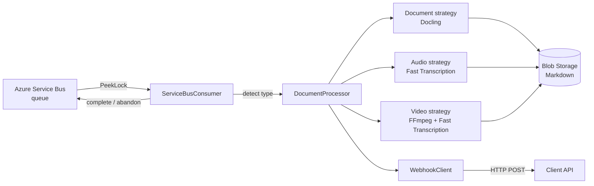

# Akay.ConvertToMarkdown

Implementation of the new three-worker architecture is tracked in
[content-processing progress](docs/docling-rag-progress.md), against the
[authoritative specification](docs/content-processing-specification.md).
N1 adds isolated worker entry points; N2 adds [typed version-one contracts](docs/content-processing-contracts.md).
N3 completes the [Docling extraction integration](docs/content-processing-docling.md),
including real offline PDF/OCR/table/figure/code/formula checks. Observed OCR
accent errors are documented engine limitations; repairing OCR is outside this
integration's scope. The legacy mixed runtime remains available.
N4 adds [local principal markers and review packages](docs/content-processing-review.md):
deterministic section IDs, review metadata and portable figure references.
N5 adds [coordinated complete-set publication](docs/content-processing-publication.md).
The dedicated document entry accepts version-one jobs with explicit technical
storage configuration, publishing Markdown, Docling JSON, review and crop files
before its completed callback. N6 adds [timed Blob media artifacts](docs/content-processing-media.md)
to the dedicated transcriber, reusing Speech/FFmpeg and the same complete-set
publisher. Both dedicated converters retain legacy envelopes; the mixed entry
remains Markdown-only. Both document-capable entries use Docling.
N7 adds [bounded explicit YouTube audio retrieval](docs/content-processing-youtube.md)
to the dedicated transcriber, with pinned extractor/EJS/Deno dependencies and
the same complete-set publication/retry path.
N8 adds [whole-workflow reliability](docs/content-processing-reliability.md):
lock-loss cancellation/draining, validated renewal budgets, durable version-one
failure replay and notification-only retries, plus graceful shutdown.
N9 adds [local structured chunk preparation](docs/content-processing-chunking.md):
saved Docling/transcript JSON, structural section boundaries, full-context token
limits and page/segment citations.
N9A adds [reviewed-content preparation](docs/content-processing-reviewed-content.md):
`rebuildFromMarkdown` on the dedicated document worker regenerates final structured
artifacts from a frozen edited draft, preserving extracted images and their
original diagnostics separately. Corrected transcript fixtures pass through N9
without Speech. Approval, editor persistence and sending final index jobs remain
consumer responsibilities; conversion never triggers indexing automatically.
N10 adds [embedding and point-set indexing APIs](docs/content-processing-indexing.md):
the approved AzureOpenAI `text-embedding-3-small` / 1536 / `cl100k_base` selection,
explicit Azure endpoint/deployment/authentication, immutable profile/space checks,
deterministic UUID points and scoped replacement in Qdrant. Verified with stub
embeddings and persistent local Qdrant, plus a real offline tokenizer and mocked
Azure transport. No Azure resource/deployment exists; production integration is
not verified. N11 adds [durable ordered index/delete delivery](docs/content-processing-ordering.md),
confirmed-embedding/command reuse, scoped deletion, reassignment and callback
replay. The index queue path requires explicit adapter/state settings. A durable
in-flight acknowledgement barrier blocks takeover after an uncertain Qdrant
mutation; lease expiry alone cannot safely authorize a newer write.
N12 adds [isolated installation targets and CPU/resource locks](docs/content-processing-packaging.md).
The shared base contains only technical clients/settings. Clean Windows wheel
installations verify document, media and index import boundaries, both document
operations, local model loading and saved-transcript chunking/local Qdrant.
N13 adds [three Linux images and offline non-root smoke checks](docs/content-processing-images.md),
including both document operations, local model/OCR/enrichment paths, real media
tools and local tokenization/indexing. Native Linux formula-layout detection in
the synthetic fixture remains a separate failing diagnostic; real formula crop
inference succeeds.
N14 prepares [three-image CI and explicitly gated GHCR publication](docs/content-processing-ci.md):
tests before builds, all offline image smoke phases, one unique SHA/run-attempt
identity and complete digest records. Publication requires manual authorization
and explicit repository settings; remote Actions/GHCR execution remains unverified.
N15 prepares [independently gated Container Apps deployments](docs/content-processing-deployment.md):
offline three-app ARM configuration, exact N14 release digests, manual per-worker
environment approval/OIDC, separate GHCR pull secrets and Service Bus scaler
identities, plus coordinated cutover/rollback. Physical cloud inputs, bootstrap,
real deployment and staging verification remain pending; no Azure call is credited.
N16 adds the [reproducible local handoff](docs/content-processing-handoff.md):
validated routed requests, a fixture callback receiver, the real processing/index
flow with explicit service doubles, and future Akay.Be/manual-data responsibilities.
The [operator guide](docs/content-processing-operations.md) maps acceptance evidence,
recovery and remaining external actions. Local completion does not establish a
deployed system or an implemented .NET approval/chat workflow.

One Python package supplies three independent Azure Service Bus workers/images,
with prepared Container Apps configuration **without public ingress**. They convert
documents, transcribe media and index/delete saved final artifacts. Actual cloud
deployment remains pending. The original mixed Markdown-only command is retained.

It handles:

- **Documents** — PDF, DOCX, PPTX, HTML, TXT, MD via [Docling](https://github.com/docling-project/docling).
  PDF requires explicitly configured local models; document OCR defaults to Spanish.
- **Audio** — MP3, WAV, AAC, M4A, OGG/OPUS, FLAC via Azure AI Speech Fast Transcription.
- **Video** — MP4, MOV, MKV, WebM, AVI via FFmpeg audio extraction + Fast Transcription.

## Worker entry points (N1)

| Command / Python module | Queue environment variable (required, no default) | Current behavior |
| --- | --- | --- |
| `akay-convert-document` / `akay_convert_to_markdown.document_main` | `DOCUMENT_SERVICEBUS_QUEUE_NAME` | Documents only; Docling extraction or model-free `rebuildFromMarkdown`, default concurrency 1. Version-one artifact sets require publication state settings. Legacy jobs remain compatible. |
| `akay-transcribe-media` / `akay_convert_to_markdown.media_main` | `MEDIA_SERVICEBUS_QUEUE_NAME` | Blob audio/video and explicit version-one YouTube videos; Speech/FFmpeg. Version-one jobs publish Markdown/transcript/review with explicit publication state settings. YouTube requires the optional adapter dependencies. Legacy Blob jobs remain compatible. |
| `akay-index-content` / `akay_convert_to_markdown.index_main` | `INDEX_SERVICEBUS_QUEUE_NAME` | Ordered version-one index/delete of saved artifacts. Requires explicit profile/tokenizer/Azure/Qdrant/technical-state configuration; missing adapter settings log `INDEX_CONFIGURATION_REQUIRED` and exit **2** before credentials/consumption. |
| `akay-convert-to-markdown` / `akay_convert_to_markdown.main` | `SERVICEBUS_QUEUE_NAME` | Retained legacy mixed worker, including document/audio/video dispatch. |

Run a module as `python -m <module>`. Reinstall the editable package after this
change to generate the new console scripts. The configuration/architecture and
message examples below describe the existing mixed worker unless noted here.

All entries require the existing Blob account/source container, Service Bus
authentication and callback settings. Only conversion/transcription require
`DESTINATION_CONTAINER_NAME`. The dedicated transcriber additionally requires
non-blank `SPEECH_RESOURCE_KEY` and `SPEECH_ENDPOINT` at startup; the legacy
worker retains its optional Speech configuration. Document/index settings do
not load or validate Speech/FFmpeg options. N10's Azure settings are loaded only
when constructing that adapter; endpoint, deployment and authentication have no
fallback. The full profile/catalog and Qdrant client are explicitly supplied to
the local indexing API, not inferred from specification examples. N11's runtime
configuration is listed in the [ordering guide](docs/content-processing-ordering.md).
The CLI uses explicit Azure API-key mode; programmatic Entra integration requires
a supplied async token provider, with no embedding credential fallback.

Assign **distinct queues** before starting the dedicated consumers. They never
fall back to `SERVICEBUS_QUEUE_NAME`; locally configured routing collisions
(including the legacy queue, ignoring case/outer whitespace) fail validation.
Supply the known queue assignments to each process so that this local check can
detect conflicts. It cannot discover another deployment's configuration or
inspect a queue's contents. Coordinate producer routing and stop the legacy
consumer before reusing its queue during a cutover. Do not direct a dedicated
worker at a queue that still receives mixed messages. Physical queue names and
the production cutover remain integration inputs.

The shared consumer, authenticated allowlisted callbacks, storage and logging
are reused. Each dedicated converter rejects out-of-role content before Blob
reuse/download, even if a Markdown output already exists. The dedicated document
consumer and the dedicated media consumer select N2's strict parser for version-one
jobs. The mixed consumer retains the legacy parser and rejects versioned jobs.
YouTube sources use strict individual-video URL and network/download policies;
see the [YouTube guide](docs/content-processing-youtube.md). They are processed
only on explicit version-one media requests; document links are never crawled.
Dependency isolation is verified by N12's clean target installations and N13's
three Linux images. `Dockerfile.workers` provides the isolated targets; the original
Dockerfile installs the document/media lock union and runs the legacy command.
CI now tests and builds the three dedicated targets; the legacy image remains
available for explicit local builds.

## Purpose

Dedicated document/media workers perform conversion/transcription, then publish a
complete Markdown/JSON/review set before their callback. The dedicated index worker
consumes separate explicit index/delete requests for saved artifacts; conversion
does not trigger indexing. Approval, permissions, final-section persistence and
availability belong to the consuming application.

The retained legacy mixed command performs this Markdown-only job:

1. Receives a conversion request from Azure Service Bus.
2. Detects the content type (document, audio or video).
3. Obtains the source content from Blob Storage.
4. Normalizes it to Markdown using the matching strategy.
5. Uploads the resulting Markdown to a Blob Storage container.
6. Notifies through a single HTTP webhook, regardless of content type.
7. Completes the Service Bus message only when processing **and** the
   corresponding webhook notification have succeeded.

The worker has **no knowledge** of domain entities. Client metadata is carried
unchanged in the request's `payload` and returned in webhook notifications.

## Architecture

The dedicated architecture has three independent queues/commands as listed above;
see the [handoff routing table](docs/content-processing-handoff.md#validated-request-examples-and-routing).
This diagram describes the retained legacy mixed path:



- **ServiceBusConsumer** — receives, deserializes, dispatches and settles messages
  (bounded concurrency).
- **DocumentProcessor** — orchestrates one request; knows nothing about Service Bus settlement.
- **processors** (`audio_processor`, `video_processor`) — per-content-type strategies.
- **services** (`fast_transcription_service`, `ffmpeg_service`, `markdown_builder`) — external integrations.
- **BlobStorage** — streaming download/upload abstraction.
- **DocumentConverter** — Markdown conversion boundary (`DoclingDocumentConverter`).
  Its separate `extract` API retains the structured document, confidence and warnings;
  the local exporter produces sections/review and sidecars. The dedicated worker's
  artifact publisher coordinates the full set before notifying completion.
- **WebhookClient** — HTTP notifications with a small local retry policy.

## Supported content

| Type | Sources |
| --- | --- |
| Document | `.pdf`, `.docx`, `.pptx`, `.html`, `.htm`, `.txt`, `.md` |
| Audio | `.mp3`, `.wav`, `.aac`, `.m4a`, `.ogg`, `.opus`, `.flac` |
| Video | `.mp4`, `.mov`, `.mkv`, `.webm`, `.avi`, `.m4v`, `.mpg`, `.mpeg`, `.wmv` |

`.webm` is treated as video (the FFmpeg path handles audio-only WebM too).
Unknown extensions still fall through to the document path and are rejected as
`UNSUPPORTED_DOCUMENT_TYPE`.

## Local setup

Python 3.12 is required.

```bash
python -m venv .venv
.venv\Scripts\activate        # Windows
# or: source .venv/bin/activate

pip install --require-hashes -r requirements/document-windows.txt -r requirements/media-windows.txt -r requirements/index-windows.txt
pip install -e ".[test]"
```

On Linux x86_64/glibc >= 2.28, use the `*-linux.txt` locks instead. For a single
worker install only its target lock, then `pip install --no-deps .`. The plain
package and `test` extra do not install all worker engines. See the
[packaging guide](docs/content-processing-packaging.md) for reproducible checks,
extra ownership and the retained mixed command's document/media requirements.

Media processing requires `ffmpeg` and `ffprobe` on the PATH.
YouTube additionally requires `pip install -e ".[youtube]"` (pinned yt-dlp, EJS
and Deno). The `test` extra also installs these dependencies for offline checks.

### Local Docling models (N3)

DOCX/PPTX/HTML/HTM/TXT/MD extraction runs without model weights. PDF uses the
standard `docling_parse` pipeline with CPU inference, bounded RapidOCR/ONNX,
accurate tables and heading hierarchy. Before processing PDF, provide:

| Variable | Purpose |
| --- | --- |
| `DOCLING_ARTIFACTS_PATH` | Explicit directory containing the compatible prefetched Docling layout/table/OCR assets, plus code/formula assets when those options are used locally. No ambient model-cache fallback. |

This setting is loaded only by the document and legacy mixed entries. Missing
or uninitializable PDF models cause a safe transient configuration error before
the native PDF backend opens. Jobs never download missing weights. See the
[Docling guide](docs/content-processing-docling.md) for exact pins, local API,
feature limitations and measured inference evidence. N12 locks target dependencies
and the 19 model files; N13 stages those exact assets and verifies non-root offline
loading/inference in the [document image](docs/content-processing-images.md).

`documentOptions.ocrLanguage` selects **one** document OCR language per conversion:
`es` (Spanish, default when omitted), `eu` (Basque), `gl` (Galician), `ca` (Catalan),
`fr` (French), `en` (English) or `de` (German). Null, empty, wrong-type and other
values are rejected. This affects neither translation nor Azure Speech.
The rich local extraction API and dedicated version-one document worker honor it;
legacy Markdown-only processing uses default `es`. The mixed entry still
rejects version-one jobs. The former global
`DOCLING_OCR_LANGUAGE` setting is retired and cannot override a request.
Pinned RapidOCR 3.10.0 uses shared multilingual PP-OCRv6 weights for these codes,
while receiving exactly one selected language. All seven local selections
initialize offline; OCR quality in `eu/gl/ca/fr/en/de` has not been measured.

## Azure authentication

Azure Blob Storage uses the optional `AZURE_STORAGE_SAS_TOKEN` when configured;
otherwise it uses the **async** `DefaultAzureCredential`. Azure Service Bus
independently uses that Azure Identity credential with a namespace, or a
separate connection string, including for the local emulator.

- In the Container App, a **User Assigned Managed Identity** is used. Set its
  client ID via `AZURE_CLIENT_ID`.
- Locally, `DefaultAzureCredential` falls back to Azure CLI developer
  credentials (`az login`).
- Azure Speech uses its resource key (`SPEECH_RESOURCE_KEY`) via the
  `Ocp-Apim-Subscription-Key` header.

## Required RBAC roles

The managed identity needs only the minimum permissions:

| Resource | Role |
| --- | --- |
| Service Bus queue | `Azure Service Bus Data Receiver` |
| Source Blob container/account | `Storage Blob Data Reader` |
| Destination Blob container/account | `Storage Blob Data Contributor` |

Do **not** grant Owner or Contributor.

## Environment variables

| Variable | Required | Default | Description |
| --- | --- | --- | --- |
| `AZURE_CLIENT_ID` | no | — | User Assigned Managed Identity client ID |
| `AZURE_STORAGE_ACCOUNT_URL` | yes | — | Account URL without a query string, e.g. `https://<account>.blob.core.windows.net` |
| `AZURE_STORAGE_SAS_TOKEN` | no | — | Secret SAS token, with or without `?`; takes precedence over Azure Identity for Blob Storage |
| `SOURCE_CONTAINER_NAME` | yes | — | Source container name |
| `DESTINATION_CONTAINER_NAME` | yes | — | Destination container name |
| `PUBLICATION_STATE_CONTAINER_NAME` | version-one document/media jobs | — | Existing controlled technical-state container; dedicated document and media workers only |
| `PUBLICATION_STATE_PREFIX` | version-one document/media jobs | — | Explicit technical receipt/staging prefix, shared across cooperating replicas |
| `SERVICEBUS_FULLY_QUALIFIED_NAMESPACE` | one of** | — | e.g. `<ns>.servicebus.windows.net`; uses Azure Identity |
| `SERVICEBUS_CONNECTION_STRING` | one of** | — | Service Bus connection string, including emulator mode (secret) |
| `SERVICEBUS_QUEUE_NAME` | yes | — | Queue name, e.g. `convert-to-markdown` |
| `SERVICEBUS_MAX_LOCK_RENEWAL_SECONDS` | no | `4500` | Max renewal duration; must cover workflow plus at least 60 seconds |
| `WEBHOOK_CALLBACKS` | yes | — | JSON mapping of callback id → webhook URL |
| `WEBHOOK_API_KEY` | yes | — | Webhook secret (never logged) |
| `WEBHOOK_TIMEOUT_SECONDS` | no | `10` | Per-attempt HTTP timeout |
| `WEBHOOK_RETRY_COUNT` | no | `3` | Webhook attempts |
| `WEBHOOK_RETRY_DELAY_SECONDS` | no | `2` | Delay between attempts |
| `MAX_INPUT_SIZE_MB` | no | `100` | Max source size |
| `MAX_MEDIA_DURATION_MINUTES` | no | `240` | Max media duration |
| `PROCESS_TIMEOUT_MINUTES` | no | `60` | Whole-processing timeout |
| `WORKFLOW_TIMEOUT_SECONDS` | no | `4200` | Full job/publication/callback/cleanup/settlement budget; must cover processing plus callback retries and at least 60 seconds for publication |
| `MAX_CONCURRENT_JOBS` | no | `2` | Concurrent message processing |
| `SPEECH_RESOURCE_KEY` | yes* | — | Azure Speech resource key (secret) |
| `SPEECH_ENDPOINT` | yes* | — | e.g. `https://<resource>.cognitiveservices.azure.com` |
| `SPEECH_API_VERSION` | no | `2025-10-15` | Fast Transcription API version |
| `SPEECH_LOCALES` | no | *(auto)* | Comma-separated locales, e.g. `es-ES` |
| `SPEECH_TIMEOUT_SECONDS` | no | `600` | Transcription HTTP timeout |
| `SPEECH_RETRY_COUNT` | no | `2` | Transient transcription retries |
| `SPEECH_RETRY_DELAY_SECONDS` | no | `1` | Delay between transcription retries |
| `FFMPEG_TIMEOUT_SECONDS` | no | `300` | FFmpeg/FFprobe timeout |
| `FFMPEG_MAX_LOG_BYTES` | no | `8192` | Bounded subprocess log size |
| `YOUTUBE_TIMEOUT_SECONDS` | no | `300` | Dedicated media worker: extractor/JS/audio-download time budget, finite positive seconds |
| `YOUTUBE_MAX_TEMP_MB` | no | `256` | Dedicated media worker: attempt-local audio/cache usage rejection limit; monitored and checked on completion |
| `TEMP_DIRECTORY` | no | `/tmp/akay` | Ephemeral conversion data |
| `LOG_LEVEL` | no | `INFO` | Logging level |

\* Required only when processing audio/video.

\** Configure at least one of `SERVICEBUS_FULLY_QUALIFIED_NAMESPACE` and
`SERVICEBUS_CONNECTION_STRING`. When both are present, the namespace takes
precedence. Empty or whitespace-only values are treated as absent. There is no
automatic fallback if the selected connection fails. Blob Storage authentication
is selected independently of the Service Bus mode.

The application **fails fast at startup** if a mandatory variable is absent.
Secrets have no default values.

## Running locally

For the local Service Bus Emulator, provide the following environment values
through your local secret configuration (the key below is a placeholder):

```text
SERVICEBUS_CONNECTION_STRING=Endpoint=sb://localhost;SharedAccessKeyName=RootManageSharedAccessKey;SharedAccessKey=SAS_KEY_VALUE;UseDevelopmentEmulator=true;
SERVICEBUS_QUEUE_NAME=convert-to-markdown
WEBHOOK_CALLBACKS={"topic-content":"http://localhost:5246/api/webhooks/topic-content-converted"}
WEBHOOK_API_KEY=<local-webhook-api-key>
```

For the emulator, leave `SERVICEBUS_FULLY_QUALIFIED_NAMESPACE` absent or empty,
otherwise it takes precedence over the connection string. Configure the
emulator's queue separately. A process running directly on the host can use
`localhost` for both the emulator and Akay.Be. From a container, `localhost`
refers to that container: use the appropriate Docker service name for a
containerized emulator or backend, or `host.docker.internal` when connecting
to a host process where supported. The complete Docker composition is a
separate setup step.

For local Docker development, configure a user delegation SAS limited to the
container, with read and write permissions and an expiry. The account URL must
not contain a SAS or any query string. Empty or whitespace-only SAS values use
`DefaultAzureCredential` instead; a token may have a leading `?`. Renew and
update the token when it expires, then restart the worker to load it. A
container-scoped SAS only authorizes that container, so both source and
destination must be within its scope:

```text
AZURE_STORAGE_ACCOUNT_URL=https://<account>.blob.core.windows.net
AZURE_STORAGE_SAS_TOKEN=<container-sas-token>
SOURCE_CONTAINER_NAME=topic-content
DESTINATION_CONTAINER_NAME=topic-content
```

Processing audio/video also requires Azure Speech and local FFmpeg/FFprobe.
Keep SAS tokens, connection strings and API keys in your environment or secret
store, not in version-controlled files. For Azure deployment, prefer managed
identity and omit `AZURE_STORAGE_SAS_TOKEN`.

```bash
akay-convert-to-markdown
# or
python -m akay_convert_to_markdown.main
```

## Running tests

```bash
pytest                     # unit tests
pytest --cov=akay_convert_to_markdown
```

For a complete offline conversion -> reviewed final artifacts -> local indexing ->
delete/reassignment scenario, see the [N16 handoff](docs/content-processing-handoff.md#reproduce-the-handoff).
It includes a loopback callback receiver and uses explicit service doubles, never
ambient credentials or live Speech/YouTube/embedding calls.

Integration tests are disabled by default:

```bash
RUN_AZURE_INTEGRATION_TESTS=true pytest tests/integration
```

Local PDF model tests are independently opt-in. Set `RUN_DOCLING_MODEL_TESTS=true`
and an explicit `DOCLING_TEST_ARTIFACTS_PATH`, then run
`pytest tests/integration/test_docling_models.py`. They block network connections,
never download assets and do not use Azure. Actual offline results are seven
successful language-resource initializations, two scanned-PDF integration cases
and four successful PDF enrichment combinations. Two strict Spanish optical-quality
diagnostics have known accent-fidelity failures and require the separate
`RUN_DOCLING_QUALITY_DIAGNOSTICS=true` opt-in; they do not gate N3 integration.
See the [Docling guide](docs/content-processing-docling.md) for cache reuse,
exact commands, model identities and the distinction between resources and quality.

Media integration tests additionally require `ffmpeg`/`ffprobe` on the PATH and
`SPEECH_RESOURCE_KEY` + `SPEECH_ENDPOINT` set.

## Building the Docker image

For the three dedicated targets, use the explicit asset/build/smoke command in
the [image guide](docs/content-processing-images.md). The following retains the
legacy mixed worker for explicit local builds:

```bash
docker build -t akay-convert-to-markdown .
```

The image installs `ffmpeg`/`ffprobe` (apt), validates them at build time, runs
as a non-root user and uses `/tmp/akay` for temporary data. No HTTP port is
exposed.

## Expected Service Bus message

This section describes the **active legacy contract**. The staged version-one
document/media/index contracts, strict validation rules, artifact results and
tested examples are documented in [content-processing contracts](docs/content-processing-contracts.md).
The dedicated document and media entries support version one with the
[publication configuration](docs/content-processing-publication.md). Blob media
jobs return `transcriptJsonBlobName` and `reviewBlobName`; see the
[media guide](docs/content-processing-media.md) for nullable timestamps and examples. Do not send
version-one jobs to the legacy mixed consumer: it rejects `schemaVersion`,
`contentKey`, `documentOptions` and index-operation fields as `INVALID_MESSAGE`.

```json
{
  "requestId": "e0a01a4c-1234-4567-8901-123456789abc",
  "source": {"type": "blob", "blobName": "subjects/3/topics/5/sources/550e8400-e29b-41d4-a716-446655440000.pdf"},
  "destinationBlobName": "subjects/3/topics/5/content/550e8400-e29b-41d4-a716-446655440000.md",
  "contentType": "document",
  "overwriteDestination": true,
  "callback": "topic-content",
  "payload": {"topicContentId": 15, "topicId": 5, "userId": 1234}
}
```

`requestId` is a UUID identifying a client-issued request. Service Bus
redeliveries keep the same ID; a new client-issued attempt gets a new ID.
This legacy contract supports only `source.type: "blob"`. `source.blobName` identifies a blob in
`SOURCE_CONTAINER_NAME`, and its extension determines the filename used for
conversion. `destinationBlobName` is the complete blob name within
`DESTINATION_CONTAINER_NAME`, chosen by the client.

`contentType` is optional (`document`, `audio`, or `video`); when omitted the
type is inferred from the source filename. `payload` is an optional JSON object,
defaulting to `{}`, returned without interpretation. `callback` selects a
configured webhook URL. This contract replaces the previous `documentId`,
`contextId`, `userId`, `fileName`, and `sourceBlobName` message fields;
producers must migrate before using this version.

## Destination and retries

This section describes legacy envelopes. Version-one document/media jobs use the
[complete-set reuse/conflict rules](docs/content-processing-publication.md),
not a Markdown existence check or unconditional overwrite.

`overwriteDestination` defaults to `false`. If the destination exists, the
worker reuses it and sends a completed webhook. With `true`, it converts and
overwrites the destination, including on redelivery. Concurrent requests with
overwrite disabled use an atomic create: if another request writes first, its
result is reused. Concurrent requests may still perform duplicate conversion.

Clients should use the same destination for retries of the same source version,
and distinct destinations for different source versions. An existing blob is
reused without checking its origin; the client owns that association.

## Webhook contracts

The webhook contract is identical for every content type.

### Completed

The destination URL is resolved from the message's `callback` identifier via
`WEBHOOK_CALLBACKS`.

```http
POST {callback-resolved URL}
X-Api-Key: <secret>
Idempotency-Key: convert-to-markdown:{requestId}:completed
```

```json
{
  "eventType": "document.conversion.completed",
  "requestId": "f7fc711f-b8d5-4e20-94fd-c77c0472a1d1",
  "source": {"type": "blob", "blobName": "uploads/lesson.pdf"},
  "destinationBlobName": "456/123/version-1/document.md",
  "contentType": "document",
  "payload": {"documentId": 123, "contextId": 456, "userId": 789}
}
```

### Failed

```http
Idempotency-Key: convert-to-markdown:{requestId}:failed
```

```json
{
  "eventType": "document.conversion.failed",
  "requestId": "f7fc711f-b8d5-4e20-94fd-c77c0472a1d1",
  "source": {"type": "blob", "blobName": "uploads/lesson.mp3"},
  "destinationBlobName": "456/123/version-1/document.md",
  "contentType": "audio",
  "payload": {"documentId": 123, "contextId": 456, "userId": 789},
  "error": {
    "code": "SPEECH_TRANSCRIPTION_FAILED",
    "message": "Azure Speech returned status 500."
  }
}
```

Stack traces and subprocess stdout/stderr are never exposed through the
webhook. Application failure logs retain safe event/code/type information rather
than raw exception details or captured subprocess output.
For an invalid message, the failed webhook contains the recoverable fields
only. It is sent only if a valid `requestId` and configured `callback` can be
recovered.

## Error / retry semantics

- **Permanent errors** send the `document.conversion.failed` webhook; the message
  is completed only if the webhook returns 2xx. Codes include:
  `UNSUPPORTED_DOCUMENT_TYPE`, `UNSUPPORTED_CONTENT_TYPE`, `INVALID_MEDIA`,
  `NO_AUDIO_TRACK`, `FFMPEG_FAILED`,
  `SPEECH_TRANSCRIPTION_FAILED`, `PROCESSING_TIMEOUT`, `MEDIA_TOO_LONG`,
  `DOCUMENT_TOO_LARGE`, `SOURCE_BLOB_NOT_FOUND`, `DOCUMENT_CONVERSION_FAILED`,
  `INVALID_MESSAGE`.
- **Transient errors** abandon the message and let Service Bus redeliver it.
  This covers Blob/Service Bus failure, HTTP timeouts, webhook 408/429/5xx,
  network failure, unknown `callback`, and Azure Speech throttling
  (`SPEECH_RATE_LIMITED`).
- The webhook and the Speech client have small local retry policies
  (`WEBHOOK_RETRY_COUNT` / `SPEECH_RETRY_COUNT`) limited to transient conditions.
  Normal client errors (400/401/403/404) are not retried.
- The shared consumer disables prefetch, renews invalid-message callbacks too,
  cancels/drains on lock loss, and contains settlement errors. Whole-workflow
  deadlines abandon rather than emit a conflicting definitive failure. See the
  [reliability guide](docs/content-processing-reliability.md) for budget validation,
  shutdown/drain limits and DLQ recovery. Version-one permanent build outcomes are
  persisted before HTTP and replayed without another extraction/transcription.
- Redelivery and dead-lettering are controlled by the queue's
  `MaxDeliveryCount`, not by application code.
- Delivery is **at-least-once**. Conversion and webhook notifications may be
  repeated; `Idempotency-Key` provides correlation and does not enforce
  deduplication.

## Logging

Structured JSON logs allow tracing processing by `requestId`. The webhook
API key, Azure credentials, Speech key and document/transcription contents are
never logged. Subprocess stdout/stderr are captured with bounded buffers
(`*_MAX_LOG_BYTES`) and are not exposed in application failure logs or callbacks.

## Explicit non-goals

No domain logic, database access, production-verified RAG integration, picture-description LLM calls,
HTTP API, or custom Service Bus retry scheduler. Docling's local extraction API
supports OCR and figure crops. Principal sections and review generation are
available in the artifact API and the dedicated document publication path.
Blob and explicit YouTube media produce timed transcript/review packages, without
document sections or PDF confidence. Whole-workflow reliability is verified with
local doubles; three-image checks are recorded, while production indexing and
live-service verification remain pending external work. The local N9 API prepares chunks without consuming jobs or generating
embeddings. Live YouTube compatibility is not yet verified.
N10's separate local API can embed/index saved artifacts with explicitly supplied
configuration. N11 consumes ordered index/delete jobs when explicitly configured;
its tests use synthetic embeddings/local Qdrant and durable Blob doubles. Actual
Azure provisioning, deployment/authentication and live integration remain pending.
N16's local end-to-end evidence and manual consumer handoff are documented; no
Akay.Be editor, database change, approval lock, authorized retrieval or chat behavior
is claimed from Python/local-image checks.
