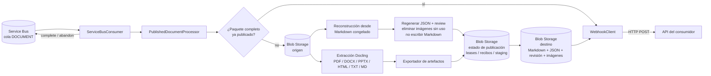
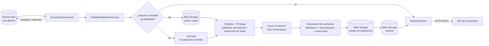
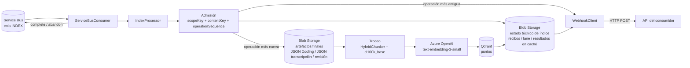

# Akay.ConvertToMarkdown

[English](README.md)

Conjunto de workers orientados por Azure Service Bus que convierten material de origen en
Markdown estructurado y, opcionalmente, en contenido indexado vectorialmente:

- **Documentos** — PDF, DOCX, PPTX, HTML, TXT y Markdown convertidos con
  [Docling](https://github.com/docling-project/docling).
- **Audio y vídeo** — transcritos con Azure AI Speech Fast Transcription; el audio del vídeo se
  extrae con FFmpeg. También se admiten vídeos explícitos de YouTube.
- **Contenido revisado** — un borrador Markdown editado se puede reconstruir en un documento
  estructurado nuevo sin volver a ejecutar extracción ni OCR.
- **Indexación** — los artefactos finales guardados se trocean, se embeben con Azure OpenAI y se
  escriben en Qdrant con operaciones ordenadas de indexación, borrado y reasignación.

Un único paquete Python ofrece cuatro puntos de entrada: tres workers independientes de propósito
único y un worker combinado de compatibilidad. Los workers dedicados añaden artefactos, revisiones,
recibos de publicación, indexación ordenada y contratos versionados. El worker combinado conserva
el comportamiento original de solo Markdown.

Los workers **no tienen ingress HTTP**. Consumen colas de Azure Service Bus, leen de Blob Storage
y llaman a un webhook autenticado cuando termina un trabajo.

---

## Índice

- [Arquitectura](#arquitectura)
- [Funcionalidades](#funcionalidades)
- [Contenido admitido](#contenido-admitido)
- [Contratos de Service Bus](#contratos-de-service-bus)
- [Contratos de webhook](#contratos-de-webhook)
- [Configuración](#configuración)
- [Recursos de Azure](#recursos-de-azure)
- [Entorno local](#entorno-local)
- [Docker](#docker)
- [Ejemplos de uso](#ejemplos-de-uso)
- [Garantías de procesamiento](#garantías-de-procesamiento)
- [Pruebas](#pruebas)
- [Limitaciones conocidas](#limitaciones-conocidas)
- [Estructura del repositorio](#estructura-del-repositorio)

---

## Arquitectura

Los tres diagramas siguientes cubren las rutas de documentos, medios e indexación. Se renderizan
automáticamente en GitHub y en cualquier visor Markdown con soporte de Mermaid.

### Puntos de entrada

Cada worker tiene su propia variable de entorno para la cola. Los workers dedicados nunca usan
la cola combinada como respaldo, y los nombres de cola conocidos localmente deben ser distintos.

| Comando | Módulo Python | Variable de cola | Responsabilidad |
| --- | --- | --- | --- |
| `akay-convert-document` | `akay_convert_to_markdown.document_main` | `DOCUMENT_SERVICEBUS_QUEUE_NAME` | Extracción de documentos, reconstrucción de Markdown y publicación del conjunto completo de artefactos. Concurrencia por defecto `1`. |
| `akay-transcribe-media` | `akay_convert_to_markdown.media_main` | `MEDIA_SERVICEBUS_QUEUE_NAME` | Transcripción de audio/vídeo en Blob y de YouTube explícito; publicación de transcripción y revisión. Concurrencia por defecto `2`. |
| `akay-index-content` | `akay_convert_to_markdown.index_main` | `INDEX_SERVICEBUS_QUEUE_NAME` | Indexación y borrado ordenados de artefactos finales guardados en Qdrant. Concurrencia por defecto `2`. |
| `akay-convert-to-markdown` | `akay_convert_to_markdown.main` | `SERVICEBUS_QUEUE_NAME` | Worker combinado de compatibilidad: documento, audio y vídeo a un único archivo Markdown. |

Cualquier entrada se puede ejecutar como módulo, por ejemplo:

```bash
python -m akay_convert_to_markdown.document_main
```

### 1. Conversión de documentos



1. El consumidor recibe un mensaje bloqueado y analiza el contrato de documento.
2. Si ya existe un paquete completo y compatible en el destino, se reutiliza sin volver a
   extraer. Un destino incompatible o sin propietario falla como
   `ARTIFACT_PUBLICATION_CONFLICT`.
3. El origen se descarga y se comprueba su tamaño.
4. `operation=convert` ejecuta Docling y exporta Markdown. `operation=rebuildFromMarkdown` lee
   el Markdown editado y sustituye solo sus JSON, eliminando imágenes del inventario sin uso.
5. El worker construye un paquete local completo: Markdown, JSON de Docling, `review.json` e
   imágenes de figuras y tablas.
6. Las conversiones usan escrituras de solo creación. Las reconstrucciones preparan los JSON
   para poder reintentarlos y sobrescriben los artefactos sin escribir ni normalizar el Markdown.
7. Se envía el webhook de completado y se registra su éxito. Solo entonces se confirma el
   mensaje.

En `convert`, un paquete completo existente se reutiliza incluso con `overwriteDestination=true`. Esto hace
segura la reentrega y evita que una segunda extracción distinta reemplace material aceptado.

### 2. Transcripción de audio y vídeo



- Los formatos de audio van directamente a Fast Transcription.
- Los formatos de vídeo se sondean, se extrae su primer flujo de audio con `-vn` y se transcribe
  el audio. WebM puede contener solo audio y aun así usa la estrategia de vídeo.
- Las fuentes de YouTube recuperan un único archivo de solo audio bajo una política acotada de
  red, tiempo y almacenamiento temporal, y después reutilizan la misma ruta FFmpeg/Speech.
- El paquete publicado consta de Markdown, `transcript.json` y `review.json`. Las marcas de
  tiempo de los segmentos se conservan en milisegundos; las mediciones no disponibles quedan
  como `null`.
- Las frases de Speech nunca se re-segmentan, reformatean ni traducen.

### 3. Indexación y borrado



1. El worker admite la operación contra un recibo duradero por contenido.
2. Un `operationSequence` menor emite `content.index.operation.superseded`. Una repetición de la
   operación actual ya completada reutiliza su resultado guardado sin volver a trocear ni a
   embeber.
3. Una operación de indexación más nueva lee el artefacto final guardado (`format=docling` o
   `format=transcript`), opcionalmente lee la revisión final, y trocea el contenido.
4. Los fragmentos se embeben y se escriben en Qdrant con IDs de punto UUIDv5 deterministas. Un
   resultado más corto borra solo la cola exacta de ese scope/contenido/perfil.
5. El evento de completado o borrado se persiste antes del webhook y se reproduce en la
   reentrega.

Una operación de borrado elimina **solo puntos de Qdrant** para el scope, contenido y perfil
exactos. Nunca elimina archivos Blob, filas de base de datos ni otro contenido.

### Distribución de artefactos

El directorio sidecar se deriva del destino Markdown: el sufijo `.md` se sustituye por
`.artifacts/`.

Para un destino `topics/manual.md`:

| Artefacto | Nombre de blob |
| --- | --- |
| Markdown | `topics/manual.md` |
| JSON de Docling | `topics/manual.artifacts/document.docling.json` |
| Revisión | `topics/manual.artifacts/review.json` |
| Recortes de figuras | `topics/manual.artifacts/images/figure-001.png` |
| Recortes de tablas | `topics/manual.artifacts/images/table-002.png` |

Para medios, el artefacto JSON es `topics/manual.artifacts/transcript.json` y la revisión es
`topics/manual.artifacts/review.json`.

Notas:

- `review.json` es el **único** inventario de imágenes. Los webhooks de completado nunca
  contienen listas de imágenes, datos binarios ni prefijos de imágenes.
- Un destino Markdown no puede vivir dentro de un directorio reservado `.artifacts`.
- `document.md` y `document.MD` no pueden reclamar el mismo espacio `document.artifacts/`.
- Los originales nunca se mueven, copian ni eliminan.

### Contenido de revisión y transcripción

`review.json` contiene contadores técnicos, secciones, tablas, inventarios de imágenes y
fórmulas, confianza de extracción disponible y avisos. `document.docling.json` conserva el
documento estructurado completo. En medios, el texto y los tiempos de los segmentos están en
`transcript.json`, no en la revisión ni en el webhook. Los webhooks de completado proporcionan
los nombres de blob de los artefactos que se deben leer.

#### Inventario de fórmulas

Cada revisión incluye `formulas` y `summary.formulaCount`, igual a la longitud del array.
Cada ocurrencia tiene un ID local al documento estable en reintentos idénticos,
`doclingItemRef`, `sectionId` nullable, `text` extraído, `latex` nullable y `pageNumber` nullable.
La sección es `null` cuando no corresponde ninguna sección emitida, incluidos los documentos
adicionales; la página es `null` cuando no está disponible. Las expresiones idénticas siguen
siendo ocurrencias separadas. Por ejemplo, este es un fragmento de una revisión documental:

```json
{
  "summary": { "formulaCount": 2 },
  "formulas": [
    {
      "id": "formula-001",
      "doclingItemRef": "#/texts/4",
      "sectionId": "4c8d1f14-ffda-5b2e-9616-c7a4f82e34ef",
      "text": "a / b",
      "latex": "\\frac{a}{b}",
      "pageNumber": 2
    },
    {
      "id": "formula-002",
      "doclingItemRef": "#/texts/5",
      "sectionId": "4c8d1f14-ffda-5b2e-9616-c7a4f82e34ef",
      "text": "a / b",
      "latex": null,
      "pageNumber": 3
    }
  ]
}
```

El inventario utiliza solo FormulaItems estructurados existentes. Conserva el texto de origen
(`orig` cuando está disponible; en su defecto, `text`) y la representación decodificada
disponible en el campo `text` del elemento de la versión fijada como LaTeX; si falta o solo
contiene espacios, devuelve `null`. No corrige expresiones, añade otra llamada LLM/modelo/pasada
de extracción ni activa `formulaEnrichment` implícitamente. La disponibilidad de LaTeX no
garantiza su validez sintáctica o corrección matemática. No hay archivos independientes por
fórmula ni inventarios `codeBlocks` o `codeBlockCount`.

Al leer revisiones antiguas, los campos ausentes `formulas` y `formulaCount` toman `[]` y `0`.
Las revisiones sin fórmulas detectadas y todas las revisiones multimedia emiten esos valores
vacíos; nunca se infieren ecuaciones del texto transcrito. La reconstrucción recoge de nuevo
las fórmulas del documento reconstruido sin copiar el inventario ni las páginas anteriores.
Consulte la [limitación del parser](#limitaciones-conocidas) antes de depender de la detección
matemática en Markdown.

### Citas de lectura y segmentos multimedia

En la experiencia de lectura de Akay, el **Markdown principal es la superficie de lectura**.
Las transcripciones y notas aclaratorias breves adicionales aportan conocimiento de apoyo;
su Markdown es un artefacto de procesamiento, no un destino de lectura independiente. El
material destinado a leerse debe estar en el principal. Los workers siguen siendo reutilizables
fuera de esta política del consumidor.

| Información utilizada | Destino de la cita | Datos que ya proporciona el worker/indexador |
| --- | --- | --- |
| Texto principal | Su sección en el Markdown principal actual. | IDs de sección del review final y `sectionId`/`headingPath` indexados. |
| Nota/documento adicional | Su sección asignada del principal. | `contentKey` del adicional y `sectionId`/`headingPath` padre enviados en el contexto `fixed` de indexación. |
| Audio/vídeo/YouTube adicional | Un segmento de ese medio dentro del contexto de su sección asignada. | El mismo contexto de sección padre, identidad/origen del medio y `provenance.segments` con IDs e inicio/fin disponibles en milisegundos. |

Por ejemplo, el consumidor puede mostrar **Simplificación de fracciones → Vídeo explicativo ·
02:15–02:40**: abrir la sección del principal o reproducir el medio asociado desde el segmento
citado. Esto no implica que las palabras exactas de la transcripción estén escritas en el
principal. `contentKey` identifica el recurso que aporta la información; `sectionId`, su contexto
de lectura. El indexador conserva ambos y los tiempos individuales de los segmentos en Qdrant.
Un chunk puede abarcar varios segmentos; dividir un segmento no inventa tiempos por palabra.
Los tiempos ausentes siguen siendo `null`.

Las páginas, coordenadas y confianza del documento original son diagnóstico de extracción,
no destinos de navegación. `doclingItemRef` relaciona elementos estructurados internamente;
`prov.bbox`/`prov.charspan` son procedencia del elemento de origen, no offsets del Markdown
generado. Tras reconstruir, el texto no tiene procedencia paginada y `summary.pageCount` y los
`pageNumber` de secciones/tablas/fórmulas son `null`. Las páginas conservadas en imágenes siguen
describiendo sus recortes originales.

**La integración del consumidor sigue pendiente:** resolver la sección contra el Markdown
principal actual, autorizar el acceso al recurso, representar la cita y controlar la reproducción.
Un comentario HTML de sección no es un ancla de navegador por sí mismo. Tras reconstruir, hay que
mapear los IDs del review regenerado a los encabezados renderizados actuales en lugar de depender
de comentarios antiguos. El worker aporta metadatos; no implementa el lector, reproductor ni esos
mapeos de interfaz.

---

## Funcionalidades

### Documentos

- Extracción de PDF, DOCX, PPTX, HTML/HTM, TXT y Markdown con Docling.
- Pipeline PDF con modelos locales, inferencia en CPU, OCR, estructura de tablas precisa,
  jerarquía de encabezados, recortes de imágenes y enriquecimiento opcional de código/fórmulas.
- Idioma OCR por petición: `es`, `eu`, `gl`, `ca`, `fr`, `en`, `de` (por defecto `es`).
- IDs de sección deterministas, orden padre/hijo y rutas de encabezados para contenido
  principal.
- Revisión estructurada con número de páginas, secciones, tablas, inventarios de imágenes y
  fórmulas, notas de confianza y avisos seguros.
- `rebuildFromMarkdown` sobrescribe el JSON de Docling y la revisión del Markdown editado,
  conserva las imágenes referenciadas del inventario y elimina las que ya no se usan. No escribe el Markdown.

### Audio y vídeo

- Fuentes Blob de audio/vídeo y vídeos explícitos individuales de YouTube.
- Azure AI Speech Fast Transcription con orden de frases, identidad de hablante opcional, idioma
  y marcas de tiempo en milisegundos.
- IDs estables tipo `segment-0001`, validación de duración y avisos explícitos cuando faltan
  marcas de tiempo.
- Markdown con anclas de visualización y una transcripción temporizada legible por máquina.

### Indexación

- Troceo híbrido sobre JSON de Docling o JSON de transcripción.
- Azure OpenAI `text-embedding-3-small`, 1536 dimensiones, tokenizador `cl100k_base`.
- Colecciones Qdrant con metadatos de vinculación inmutables de perfil/espacio.
- IDs de punto deterministas, reemplazo acotado, poda de cola y borrado por perfil.
- Indexación, borrado y reasignación ordenados con recibos duraderos, supersesión y repetición de
  callbacks.
- Una barrera de reconocimiento en vuelo impide que un escritor más nuevo compita con una
  mutación incierta de Qdrant.

### Fiabilidad y operación

- Contratos versionados y estrictos de petición y evento (los campos desconocidos se rechazan).
- Publicación de conjunto completo: nada se informa como completo hasta que existe cada archivo.
- Leases y ETags de Blob para coordinar publicación y estado de índice.
- Presupuesto de tiempo de flujo completo separado del timeout de procesamiento.
- Renovación de bloqueo de Service Bus, cancelación al perder el bloqueo, apagado ordenado y
  drenaje.
- Los fallos permanentes se persisten y se reproducen sin volver a extraer ni a transcribir.
- Logs JSON estructurados correlacionados por `requestId`; nunca se registran secretos ni
  contenido.

### Fuera de alcance

- Sin modelo de dominio, acceso a base de datos, flujo de aprobación ni implementación de chat.
- Sin API HTTP, interfaz de usuario ni servidor de entrada.
- Sin indexación automática tras la conversión. La indexación es siempre una petición explícita.
- Sin limpieza automática del dominio cuando se procesa un borrado de índice.

---

## Contenido admitido

| Tipo | Extensiones |
| --- | --- |
| Documento | `.pdf`, `.docx`, `.pptx`, `.html`, `.htm`, `.txt`, `.md` |
| Audio | `.mp3`, `.wav`, `.aac`, `.m4a`, `.ogg`, `.opus`, `.flac` |
| Vídeo | `.mp4`, `.mov`, `.mkv`, `.webm`, `.avi`, `.m4v`, `.mpg`, `.mpeg`, `.wmv` |

`.webm` se enruta por la estrategia de vídeo, que también admite WebM de solo audio. Las
extensiones de documento desconocidas fallan como `UNSUPPORTED_DOCUMENT_TYPE`.

---

## Contratos de Service Bus

### Reglas comunes

- El cuerpo del mensaje es JSON UTF-8.
- Cada worker dedicado lee solo su propia cola.
- Las peticiones son **estrictas**: campos desconocidos, claves JSON duplicadas, tipos
  incorrectos, `NaN`/`Infinity` y UUID inválidos se rechazan con `INVALID_MESSAGE`.
- `payload` es un objeto JSON opaco, por defecto `{}`, que se devuelve en el webhook sin
  interpretación.
- `callback` es una identidad configurada que se resuelve mediante `WEBHOOK_CALLBACKS`, nunca
  una URL.
- La entrega de cola es **al menos una vez**. Reutilice el mismo `requestId` para reintentos de
  la misma operación del cliente; use un `requestId` nuevo para un intento nuevo con parámetros
  distintos.
- El envío a la cola de mensajes muertos lo controla `MaxDeliveryCount` de la cola, no el código
  de la aplicación.

Ejemplo genérico de envío con el SDK de Azure Service Bus:

```python
import json
import os

from azure.servicebus import ServiceBusClient, ServiceBusMessage

message = {
    "schemaVersion": 1,
    "requestId": "5d0c5f6e-4a3b-4c2d-9e1f-2a3b4c5d6e7f",
    # ...
}

with ServiceBusClient.from_connection_string(os.environ["SERVICEBUS_CONNECTION_STRING"]) as client:
    with client.get_queue_sender("convert-document") as sender:
        sender.send_messages(ServiceBusMessage(json.dumps(message)))
```

Para autenticación basada en namespace, construya
`ServiceBusClient(namespace, credential=DefaultAzureCredential())`.

### Conversión de documentos

Campos obligatorios:

| Campo | Valor |
| --- | --- |
| `schemaVersion` | `1` |
| `requestId` | UUID |
| `contentKey` | Identidad de contenido opaca y no vacía |
| `source` | `{"type": "blob", "blobName": "<nombre en SOURCE_CONTAINER_NAME>"}` |
| `destinationBlobName` | Obligatorio para `convert`; se omite en `rebuildFromMarkdown` |
| `contentType` | `"document"` |
| `operation` | `"convert"` (por defecto) |
| `callback` | Identidad de callback configurada |
| `documentOptions` | Opcional; ver más abajo |
| `overwriteDestination` | Booleano opcional, por defecto `false` |

```json
{
  "schemaVersion": 1,
  "requestId": "5d0c5f6e-4a3b-4c2d-9e1f-2a3b4c5d6e7f",
  "contentKey": "topic-content:550e8400-e29b-41d4-a716-446655440000",
  "source": {
    "type": "blob",
    "blobName": "subjects/3/topics/5/sources/manual.pdf"
  },
  "destinationBlobName": "subjects/3/topics/5/content/manual.md",
  "contentType": "document",
  "operation": "convert",
  "overwriteDestination": false,
  "documentOptions": {
    "extractSections": true,
    "codeEnrichment": false,
    "formulaEnrichment": false,
    "ocrLanguage": "es"
  },
  "callback": "topic-content",
  "payload": {
    "topicContentId": 15,
    "topicId": 5,
    "userId": 1234
  }
}
```

`documentOptions`:

| Opción | Por defecto | Significado |
| --- | --- | --- |
| `extractSections` | `false` | Emite IDs de sección deterministas y rutas de encabezados. Use `true` para material principal; `false` para material adicional. |
| `codeEnrichment` | `false` | Solo PDF. Ejecuta reconocimiento de código en regiones PDF. |
| `formulaEnrichment` | `false` | Solo PDF. Ejecuta reconocimiento de fórmulas y emite LaTeX cuando esté disponible. |
| `ocrLanguage` | `es` | Exactamente uno de `es`, `eu`, `gl`, `ca`, `fr`, `en`, `de`. Es OCR de documento, no traducción ni Speech. |

Las opciones de enriquecimiento en fuentes que no son PDF producen un aviso
`ENRICHMENT_NOT_APPLICABLE` y conservan el contenido nativo.

### Reconstrucción de Markdown (`rebuildFromMarkdown`)

Use esta operación cuando un usuario haya editado el Markdown producido por una conversión
anterior y los artefactos estructurados finales deban reflejar ese texto antes de indexar.

```json
{
  "schemaVersion": 1,
  "requestId": "0f6b2c1d-8e7a-4b5c-9d0e-1f2a3b4c5d6e",
  "contentKey": "topic-content:550e8400-e29b-41d4-a716-446655440000",
  "source": {
    "type": "blob",
    "blobName": "subjects/3/topics/5/content/manual.md"
  },
  "contentType": "document",
  "operation": "rebuildFromMarkdown",
  "documentOptions": {
    "extractSections": true
  },
  "callback": "topic-content",
  "payload": {
    "topicContentId": 15,
    "approvalRequestId": "0f6b2c1d-8e7a-4b5c-9d0e-1f2a3b4c5d6e"
  }
}
```

Reglas:

- `source.blobName` debe ser Markdown congelado (`.md`). No lo edite mientras se reentrega la
  misma petición.
- Omita `destinationBlobName` y `extractionReviewBlobName`. Las rutas se deducen del origen:
  `manual.md` actualiza `manual.artifacts/document.docling.json` y `manual.artifacts/review.json`
  en `DESTINATION_CONTAINER_NAME`.
- La reconstrucción siempre sustituye los JSON; no usa `overwriteDestination` para decidir su reutilización.
- El Markdown se lee de `SOURCE_CONTAINER_NAME` y nunca se modifica, copia ni borra. Si el
  contenido editado permanece en el contenedor de salida, configure el origen en consecuencia.
- `codeEnrichment` y `formulaEnrichment` deben ser `false`. No se ejecuta OCR, inferencia de
  maquetación ni enriquecimiento con modelos.
- Se sobrescribe el `review.json` actual. No hay copia del informe de extracción: la fuente de
  verdad es el Markdown editado. Las páginas y la confianza PDF del texto dejan de estar disponibles.
- Secciones, tablas y fórmulas proceden del documento reconstruido, incluidas las adiciones,
  modificaciones y eliminaciones que soporte el parser. No se copia el inventario de fórmulas
  anterior; [el parser fijado no detecta matemática Markdown delimitada por dólares](#limitaciones-conocidas).
- Se conservan solo las imágenes del inventario actual referenciadas en el Markdown. Se eliminan
  las que ya no se usan dentro del mismo directorio de artefactos; los archivos ajenos no se tocan.
  No se descargan ni reescriben enlaces, ni se infieren nuevos recortes de imagen desde Markdown.
- Se utiliza el mismo webhook de completado, con `destinationBlobName` igual a `source.blobName`.
- Los comentarios antiguos de sección se ignoran al analizar, pero permanecen intactos en el
  Markdown. Use el review regenerado para obtener los IDs finales.
- Espere al completado para indexar y bloquee la edición durante la indexación. Otra edición
  necesita un UUID de petición nuevo. El staging de reintento es interno, no otra versión pública.

Si no hay cambios, reutilice el paquete completo inicial y omita la reconstrucción.

### Audio, vídeo y YouTube

```json
{
  "schemaVersion": 1,
  "requestId": "b1ad362f-0911-4773-8651-1508d94cb004",
  "contentKey": "topic-content:6c1d2e3f-4a5b-6c7d-8e9f-0a1b2c3d4e5f",
  "source": {
    "type": "blob",
    "blobName": "media/lesson-01.mp3"
  },
  "destinationBlobName": "subjects/3/topics/5/content/lesson-01.md",
  "contentType": "audio",
  "overwriteDestination": false,
  "callback": "topic-content",
  "payload": {
    "topicContentId": 21
  }
}
```

Origen de vídeo en Blob:

```json
{
  "schemaVersion": 1,
  "requestId": "c2be473e-1a2b-4c3d-8e4f-5a6b7c8d9e0f",
  "contentKey": "topic-content:7d2e3f4a-5b6c-7d8e-9f0a-1b2c3d4e5f60",
  "source": {
    "type": "blob",
    "blobName": "media/lesson-02.webm"
  },
  "destinationBlobName": "subjects/3/topics/5/content/lesson-02.md",
  "contentType": "video",
  "callback": "topic-content",
  "payload": {}
}
```

Origen de YouTube:

```json
{
  "schemaVersion": 1,
  "requestId": "d3cf584f-2b3c-4d5e-9f60-6b7c8d9e0f1a",
  "contentKey": "topic-content:8e3f4a5b-6c7d-8e9f-0a1b-2c3d4e5f6071",
  "source": {
    "type": "youtube",
    "url": "https://www.youtube.com/watch?v=abcdefghijk"
  },
  "destinationBlobName": "subjects/3/topics/5/content/video.md",
  "contentType": "video",
  "callback": "topic-content",
  "payload": {}
}
```

Reglas:

- Las peticiones de medios no aceptan `documentOptions`.
- YouTube es siempre `contentType=video` y debe ser una URL de vídeo individual; se rechazan
  listas de reproducción, directos, credenciales en URL, fragmentos y campos de consulta
  desconocidos.
- La configuración de salida Blob y estado de publicación es obligatoria incluso cuando la
  entrada es una URL.
- El evento de completado referencia `transcript.json` y `review.json`, no un JSON de Docling.

#### Editar una transcripción antes de indexar

No existe una operación `rebuildFromMarkdown` para medios. La corrección la realiza el
consumidor:

1. Cargar `transcript.json`.
2. Cambiar solo el `text` de segmentos existentes, seleccionados por `id`.
3. Conservar IDs de segmento, orden, origen, hablante y límites temporales disponibles.
4. Guardar el `transcript.json` corregido.
5. Regenerar el Markdown a partir de esos mismos segmentos.
6. Enviar la transcripción corregida guardada al worker de índice con
   `source.format=transcript`.

No se requiere una segunda transcripción, una llamada a FFmpeg ni una petición a la cola de
medios.

### Indexar, borrar y reasignar

Petición de indexación:

```json
{
  "schemaVersion": 1,
  "requestId": "e4d06950-3c4d-5e6f-a071-7c8d9e0f1a2b",
  "operation": "index",
  "operationSequence": 1,
  "scopeKey": "subject:3",
  "contentKey": "topic-content:550e8400-e29b-41d4-a716-446655440000",
  "source": {
    "type": "blob",
    "format": "docling",
    "blobName": "subjects/3/topics/5/content/manual.artifacts/document.docling.json"
  },
  "sectionContext": {
    "mode": "fromReview",
    "reviewBlobName": "subjects/3/topics/5/content/manual.artifacts/review.json"
  },
  "indexProfile": {
    "id": "default",
    "provider": "AzureOpenAI",
    "model": "text-embedding-3-small",
    "deployment": "text-embedding-3-small",
    "dimensions": 1536,
    "tokenizer": "cl100k_base",
    "maxChunkTokens": 600,
    "distance": "Cosine",
    "collection": "akay-content"
  },
  "metadata": {
    "topicId": 5
  },
  "callback": "content-index",
  "payload": {
    "topicContentId": 15
  }
}
```

Modos de contexto de sección:

| Modo | Uso |
| --- | --- |
| `fromReview` | Origen Docling con su revisión final. Las secciones vienen de la revisión. |
| `fixed` | `sectionId` y `headingPath` explícitos, para contenido adicional o reasignación. |
| `none` | Sin asociación de sección. |

Para adicionales de Akay, envíe la sección del principal en modo `fixed`. El indexador conserva
IDs/tiempos de segmentos de los orígenes de transcripción junto a ese contexto. Consulte
[citas de lectura y segmentos multimedia](#citas-de-lectura-y-segmentos-multimedia) para la
semántica de navegación y las responsabilidades del consumidor.

Petición de borrado:

```json
{
  "schemaVersion": 1,
  "requestId": "f5e17a61-4d5e-6f70-b182-8d9e0f1a2b3c",
  "operation": "delete",
  "operationSequence": 2,
  "scopeKey": "subject:3",
  "contentKey": "topic-content:550e8400-e29b-41d4-a716-446655440000",
  "indexTarget": {
    "profileId": "default",
    "collection": "akay-content"
  },
  "callback": "content-index",
  "payload": {}
}
```

La reasignación es una **indexación con secuencia mayor** que usa artefactos finales existentes y
un contexto de sección `fixed` nuevo. No vuelve a transcribir ni a convertir.

Reglas:

- `operationSequence` es un contador positivo de operaciones por contenido, no una versión del
  documento.
- El par exacto `(scopeKey, contentKey)` identifica el lane de coordinación.
- `indexProfile` debe coincidir exactamente con un perfil inmutable configurado en
  `INDEX_PROFILES`.
- El único espacio de embeddings admitido es `AzureOpenAI` / `text-embedding-3-small` / `1536` /
  `cl100k_base`, sin `modelRevision`.
- `metadata` no puede sobrescribir campos reservados del punto como `scopeKey`, `contentKey`,
  `profileId`, `operationSequence`, `chunkIndex`, `sectionId`, `headingPath`, `text`, `source`
  ni `provenance`.
- El borrado requiere `profileId` y `collection` exactamente como se configuraron o como los usó
  previamente ese contenido.

### Contrato combinado de compatibilidad

El worker combinado conserva el contrato simple original. Produce un único archivo Markdown y
**no** acepta `schemaVersion`, `contentKey`, `documentOptions`, `operation`, `operationSequence`,
`scopeKey` ni `extractionReviewBlobName`.

```json
{
  "requestId": "e0a01a4c-1234-4567-8901-123456789abc",
  "source": {
    "type": "blob",
    "blobName": "subjects/3/topics/5/sources/550e8400-e29b-41d4-a716-446655440000.pdf"
  },
  "destinationBlobName": "subjects/3/topics/5/content/550e8400-e29b-41d4-a716-446655440000.md",
  "contentType": "document",
  "overwriteDestination": true,
  "callback": "topic-content",
  "payload": {
    "topicContentId": 15,
    "topicId": 5,
    "userId": 1234
  }
}
```

`contentType` es opcional (`document`, `audio` o `video`) y se infiere del nombre del archivo de
origen cuando se omite. El destino se reutiliza si ya existe y `overwriteDestination` es
`false`; en ese caso el worker envía un webhook de completado sin volver a convertir.

Los workers dedicados de documentos y medios también aceptan este mensaje y lo procesan solo como
Markdown. El worker de índice acepta únicamente la versión 1 del esquema. No envíe trabajos
versionados al worker combinado; use las rutas dedicadas para el procesamiento con artefactos.

### Resumen de enrutamiento

| Necesidad | Worker | Cola |
| --- | --- | --- |
| Extracción de documento con artefactos | `akay-convert-document` | `DOCUMENT_SERVICEBUS_QUEUE_NAME` |
| Reconstrucción de Markdown tras edición | `akay-convert-document` | `DOCUMENT_SERVICEBUS_QUEUE_NAME` |
| Transcripción de audio/vídeo con artefactos | `akay-transcribe-media` | `MEDIA_SERVICEBUS_QUEUE_NAME` |
| Indexación, borrado, reasignación | `akay-index-content` | `INDEX_SERVICEBUS_QUEUE_NAME` |
| Compatibilidad Markdown simple | `akay-convert-to-markdown` | `SERVICEBUS_QUEUE_NAME` |

---

## Contratos de webhook

### Transporte y seguridad

```http
POST <URL resuelta desde WEBHOOK_CALLBACKS[callback]>
Content-Type: application/json
X-Api-Key: <WEBHOOK_API_KEY>
Idempotency-Key: <requestId>:<eventType>
```

El worker combinado usa el formato de clave anterior:

```text
convert-to-markdown:<requestId>:completed
convert-to-markdown:<requestId>:failed
```

Reglas:

- Una respuesta 2xx significa que la notificación fue aceptada. Cualquier otro resultado es un
  fallo de entrega y el mensaje de Service Bus se abandona para reentrega.
- La entrega es al menos una vez. `Idempotency-Key` sirve para correlación; el receptor también
  debe deduplicar y rechazar peticiones o secuencias obsoletas.
- Nunca se incluyen trazas, mensajes de excepción en bruto, salida de subprocesos, texto de
  documentos, texto de transcripciones ni credenciales.
- Los fallos permanentes de procesamiento persisten un evento de fallo seguro antes de la
  llamada HTTP; la reentrega reproduce ese evento en vez de volver a extraer.
- Un mensaje inválido recibe un evento de fallo solo cuando se pueden recuperar un `requestId`
  válido y un callback configurado.

> El tipo de evento de completado para **documentos y medios** es
> `document.conversion.completed`. Use `contentType` y `artifacts` para distinguirlos.

### `document.conversion.completed`

Documento:

```json
{
  "schemaVersion": 1,
  "requestId": "5d0c5f6e-4a3b-4c2d-9e1f-2a3b4c5d6e7f",
  "contentKey": "topic-content:550e8400-e29b-41d4-a716-446655440000",
  "payload": {
    "topicContentId": 15,
    "topicId": 5,
    "userId": 1234
  },
  "eventType": "document.conversion.completed",
  "source": {
    "type": "blob",
    "blobName": "subjects/3/topics/5/sources/manual.pdf"
  },
  "destinationBlobName": "subjects/3/topics/5/content/manual.md",
  "contentType": "document",
  "operation": "convert",
  "artifacts": {
    "doclingJsonBlobName": "subjects/3/topics/5/content/manual.artifacts/document.docling.json",
    "reviewBlobName": "subjects/3/topics/5/content/manual.artifacts/review.json"
  }
}
```

Medios:

```json
{
  "schemaVersion": 1,
  "requestId": "b1ad362f-0911-4773-8651-1508d94cb004",
  "contentKey": "topic-content:6c1d2e3f-4a5b-6c7d-8e9f-0a1b2c3d4e5f",
  "payload": {
    "topicContentId": 21
  },
  "eventType": "document.conversion.completed",
  "source": {
    "type": "blob",
    "blobName": "media/lesson-01.mp3"
  },
  "destinationBlobName": "subjects/3/topics/5/content/lesson-01.md",
  "contentType": "audio",
  "artifacts": {
    "transcriptJsonBlobName": "subjects/3/topics/5/content/lesson-01.artifacts/transcript.json",
    "reviewBlobName": "subjects/3/topics/5/content/lesson-01.artifacts/review.json"
  }
}
```

Para `rebuildFromMarkdown`, `operation` es `"rebuildFromMarkdown"` y `destinationBlobName` es el
nombre del Markdown de origen; no significa que se haya escrito un Markdown. Para YouTube, `source` es
`{"type": "youtube", "url": "<URL original>"}`.

### `document.conversion.failed`

```json
{
  "schemaVersion": 1,
  "requestId": "5d0c5f6e-4a3b-4c2d-9e1f-2a3b4c5d6e7f",
  "contentKey": "topic-content:550e8400-e29b-41d4-a716-446655440000",
  "payload": {
    "topicContentId": 15
  },
  "eventType": "document.conversion.failed",
  "source": {
    "type": "blob",
    "blobName": "subjects/3/topics/5/sources/manual.pdf"
  },
  "destinationBlobName": "subjects/3/topics/5/content/manual.md",
  "contentType": "document",
  "operation": "convert",
  "error": {
    "code": "DOCUMENT_CONVERSION_FAILED",
    "message": "The document could not be converted."
  }
}
```

Los campos recuperables pueden omitirse. `error.code` y `error.message` son siempre valores
seguros.

### `content.indexing.completed`

```json
{
  "schemaVersion": 1,
  "requestId": "e4d06950-3c4d-5e6f-a071-7c8d9e0f1a2b",
  "contentKey": "topic-content:550e8400-e29b-41d4-a716-446655440000",
  "payload": {
    "topicContentId": 15
  },
  "eventType": "content.indexing.completed",
  "scopeKey": "subject:3",
  "operationSequence": 1,
  "index": {
    "profileId": "default",
    "chunkCount": 37
  }
}
```

### `content.index.deleted`

```json
{
  "schemaVersion": 1,
  "requestId": "f5e17a61-4d5e-6f70-b182-8d9e0f1a2b3c",
  "contentKey": "topic-content:550e8400-e29b-41d4-a716-446655440000",
  "payload": {},
  "eventType": "content.index.deleted",
  "scopeKey": "subject:3",
  "operationSequence": 2,
  "index": {
    "profileId": "default"
  }
}
```

### `content.index.operation.superseded`

```json
{
  "schemaVersion": 1,
  "requestId": "aabbccdd-eeff-4011-2233-445566778899",
  "contentKey": "topic-content:550e8400-e29b-41d4-a716-446655440000",
  "payload": {},
  "eventType": "content.index.operation.superseded",
  "scopeKey": "subject:3",
  "operationSequence": 1,
  "currentOperationSequence": 3
}
```

Un evento de supersesión nunca reactiva contenido anterior.

### Fallos de índice

```json
{
  "schemaVersion": 1,
  "requestId": "e4d06950-3c4d-5e6f-a071-7c8d9e0f1a2b",
  "contentKey": "topic-content:550e8400-e29b-41d4-a716-446655440000",
  "payload": {},
  "eventType": "content.indexing.failed",
  "operation": "index",
  "scopeKey": "subject:3",
  "operationSequence": 1,
  "error": {
    "code": "INDEX_PROFILE_INCOMPATIBLE",
    "message": "The profile is incompatible with the configured embedding adapter."
  }
}
```

Los borrados usan `eventType: "content.index.deletion.failed"` y `operation: "delete"`.

---

## Configuración

Toda la configuración se realiza mediante variables de entorno. Los valores obligatorios no
tienen valor por defecto y el proceso falla al arrancar si faltan. Los secretos no tienen valor
por defecto.

`L` = worker combinado, `D` = worker de documentos, `M` = worker de medios, `I` = worker de
índice.

### Variables comunes

| Variable | Workers | Obligatoria | Por defecto | Descripción |
| --- | --- | --- | --- | --- |
| `AZURE_CLIENT_ID` | L/D/M/I | No | — | Client ID de la identidad administrada asignada por el usuario usada por `DefaultAzureCredential`. |
| `AZURE_STORAGE_ACCOUNT_URL` | L/D/M/I | Sí | — | URL de la cuenta Blob sin cadena de consulta, por ejemplo `https://<account>.blob.core.windows.net`. |
| `AZURE_STORAGE_SAS_TOKEN` | L/D/M/I | No | — | Token SAS limitado al contenedor, con o sin `?` inicial. Tiene prioridad sobre Azure Identity. |
| `SOURCE_CONTAINER_NAME` | L/D/M/I | Sí | — | Contenedor de origen. Para el worker de índice, el contenedor con los artefactos finales guardados. |
| `SERVICEBUS_FULLY_QUALIFIED_NAMESPACE` | L/D/M/I | Uno de los dos | — | Por ejemplo `<namespace>.servicebus.windows.net`; usa Azure Identity. |
| `SERVICEBUS_CONNECTION_STRING` | L/D/M/I | Uno de los dos | — | Cadena de conexión de Service Bus, incluido el modo emulador. |
| `SERVICEBUS_QUEUE_NAME` | L | Sí | — | Cola del worker combinado. |
| `DOCUMENT_SERVICEBUS_QUEUE_NAME` | D | Sí | — | Cola del worker de documentos. |
| `MEDIA_SERVICEBUS_QUEUE_NAME` | M | Sí | — | Cola del worker de medios. |
| `INDEX_SERVICEBUS_QUEUE_NAME` | I | Sí | — | Cola del worker de índice. |
| `SERVICEBUS_MAX_LOCK_RENEWAL_SECONDS` | L/D/M/I | No | `4500` | Duración máxima de renovación de bloqueo. Debe ser al menos `WORKFLOW_TIMEOUT_SECONDS + 60`. |
| `WEBHOOK_CALLBACKS` | L/D/M/I | Sí | — | Objeto JSON que asigna identidades de callback a URLs HTTP(S) absolutas. |
| `WEBHOOK_API_KEY` | L/D/M/I | Sí | — | Secreto enviado en `X-Api-Key`. |
| `WEBHOOK_TIMEOUT_SECONDS` | L/D/M/I | No | `10` | Timeout por intento de webhook. |
| `WEBHOOK_RETRY_COUNT` | L/D/M/I | No | `3` | Intentos de webhook para condiciones transitorias. |
| `WEBHOOK_RETRY_DELAY_SECONDS` | L/D/M/I | No | `2` | Espera entre intentos de webhook. |
| `MAX_INPUT_SIZE_MB` | L/D/M/I | No | `100` | Tamaño máximo de origen o artefacto guardado. |
| `PROCESS_TIMEOUT_MINUTES` | L/D/M/I | No | `60` | Timeout de procesamiento para las rutas combinada, de documentos y de medios. También participa en la validación del presupuesto del flujo para todos los workers. |
| `WORKFLOW_TIMEOUT_SECONDS` | L/D/M/I | No | `4200` | Presupuesto del flujo completo: procesamiento, publicación, reintentos de callback, limpieza y confirmación. |
| `MAX_CONCURRENT_JOBS` | L/D/M/I | No | `2` (`D`: `1`) | Mensajes concurrentes por proceso. |
| `TEMP_DIRECTORY` | L/D/M/I | No | `/tmp/akay` | Directorio de trabajo efímero. |
| `LOG_LEVEL` | L/D/M/I | No | `INFO` | Nivel de logging. |

Reglas de autenticación:

- Configure al menos una de `SERVICEBUS_FULLY_QUALIFIED_NAMESPACE` y
  `SERVICEBUS_CONNECTION_STRING`. El namespace tiene prioridad cuando existen ambas.
- `AZURE_STORAGE_ACCOUNT_URL` no debe contener cadena de consulta. Configure el SAS por separado.
- Sin `AZURE_STORAGE_SAS_TOKEN`, Blob Storage usa `DefaultAzureCredential`.
- En local, `DefaultAzureCredential` puede usar `az login`. En Azure, asigne una identidad
  administrada asignada por el usuario y establezca `AZURE_CLIENT_ID`.
- Los nombres de cola conocidos localmente deben ser distintos entre sí; una colisión con la
  cola de otro worker hace fallar el arranque.

### Worker de documentos

| Variable | Obligatoria | Por defecto | Descripción |
| --- | --- | --- | --- |
| `DESTINATION_CONTAINER_NAME` | Sí | — | Contenedor para Markdown y artefactos. |
| `PUBLICATION_STATE_CONTAINER_NAME` | Para trabajos versionados | — | Contenedor de estado técnico existente. |
| `PUBLICATION_STATE_PREFIX` | Para trabajos versionados | — | Prefijo técnico compartido para recibos y staging. |
| `DOCLING_ARTIFACTS_PATH` | Para PDF | — | Directorio con los assets locales de layout/tabla/OCR de Docling, más los de código/fórmula cuando se usan. Sin respaldo a caché de modelos ambiental. |

Si se proporciona uno de los valores de estado de publicación, ambos deben existir y no estar en
blanco. Sin ellos, los trabajos de documento versionados fallan de forma transitoria antes de
leer el origen. La imagen de documentos ya establece
`DOCLING_ARTIFACTS_PATH=/opt/docling/models`; proporciónelo solo en ejecuciones en host o con una
imagen personalizada.

### Worker de medios

| Variable | Obligatoria | Por defecto | Descripción |
| --- | --- | --- | --- |
| `DESTINATION_CONTAINER_NAME` | Sí | — | Contenedor para Markdown y artefactos. |
| `PUBLICATION_STATE_CONTAINER_NAME` | Sí para trabajos versionados | — | Contenedor de estado técnico existente. |
| `PUBLICATION_STATE_PREFIX` | Sí para trabajos versionados | — | Prefijo técnico compartido. |
| `MAX_MEDIA_DURATION_MINUTES` | No | `240` | Duración máxima de medios. |
| `SPEECH_RESOURCE_KEY` | Sí | — | Clave del recurso Azure AI Speech. |
| `SPEECH_ENDPOINT` | Sí | — | Por ejemplo `https://<resource>.cognitiveservices.azure.com`. |
| `SPEECH_API_VERSION` | No | `2025-10-15` | Versión de la API Fast Transcription. |
| `SPEECH_LOCALES` | No | auto | Idiomas candidatos separados por comas, por ejemplo `es-ES`. |
| `SPEECH_TIMEOUT_SECONDS` | No | `600` | Timeout HTTP de transcripción. |
| `SPEECH_RETRY_COUNT` | No | `2` | Reintentos de transcripción transitorios. |
| `SPEECH_RETRY_DELAY_SECONDS` | No | `1` | Espera entre reintentos de transcripción. |
| `FFMPEG_TIMEOUT_SECONDS` | No | `300` | Timeout de FFmpeg/FFprobe. |
| `FFMPEG_MAX_LOG_BYTES` | No | `8192` | Tamaño acotado de log de subproceso. |
| `YOUTUBE_TIMEOUT_SECONDS` | No | `300` | Presupuesto de extracción/descarga de YouTube. |
| `YOUTUBE_MAX_TEMP_MB` | No | `256` | Límite de almacenamiento temporal por intento para YouTube. |

El worker dedicado de medios requiere `SPEECH_RESOURCE_KEY` y `SPEECH_ENDPOINT` no vacíos al
arrancar. FFmpeg y FFprobe deben estar en el `PATH`.

### Worker de índice

También se aplican las variables comunes de Blob, Service Bus, callback y presupuestos. El worker
de índice no requiere contenedor de destino, configuración de Speech ni FFmpeg.

| Variable | Obligatoria | Por defecto | Descripción |
| --- | --- | --- | --- |
| `INDEX_STATE_CONTAINER` | Sí | — | Contenedor de estado técnico existente para recibos y resultados en caché. |
| `INDEX_STATE_PREFIX` | Sí | — | Prefijo técnico compartido. |
| `INDEX_PROFILES` | Sí | — | Array JSON de objetos de perfil inmutables. |
| `INDEX_TOKENIZER_PATH` | Sí | — | Archivo local `cl100k_base.tiktoken` con el hash oficial. |
| `INDEX_QDRANT_URL` | Sí | — | Origen HTTP(S) de Qdrant sin credenciales, ruta, consulta ni fragmento. |
| `INDEX_QDRANT_AUTH_MODE` | Sí | — | `none` o `apiKey`. |
| `INDEX_QDRANT_API_KEY` | Con `apiKey` | — | Secreto. El modo `apiKey` requiere HTTPS y prohíbe clave vacía. |
| `INDEX_QDRANT_TIMEOUT_SECONDS` | No | `30` | Timeout por llamada (1–300). |
| `INDEX_BATCH_SIZE` | No | `32` | Fragmentos por lote de preparación/upsert (1–2048). |
| `INDEX_MAX_CHUNKS` | No | `10000` | Máximo de fragmentos por operación. |
| `INDEX_MAX_STATE_BYTES` | No | `134217728` | Lecturas acotadas de estado técnico/entrada (128 MiB). |
| `AZURE_OPENAI_ENDPOINT` | Sí | — | Origen HTTPS del recurso sin credenciales, ruta, consulta ni fragmento. |
| `AZURE_OPENAI_DEPLOYMENT` | Sí | — | Nombre real del deployment de embeddings. Debe coincidir con el `deployment` de cada perfil. |
| `AZURE_OPENAI_AUTH_MODE` | Sí | — | `apiKey` o `entra`. La entrada CLI requiere `apiKey`. |
| `AZURE_OPENAI_API_KEY` | Con `apiKey` | — | Secreto. Debe estar ausente en modo `entra`. |
| `AZURE_OPENAI_API_VERSION` | No | `2024-10-21` | Versión REST fijada; solo se acepta `2024-10-21`. |
| `AZURE_OPENAI_TIMEOUT_SECONDS` | No | `30` | Timeout HTTP por intento. |
| `AZURE_OPENAI_RETRY_COUNT` | No | `3` | Intentos (1–10). |
| `AZURE_OPENAI_RETRY_DELAY_SECONDS` | No | `1` | Base de backoff exponencial (0–30). |
| `AZURE_OPENAI_BATCH_SIZE` | No | `32` | Entradas por llamada HTTP (1–2048). |
| `AZURE_OPENAI_MAX_BATCH_TOKENS` | No | `65536` | Límite agregado de tokens (8192–300000). |
| `AZURE_OPENAI_MAX_RESPONSE_BYTES` | No | `16777216` | Cuerpo de respuesta acotado. |

La imagen de índice incluye el tokenizador en `/opt/tokenizers/cl100k_base.tiktoken`; establezca
`INDEX_TOKENIZER_PATH` a esa ruta. Si la configuración del adaptador falta o es inválida, la
entrada registra `INDEX_CONFIGURATION_REQUIRED` y sale con código `2` antes de construir clientes
o consumir mensajes.

Ejemplo de `INDEX_PROFILES`:

```json
[
  {
    "id": "default",
    "provider": "AzureOpenAI",
    "model": "text-embedding-3-small",
    "deployment": "text-embedding-3-small",
    "dimensions": 1536,
    "tokenizer": "cl100k_base",
    "maxChunkTokens": 600,
    "distance": "Cosine",
    "collection": "akay-content"
  }
]
```

El perfil es una instantánea inmutable. Un cambio de deployment, colección, presupuesto de
troceo o distancia requiere un ID de perfil nuevo y una reindexación explícita.

Reglas de validación:

- `WORKFLOW_TIMEOUT_SECONDS` debe cubrir `PROCESS_TIMEOUT_MINUTES`, todo el presupuesto de
  reintentos de callback y al menos 60 segundos para publicación.
- `SERVICEBUS_MAX_LOCK_RENEWAL_SECONDS` debe cubrir el flujo completo y al menos 60 segundos para
  drenaje y confirmación.
- `DESTINATION_CONTAINER_NAME` solo es obligatorio para conversión/transcripción.
- `INDEX_TOKENIZER_PATH` debe ser el archivo oficial `cl100k_base`; se comprueba su SHA-256.
- `AZURE_OPENAI_AUTH_MODE=entra` solo se admite en el constructor programático con un proveedor
  de tokens asíncrono explícito, no en la entrada CLI.

---

## Recursos de Azure

### Servicios a aprovisionar

| Servicio | Propósito | Requerido por |
| --- | --- | --- |
| Azure Blob Storage | Contenedores de origen, destino, estado de publicación y estado de índice. | Todos |
| Azure Service Bus | Un namespace con tres colas dedicadas (más la cola combinada opcional). Sin topics ni suscripciones. | Todos |
| Azure AI Speech | Fast Transcription. | Medios |
| Azure OpenAI | Deployment `text-embedding-3-small` con 1536 dimensiones. | Índice |
| Qdrant | Base de datos vectorial accesible por HTTP(S). Puede ser Qdrant Cloud, un servidor propio o una Container App. | Índice |
| Azure Container Apps | Aloja las tres aplicaciones worker sin ingress. | Despliegue |
| Identidad administrada asignada por el usuario | Autenticación de Blob, Service Bus, Key Vault y scaler. | Recomendado |
| Azure Key Vault | Almacena secretos de webhook, Speech, Azure OpenAI, Qdrant y registro. | Recomendado |
| GitHub Container Registry | Almacena las tres imágenes de worker. | Despliegue |
| Log Analytics / Azure Monitor | Logs, profundidad de cola, antigüedad de DLQ, fallos de callback, reinicios. | Recomendado |

### Contenedores

Cree los contenedores antes de arrancar cualquier worker. Los workers nunca los crean.

| Contenedor | Contenido | Acceso |
| --- | --- | --- |
| Origen | Documentos/medios originales, o artefactos finales guardados para el worker de índice. | Lectura |
| Destino | Markdown, JSON de Docling, JSON de transcripción, revisión y recortes de imágenes. | Lectura/escritura |
| Estado de publicación | Recibos, leases y archivos de intento en staging. | Lectura/escritura/borrado + lease |
| Estado de índice | Recibos de admisión, lanes, mutaciones en caché y resultados vectoriales. | Lectura/escritura/borrado + lease |

Para el worker de índice, `SOURCE_CONTAINER_NAME` debe contener los artefactos finales producidos
por el worker de documentos o de medios. Puede ser el mismo contenedor que el destino de
conversión.

### Identidades y RBAC

Use una identidad administrada asignada por el usuario distinta por aplicación worker (o una
identidad compartida explícitamente autorizada). Conceda los roles mínimos:

| Recurso | Ámbito | Rol |
| --- | --- | --- |
| Cola de Service Bus | Cada cola | `Azure Service Bus Data Receiver` |
| Contenedor Blob de origen | Origen | `Storage Blob Data Reader` |
| Contenedor Blob de destino | Destino | `Storage Blob Data Contributor` |
| Contenedor de estado de publicación | Estado | `Storage Blob Data Contributor` |
| Contenedor de estado de índice | Estado | `Storage Blob Data Contributor` |
| Key Vault | Vault | `Key Vault Secrets User` |
| Azure OpenAI (modo Entra) | Recurso | `Cognitive Services OpenAI User` |

Identidades adicionales:

- La **identidad del scaler KEDA** de cada Container App también necesita
  `Azure Service Bus Data Receiver` en su cola. Los permisos del receptor en tiempo de ejecución
  no configuran KEDA.
- La **identidad OIDC de despliegue** es independiente de las identidades de ejecución. Solo
  necesita los permisos autorizados de escritura de recursos/deployment y asignación de
  identidades administradas.
- Las credenciales de pull de GHCR son independientes tanto de la identidad de despliegue como de
  la identidad administrada de Azure. Guárdelas en Key Vault y referéncielas desde la app.

No conceda Owner ni Contributor a las identidades de ejecución.

### Secretos

Guarde estos valores en Key Vault y referéncielos desde Container Apps:

- `WEBHOOK_API_KEY`
- `SPEECH_RESOURCE_KEY` (medios)
- `AZURE_OPENAI_API_KEY` (índice, modo `apiKey`)
- `INDEX_QDRANT_API_KEY` (índice, modo `apiKey`)
- Contraseña de pull de GHCR
- `AZURE_STORAGE_SAS_TOKEN` solo si usa SAS deliberadamente en lugar de identidad administrada

La configuración no secreta, como nombres de cola, nombres de contenedor, JSON de callbacks,
perfiles y endpoints, puede ser valores de entorno simples.

### Configuración de Container Apps

Cada worker es una Container App separada con:

- **Sin ingress** (sin puerto HTTP ni endpoint público).
- Una **identidad administrada asignada por el usuario** y `AZURE_CLIENT_ID`.
- **Secretos** respaldados por referencias versionadas de Key Vault.
- Un **scaler KEDA de Azure Service Bus** configurado con el nombre de cola, namespace e
  identidad del scaler. No hay scaler HTTP.
- `minReplicas` y `maxReplicas` elegidos según la carga. La extracción de documentos consume mucha
  CPU y memoria; empiece con concurrencia de documentos `1`.
- Un volumen efímero escribible en `/tmp/akay`. Las imágenes se ejecutan como UID/GID `10001` y
  no exponen puertos.
- Un periodo de gracia de terminación suficiente para drenar el flujo configurado.

Tamaños aproximados de imagen sin comprimir como orientación (no son una garantía de capacidad):

| Imagen | Tamaño aproximado |
| --- | --- |
| Conversor de documentos | 4,6 GB |
| Transcriptor de medios | 1,3 GB |
| Indexador de contenido | 0,7 GB |

### Flujo de despliegue

El repositorio incluye dos workflows de GitHub Actions:

- `content-processing-ci` ejecuta primero las pruebas, después construye las tres imágenes y
  ejecuta comprobaciones smoke offline. La publicación en GHCR es una compuerta manual separada:
  lance el workflow con `publish=true` sobre `main` y establezca la variable de repositorio
  `GHCR_PUBLICATION_ENABLED=true`. El workflow registra una identidad completa SHA/run/attempt y
  los tres digests de imagen.
- `deploy-content-processing-worker` actualiza **una Container App existente cada vez**. Es
  manual (`workflow_dispatch`) y requiere las entradas `environment`, `worker`, `authorize` y
  `cutover_confirmed`. Usa OIDC, no credenciales de Azure almacenadas.

Requisitos y variables de entorno del despliegue:

| Variable / recurso | Propósito |
| --- | --- |
| `CONTENT_PROCESSING_DEPLOYMENT_ENABLED=true` | Compuerta explícita de despliegue. |
| `CONTENT_PROCESSING_AZURE_CONFIG` | JSON no secreto que describe suscripción, grupo de recursos, entorno, namespace y los tres objetos de worker. |
| `AZURE_DEPLOY_CLIENT_ID`, `AZURE_TENANT_ID`, `AZURE_SUBSCRIPTION_ID` | Identidad OIDC de despliegue. |
| `GHCR_IMAGE_REPOSITORIES` | Tres valores `ghcr.io/owner/repository` en minúsculas. |
| Entorno protegido de GitHub | Revisores obligatorios y protección de rama. |
| Entorno de Container Apps existente | Entorno estándar; los entornos express no admiten esta configuración. |
| Apps, colas, identidades, contenedores y Key Vault existentes | El workflow actualiza apps existentes; no crea los prerrequisitos. |

`CONTENT_PROCESSING_AZURE_CONFIG` tiene esta forma. El ejemplo rellena el worker de documentos;
los objetos `media` e `index` usan la misma forma con su entorno específico de rol.

```json
{
  "schemaVersion": 1,
  "subscriptionId": "<subscription-uuid>",
  "resourceGroup": "<existing-resource-group>",
  "environmentId": "<full-container-apps-environment-resource-id>",
  "location": "<existing-location>",
  "serviceBusNamespace": "<namespace-without-servicebus.windows.net>",
  "legacyQueue": "<combined-worker-queue>",
  "workers": {
    "document": {
      "appName": "<existing-app>",
      "queueName": "<document-queue>",
      "imageRepository": "ghcr.io/owner/document",
      "runtimeIdentity": "<uami-resource-id>",
      "runtimeClientId": "<uami-client-id>",
      "scalerIdentity": "<uami-resource-id>",
      "secretsIdentity": "<uami-resource-id>",
      "registryUsername": "<ghcr-user>",
      "registryPasswordSecret": "<app-secret-name>",
      "secrets": [
        {
          "name": "<app-secret-name>",
          "keyVaultUrl": "https://<vault>.vault.azure.net/secrets/<name>/<version>"
        }
      ],
      "resources": {
        "cpu": 2,
        "memory": "4Gi"
      },
      "workloadProfileName": "<existing-profile>",
      "tags": {
        "app": "akay-convert-document"
      },
      "minReplicas": 0,
      "maxReplicas": 3,
      "concurrency": 1,
      "messageCount": 1,
      "pollingInterval": 30,
      "cooldownPeriod": 300,
      "terminationGracePeriodSeconds": 600,
      "env": {
        "AZURE_STORAGE_ACCOUNT_URL": "https://<account>.blob.core.windows.net",
        "SOURCE_CONTAINER_NAME": "sources",
        "DESTINATION_CONTAINER_NAME": "content",
        "PUBLICATION_STATE_CONTAINER_NAME": "state",
        "PUBLICATION_STATE_PREFIX": "workers/document",
        "WEBHOOK_CALLBACKS": "{\"topic-content\":\"https://api.example.com/webhooks/content\"}",
        "WEBHOOK_API_KEY": {
          "secretRef": "<app-secret-name>"
        }
      }
    },
    "media": {},
    "index": {}
  }
}
```

El generador proporciona `AZURE_CLIENT_ID`, las asignaciones de cola conocidas,
`DOCLING_ARTIFACTS_PATH` e `INDEX_TOKENIZER_PATH`; no los sobrescriba en `env`.

Use `tools/container_apps.py prepare` para validar la configuración, generar las tres plantillas
ARM y un plan de despliegue sin iniciar sesión en Azure:

```bash
python tools/container_apps.py prepare \
  --config <controlled-config.json> \
  --release <release.json> \
  --run-metadata <publication-run.json> \
  --sha <full-sha> \
  --run-id <run-id> \
  --attempt <attempt> \
  --output .local/deployment-review
```

El directorio de salida debe ser nuevo. Contiene `document.arm.json`, `media.arm.json`,
`index.arm.json` y `deployment-plan.json`.

### Cutover y rollback

1. Conserve la configuración aprobada actual, los digests de imagen y los espacios de estado.
2. Pause los productores y detenga el consumidor combinado antes de reutilizar una cola. Drene o
   reconcilie sus mensajes en vuelo e inspeccione su DLQ.
3. Use tres colas distintas. Nunca apunte un worker dedicado a una cola que todavía recibe
   mensajes combinados o mixtos.
4. Despliegue un worker cada vez desde la misma identidad de release. Verifique secretos de pull,
   acceso a Blob y estado, receptor **y scaler** de Service Bus, entrega de callbacks, acceso a
   modelos/tokenizador y recursos antes de habilitar productores.
5. Habilite primero la conversión; indexe solo después de que la aplicación consumidora haya
   aprobado el contenido y persistido las secciones finales.
6. Para revertir, detenga las rutas de productores y los consumidores afectados, y vuelva a
   desplegar el release completo anterior para ese único worker. Los secretos, identidades y
   configuración a nivel de app no son locales a la revisión, así que restaurar solo una revisión
   no es un rollback completo.
7. Restaure el consumidor combinado solo con su imagen anterior y solo después de que se hayan
   detenido los consumidores dedicados.

---

## Entorno local

### Python

Se requiere Python 3.12.

```bash
python -m venv .venv
```

Windows:

```powershell
.venv\Scripts\Activate.ps1
```

Linux/macOS:

```bash
source .venv/bin/activate
```

Instalación completa de desarrollo (los tres workers):

```bash
pip install --require-hashes \
  -r requirements/document-windows.txt \
  -r requirements/media-windows.txt \
  -r requirements/index-windows.txt
pip install -e ".[test]"
```

En Linux x86_64/glibc >= 2.28 use los locks `*-linux.txt`. Para un único worker, instale solo su
lock de destino y después `pip install --no-deps .`.

FFmpeg y FFprobe son necesarios para procesar medios:

```bash
ffmpeg -version
ffprobe -version
```

YouTube requiere además el adaptador fijado:

```bash
pip install -e ".[youtube]"
```

### Assets de modelos Docling

La extracción de DOCX, PPTX, HTML, TXT y Markdown funciona sin pesos de modelo. PDF requiere un
bundle local explícito; el worker nunca descarga pesos ausentes en tiempo de ejecución.

Los 19 archivos necesarios y sus valores SHA-256 están en `requirements/document-models.json`.
Prepare un directorio como `.local/docling-models` con esta estructura:

```text
docling-project--docling-layout-heron/
docling-project--docling-models/model_artifacts/tableformer/accurate/
docling-project--CodeFormulaV2/
RapidOcr/
```

Si la caché de Hugging Face está vacía, descargue primero los repositorios fijados. Las
revisiones exactas están en `requirements/document-models.json`:

```bash
huggingface-cli download docling-project/docling-layout-heron \
  --revision 8f39ad3c0b4c58e9c2d2c84a38465abf757272d8
huggingface-cli download docling-project/docling-models --revision v2.3.0
huggingface-cli download docling-project/CodeFormulaV2 \
  --revision ecedbe111d15c2dc60bfd4a823cbe80127b58af4
```

Después prepare el bundle desde la caché y el paquete RapidOCR instalado:

```bash
python docs/checks/content_processing_n3_models.py \
  --hf-cache "~/.cache/huggingface/hub" \
  --rapidocr-models ".venv/lib/python3.12/site-packages/rapidocr/models" \
  --stage ".local/docling-models"
```

En Windows, la ruta de caché por defecto es `%USERPROFILE%\.cache\huggingface\hub` y los modelos
RapidOCR instalados están en `.venv\Lib\site-packages\rapidocr\models`.

Después verifique cada archivo:

```bash
python tools/verify_assets.py --document-dir .local/docling-models
```

Apunte el worker al bundle:

```text
DOCLING_ARTIFACTS_PATH=/absolute/path/to/.local/docling-models
```

### Asset del tokenizador

El worker de índice necesita el vocabulario oficial `cl100k_base`. Descárguelo una vez, fuera del
worker:

```bash
mkdir -p .local/tokenizer
curl --fail --silent --show-error \
  --output .local/tokenizer/cl100k_base.tiktoken \
  https://openaipublic.blob.core.windows.net/encodings/cl100k_base.tiktoken

python tools/verify_assets.py --tokenizer-file .local/tokenizer/cl100k_base.tiktoken
```

En PowerShell: `New-Item -ItemType Directory -Force .local/tokenizer`.

El SHA-256 esperado es
`223921b76ee99bde995b7ff738513eef100fb51d18c93597a113bcffe865b2a7`.

### Dependencias locales

| Dependencia | Opción local |
| --- | --- |
| Service Bus | Emulador de Azure Service Bus, o un namespace real. |
| Blob Storage | Una cuenta de almacenamiento real con SAS limitado al contenedor, o Azurite con SAS. |
| Qdrant | `docker run -p 6333:6333 qdrant/qdrant`. |
| FFmpeg | Instálelo en el host o use la imagen de medios. |
| Receptor de webhook | `python -m tools.callback_receiver` o su propio endpoint HTTP. |

Para el emulador de Service Bus:

```text
SERVICEBUS_CONNECTION_STRING=Endpoint=sb://localhost;SharedAccessKeyName=RootManageSharedAccessKey;SharedAccessKey=SAS_KEY_VALUE;UseDevelopmentEmulator=true;
SERVICEBUS_QUEUE_NAME=convert-to-markdown
WEBHOOK_CALLBACKS={"topic-content":"http://localhost:8765/callbacks"}
WEBHOOK_API_KEY=<local-webhook-api-key>
```

Deje `SERVICEBUS_FULLY_QUALIFIED_NAMESPACE` ausente o vacío cuando use el emulador; de lo
contrario, tiene prioridad. Desde un contenedor, `localhost` se refiere a ese contenedor. Use el
nombre de servicio Docker del emulador/backend o `host.docker.internal` cuando esté disponible.

Para Blob Storage local con una cuenta real, cree un SAS de delegación de usuario limitado al
contenedor con permisos de lectura y escritura. La URL de la cuenta no debe contener el SAS:

```text
AZURE_STORAGE_ACCOUNT_URL=https://<account>.blob.core.windows.net
AZURE_STORAGE_SAS_TOKEN=<container-sas-token>
SOURCE_CONTAINER_NAME=topic-content
DESTINATION_CONTAINER_NAME=topic-content
```

Para desarrollo local basado en identidad, ejecute `az login` y omita el SAS.

### Ejecutar los workers

```bash
akay-convert-document
# o
python -m akay_convert_to_markdown.document_main

akay-transcribe-media
akay-index-content
akay-convert-to-markdown
```

Hay disponible un harness local de extremo a extremo:

```bash
pytest tests/unit/test_content_handoff.py -q --tb=short
python -m tools.content_processing_demo \
  --tokenizer .local/tokenizer/cl100k_base.tiktoken \
  --output .local/handoff-01
```

Ejercita extracción de documentos, reconstrucción, publicación, análisis estricto, troceo, Qdrant
local e indexación/borrado ordenados con dobles de servicio explícitos. No contacta con Azure,
Speech, YouTube ni un servicio de embeddings.

---

## Docker

### Construir la imagen combinada

```bash
docker build -t akay-convert-to-markdown .
```

La imagen instala FFmpeg, lo valida en tiempo de construcción, se ejecuta como usuario no root y
usa `/tmp/akay` para datos temporales. No expone puertos.

### Construir las tres imágenes dedicadas

Las imágenes de documentos e índice necesitan assets explícitos y verificados como contextos
nombrados.

Prepare los assets:

```bash
python tools/verify_assets.py \
  --document-dir .local/docling-models \
  --tokenizer-file .local/tokenizer/cl100k_base.tiktoken
```

Construya:

```bash
# Conversor de documentos
docker build -f Dockerfile.workers --target document-converter \
  --build-context document_assets=.local/docling-models \
  -t akay-document:local .

# Transcriptor de medios
docker build -f Dockerfile.workers --target media-transcriber \
  -t akay-media:local .

# Indexador de contenido
docker build -f Dockerfile.workers --target content-indexer \
  --build-context tokenizer_assets=.local/tokenizer \
  -t akay-index:local .
```

`tokenizer_assets` debe ser un directorio cuya raíz contenga `cl100k_base.tiktoken`. La raíz del
contexto `document_assets` es la raíz del bundle de modelos.

Como alternativa, use el comprobador que construye y ejecuta todas las fases smoke offline:

```bash
python tools/check_images.py \
  --docker-host unix:///var/run/docker.sock \
  --document-models .local/docling-models \
  --tokenizer-file .local/tokenizer/cl100k_base.tiktoken
```

En Windows con Docker Desktop, use el host
`npipe:////./pipe/dockerDesktopLinuxEngine` y la ruta a su plugin de Buildx.

### Ejecutar los contenedores

Los workers no tienen ingress; empiezan a consumir inmediatamente. Monte un volumen temporal
escribible y pase la configuración mediante un archivo env (nunca lo confirme en el repositorio).

Documentos:

```bash
docker run --rm \
  --env-file .env.document \
  --read-only \
  --tmpfs /tmp/akay:rw,nosuid,size=2g,mode=1777 \
  akay-document:local
```

Medios:

```bash
docker run --rm \
  --env-file .env.media \
  --read-only \
  --tmpfs /tmp/akay:rw,nosuid,size=2g,mode=1777 \
  akay-media:local
```

Índice:

```bash
docker run --rm \
  --env-file .env.index \
  --read-only \
  --tmpfs /tmp/akay:rw,nosuid,size=1g,mode=1777 \
  akay-index:local
```

### Archivos env locales de ejemplo

`.env.document`:

```text
AZURE_STORAGE_ACCOUNT_URL=https://<account>.blob.core.windows.net
AZURE_STORAGE_SAS_TOKEN=<container-sas-token>
SOURCE_CONTAINER_NAME=sources
DESTINATION_CONTAINER_NAME=content
PUBLICATION_STATE_CONTAINER_NAME=state
PUBLICATION_STATE_PREFIX=workers/document
SERVICEBUS_CONNECTION_STRING=Endpoint=sb://localhost;SharedAccessKeyName=RootManageSharedAccessKey;SharedAccessKey=SAS_KEY_VALUE;UseDevelopmentEmulator=true;
DOCUMENT_SERVICEBUS_QUEUE_NAME=convert-document
WEBHOOK_CALLBACKS={"local":"http://host.docker.internal:8765/callbacks"}
WEBHOOK_API_KEY=local-webhook-key
DOCLING_ARTIFACTS_PATH=/opt/docling/models
```

`.env.media`:

```text
AZURE_STORAGE_ACCOUNT_URL=https://<account>.blob.core.windows.net
AZURE_STORAGE_SAS_TOKEN=<container-sas-token>
SOURCE_CONTAINER_NAME=sources
DESTINATION_CONTAINER_NAME=content
PUBLICATION_STATE_CONTAINER_NAME=state
PUBLICATION_STATE_PREFIX=workers/media
SERVICEBUS_CONNECTION_STRING=Endpoint=sb://localhost;SharedAccessKeyName=RootManageSharedAccessKey;SharedAccessKey=SAS_KEY_VALUE;UseDevelopmentEmulator=true;
MEDIA_SERVICEBUS_QUEUE_NAME=transcribe-media
SPEECH_RESOURCE_KEY=<speech-key>
SPEECH_ENDPOINT=https://<speech-resource>.cognitiveservices.azure.com
WEBHOOK_CALLBACKS={"local":"http://host.docker.internal:8765/callbacks"}
WEBHOOK_API_KEY=local-webhook-key
```

`.env.index`:

```text
AZURE_STORAGE_ACCOUNT_URL=https://<account>.blob.core.windows.net
AZURE_STORAGE_SAS_TOKEN=<container-sas-token>
SOURCE_CONTAINER_NAME=content
INDEX_STATE_CONTAINER=state
INDEX_STATE_PREFIX=workers/index
SERVICEBUS_CONNECTION_STRING=Endpoint=sb://localhost;SharedAccessKeyName=RootManageSharedAccessKey;SharedAccessKey=SAS_KEY_VALUE;UseDevelopmentEmulator=true;
INDEX_SERVICEBUS_QUEUE_NAME=index-content
INDEX_PROFILES=[{"id":"default","provider":"AzureOpenAI","model":"text-embedding-3-small","deployment":"text-embedding-3-small","dimensions":1536,"tokenizer":"cl100k_base","maxChunkTokens":600,"distance":"Cosine","collection":"akay-content"}]
INDEX_TOKENIZER_PATH=/opt/tokenizers/cl100k_base.tiktoken
INDEX_QDRANT_URL=http://host.docker.internal:6333
INDEX_QDRANT_AUTH_MODE=none
AZURE_OPENAI_ENDPOINT=https://<resource>.openai.azure.com
AZURE_OPENAI_DEPLOYMENT=text-embedding-3-small
AZURE_OPENAI_AUTH_MODE=apiKey
AZURE_OPENAI_API_KEY=<embedding-key>
WEBHOOK_CALLBACKS={"local":"http://host.docker.internal:8765/callbacks"}
WEBHOOK_API_KEY=local-webhook-key
```

En Linux, sustituya `host.docker.internal` por la dirección del host adecuada o use nombres de
servicio Docker. Para un Qdrant en contenedor, use su nombre de servicio en lugar de la dirección
del host.

---

## Ejemplos de uso

Los ejemplos siguientes asumen una cola configurada y una identidad de callback. Solo muestran el
payload de los mensajes; envíelos con su cliente de Service Bus preferido.

### 1. Convertir un documento a Markdown

Petición:

```json
{
  "schemaVersion": 1,
  "requestId": "11111111-1111-4111-8111-111111111111",
  "contentKey": "topic-content:manual-01",
  "source": {
    "type": "blob",
    "blobName": "subjects/3/topics/5/sources/manual.pdf"
  },
  "destinationBlobName": "subjects/3/topics/5/content/manual.md",
  "contentType": "document",
  "operation": "convert",
  "overwriteDestination": false,
  "documentOptions": {
    "extractSections": true,
    "codeEnrichment": false,
    "formulaEnrichment": false,
    "ocrLanguage": "es"
  },
  "callback": "topic-content",
  "payload": {
    "topicContentId": 15,
    "topicId": 5
  }
}
```

Artefactos esperados:

```text
subjects/3/topics/5/content/manual.md
subjects/3/topics/5/content/manual.artifacts/document.docling.json
subjects/3/topics/5/content/manual.artifacts/review.json
subjects/3/topics/5/content/manual.artifacts/images/figure-001.png
```

Evento de completado: `document.conversion.completed` con `operation=convert` y las dos
referencias de artefacto.

### 2. Reconstruir un borrador Markdown editado

Flujo:

1. Convierta el original a `subjects/3/topics/5/content/manual.md`.
2. El usuario edita y guarda ese mismo `manual.md`; congélelo hasta que termine la reconstrucción.
3. Envíe una petición nueva con un `requestId` nuevo, el mismo `contentKey` y
   `operation=rebuildFromMarkdown`.

```json
{
  "schemaVersion": 1,
  "requestId": "22222222-2222-4222-8222-222222222222",
  "contentKey": "topic-content:manual-01",
  "source": {
    "type": "blob",
    "blobName": "subjects/3/topics/5/content/manual.md"
  },
  "contentType": "document",
  "operation": "rebuildFromMarkdown",
  "documentOptions": {
    "extractSections": true
  },
  "callback": "topic-content",
  "payload": {
    "topicContentId": 15
  }
}
```

Resultado: se sobrescriben `manual.artifacts/document.docling.json` y
`manual.artifacts/review.json`, se conservan las imágenes referenciadas y se eliminan las que ya
no se usan. `manual.md` queda intacto, incluidos sus bytes, finales de línea y comentarios. El
webhook referencia ese mismo `manual.md`.

Si el Markdown editado no tiene cambios, omita esta petición e indexe los artefactos finales
originales.

### 3. Transcribir audio, vídeo o un vídeo de YouTube

Audio:

```json
{
  "schemaVersion": 1,
  "requestId": "33333333-3333-4333-8333-333333333333",
  "contentKey": "topic-content:lesson-audio-01",
  "source": {
    "type": "blob",
    "blobName": "media/lesson-01.mp3"
  },
  "destinationBlobName": "subjects/3/topics/5/content/lesson-01.md",
  "contentType": "audio",
  "callback": "topic-content",
  "payload": {
    "topicContentId": 21
  }
}
```

Vídeo:

```json
{
  "schemaVersion": 1,
  "requestId": "44444444-4444-4444-8444-444444444444",
  "contentKey": "topic-content:lesson-video-02",
  "source": {
    "type": "blob",
    "blobName": "media/lesson-02.mp4"
  },
  "destinationBlobName": "subjects/3/topics/5/content/lesson-02.md",
  "contentType": "video",
  "callback": "topic-content",
  "payload": {}
}
```

YouTube:

```json
{
  "schemaVersion": 1,
  "requestId": "55555555-5555-4555-8555-555555555555",
  "contentKey": "topic-content:lesson-youtube-03",
  "source": {
    "type": "youtube",
    "url": "https://www.youtube.com/watch?v=abcdefghijk"
  },
  "destinationBlobName": "subjects/3/topics/5/content/lesson-03.md",
  "contentType": "video",
  "callback": "topic-content",
  "payload": {}
}
```

Artefactos esperados para cualquiera de ellos:

```text
subjects/3/topics/5/content/lesson-01.md
subjects/3/topics/5/content/lesson-01.artifacts/transcript.json
subjects/3/topics/5/content/lesson-01.artifacts/review.json
```

Para corregir una transcripción, actualice solo `segments[].text` en `transcript.json`, regenere
el Markdown, guarde ambos e indexe el `transcript.json` corregido. No cambie IDs de segmento,
orden, origen, hablante ni límites temporales.

### 4. Indexar los artefactos finales

Indexar un documento convertido usando su revisión final:

```json
{
  "schemaVersion": 1,
  "requestId": "66666666-6666-4666-8666-666666666666",
  "operation": "index",
  "operationSequence": 1,
  "scopeKey": "subject:3",
  "contentKey": "topic-content:manual-01",
  "source": {
    "type": "blob",
    "format": "docling",
    "blobName": "subjects/3/topics/5/content/manual.artifacts/document.docling.json"
  },
  "sectionContext": {
    "mode": "fromReview",
    "reviewBlobName": "subjects/3/topics/5/content/manual.artifacts/review.json"
  },
  "indexProfile": {
    "id": "default",
    "provider": "AzureOpenAI",
    "model": "text-embedding-3-small",
    "deployment": "text-embedding-3-small",
    "dimensions": 1536,
    "tokenizer": "cl100k_base",
    "maxChunkTokens": 600,
    "distance": "Cosine",
    "collection": "akay-content"
  },
  "metadata": {
    "topicId": 5,
    "role": "principal"
  },
  "callback": "content-index",
  "payload": {
    "topicContentId": 15
  }
}
```

Indexar contenido adicional con una asociación de sección fija:

```json
{
  "schemaVersion": 1,
  "requestId": "77777777-7777-4777-8777-777777777777",
  "operation": "index",
  "operationSequence": 1,
  "scopeKey": "subject:3",
  "contentKey": "topic-content:additional-01",
  "source": {
    "type": "blob",
    "format": "docling",
    "blobName": "subjects/3/topics/5/additional/appendix.artifacts/document.docling.json"
  },
  "sectionContext": {
    "mode": "fixed",
    "sectionId": "8af35178-a031-50c7-9c53-d77084e0c684",
    "headingPath": ["Manual", "Appendix"]
  },
  "indexProfile": {
    "id": "default",
    "provider": "AzureOpenAI",
    "model": "text-embedding-3-small",
    "deployment": "text-embedding-3-small",
    "dimensions": 1536,
    "tokenizer": "cl100k_base",
    "maxChunkTokens": 600,
    "distance": "Cosine",
    "collection": "akay-content"
  },
  "callback": "content-index",
  "payload": {}
}
```

Indexar una transcripción corregida:

```json
{
  "schemaVersion": 1,
  "requestId": "88888888-8888-4888-8888-888888888888",
  "operation": "index",
  "operationSequence": 1,
  "scopeKey": "subject:3",
  "contentKey": "topic-content:lesson-audio-01",
  "source": {
    "type": "blob",
    "format": "transcript",
    "blobName": "subjects/3/topics/5/content/lesson-01.artifacts/transcript.json"
  },
  "sectionContext": {
    "mode": "fixed",
    "sectionId": "7172ce0f-1a0b-5376-a8ed-871bbb1227fc",
    "headingPath": ["Lesson 1"]
  },
  "indexProfile": {
    "id": "default",
    "provider": "AzureOpenAI",
    "model": "text-embedding-3-small",
    "deployment": "text-embedding-3-small",
    "dimensions": 1536,
    "tokenizer": "cl100k_base",
    "maxChunkTokens": 600,
    "distance": "Cosine",
    "collection": "akay-content"
  },
  "callback": "content-index",
  "payload": {}
}
```

### 5. Borrar o reasignar contenido indexado

Borrar solo los puntos de Qdrant:

```json
{
  "schemaVersion": 1,
  "requestId": "99999999-9999-4999-8999-999999999999",
  "operation": "delete",
  "operationSequence": 2,
  "scopeKey": "subject:3",
  "contentKey": "topic-content:manual-01",
  "indexTarget": {
    "profileId": "default",
    "collection": "akay-content"
  },
  "callback": "content-index",
  "payload": {}
}
```

Reasignar contenido adicional a una sección nueva usando una secuencia mayor y los artefactos
existentes:

```json
{
  "schemaVersion": 1,
  "requestId": "aaaaaaaa-aaaa-4aaa-8aaa-aaaaaaaaaaaa",
  "operation": "index",
  "operationSequence": 3,
  "scopeKey": "subject:3",
  "contentKey": "topic-content:lesson-audio-01",
  "source": {
    "type": "blob",
    "format": "transcript",
    "blobName": "subjects/3/topics/5/content/lesson-01.artifacts/transcript.json"
  },
  "sectionContext": {
    "mode": "fixed",
    "sectionId": "bbbbbbbb-bbbb-4bbb-8bbb-bbbbbbbbbbbb",
    "headingPath": ["New principal", "Lesson 1"]
  },
  "indexProfile": {
    "id": "default",
    "provider": "AzureOpenAI",
    "model": "text-embedding-3-small",
    "deployment": "text-embedding-3-small",
    "dimensions": 1536,
    "tokenizer": "cl100k_base",
    "maxChunkTokens": 600,
    "distance": "Cosine",
    "collection": "akay-content"
  },
  "callback": "content-index",
  "payload": {}
}
```

La operación anterior no puede resucitar puntos después de que se haya aceptado una secuencia más
nueva.

### 6. Ejecutar un receptor de callback local

```bash
python -m tools.callback_receiver \
  --api-key local-webhook-key \
  --port 8765
```

Valida el JSON del evento, comprueba `X-Api-Key`, deduplica por `Idempotency-Key`, devuelve `409`
para un cuerpo cambiado bajo la misma clave y puede simular la pérdida de un reconocimiento. Se
enlaza solo a `127.0.0.1` y es un fixture de desarrollo, no un endpoint de producción.

### 7. Ciclo de vida recomendado de extremo a extremo

1. El productor sube el origen y envía una petición de conversión.
2. El consumidor guarda el resultado completado y muestra el Markdown, la revisión y las imágenes
   a un usuario autorizado.
3. Al aprobar:
   - Sin cambios: reutilice el paquete completo inicial.
   - Cambios en documento: envíe `rebuildFromMarkdown` y acepte solo ese resultado nuevo.
   - Cambios en transcripción: guarde el `transcript.json` corregido, regenere el Markdown e
     indexe la transcripción corregida.
4. Persista las secciones finales de la revisión final aceptada antes de asociar contenido
   adicional.
5. Envíe una petición de indexación explícita con las rutas de los artefactos finales y un perfil
   inmutable.
6. Habilite la recuperación solo después del evento `content.indexing.completed` correspondiente.
7. Al eliminar, envíe un borrado acotado explícito. Limpie por separado los artefactos Blob, las
   filas de base de datos y las asociaciones de dominio; el borrado de índice no hace eso.
8. Deduplique callbacks e ignore peticiones o secuencias obsoletas. Una operación superada no
   puede reactivar contenido antiguo.

---

## Garantías de procesamiento

### Publicación de conjunto completo

- Las reglas siguientes de paquetes inmutables se aplican a `convert` y a la transcripción.
  En `rebuildFromMarkdown` se sobrescriben los JSON existentes y se eliminan imágenes sin uso;
  el Markdown no es una salida. Los reintentos reanudan los JSON preparados y el callback.
  No hay una transacción entre archivos Blob: espere al completado antes de indexar.

- Una conversión está completa solo cuando existen el Markdown, el JSON, la revisión y los
  recortes de imágenes, y coinciden con el inventario registrado.
- El worker prepara los archivos bajo su prefijo de estado técnico, congela el paquete y publica
  con escrituras de solo creación.
- Un paquete completado se reutiliza en la reentrega. Un origen, opciones o `contentKey`
  distintos en el mismo destino son un conflicto, no una sobrescritura.
- Una subida parcial se reanuda desde el stage duradero sin volver a extraer.
- Un archivo Markdown de solo compatibilidad nunca se adopta como paquete completo.

### Reintentos y confirmación

| Resultado | Acción en Service Bus | Webhook |
| --- | --- | --- |
| Completado | Complete | `document.conversion.completed`, `content.indexing.completed` o `content.index.deleted`. |
| Fallo permanente de procesamiento | Complete solo tras un 2xx del webhook de fallo | Evento de fallo seguro. |
| Fallo transitorio (red, Blob, 408/429/5xx, pérdida de bloqueo, callback desconocido) | Abandon para reentrega | Ninguno. |
| Operación de índice superada | Complete | `content.index.operation.superseded`. |
| Mensaje inválido | Complete tras la notificación, o abandon si la notificación falla | `INVALID_MESSAGE` solo si la identidad y el callback son recuperables. |

Los reintentos de webhook cubren timeouts, errores de red, `408`, `429` y `5xx`. Otros errores
HTTP de cliente no se reintentan localmente; la entrega se trata como fallida y el mensaje se
abandona.

### Ordenación

- La admisión se identifica por el par exacto `(scopeKey, contentKey)` y un lane por destino.
- Un `operationSequence` mayor supera el trabajo anterior.
- Una repetición de la operación actual completada devuelve el evento guardado sin volver a
  embeber.
- La indexación se serializa por lane de destino por diseño. No ejecute escritores directos
  contra el mismo destino Qdrant activo.
- Si se despacha una mutación de Qdrant pero se pierde su reconocimiento, el lane queda
  bloqueado. Restaurarlo exige demostrar quietud y reparar el estado técnico exacto; la
  expiración de un lease no demuestra por sí sola que una escritura antigua no pueda llegar.

### Logging

Los logs JSON estructurados permiten rastrear por `requestId`, `contentKey`, `scopeKey` y
`operationSequence`. Nunca se registran la clave del webhook, el token SAS, la clave de Speech,
la clave de Azure OpenAI, la clave de Qdrant, el texto de documentos, el texto de
transcripciones, los mensajes de excepción en bruto ni la salida de subprocesos.

---

## Pruebas

```bash
pytest
pytest --cov=akay_convert_to_markdown
```

Las pruebas de integración están desactivadas por defecto:

```bash
RUN_AZURE_INTEGRATION_TESTS=true pytest tests/integration
```

Las pruebas de modelos Docling son opt-in independientes:

```bash
RUN_DOCLING_MODEL_TESTS=true \
DOCLING_TEST_ARTIFACTS_PATH=/absolute/path/to/models \
pytest tests/integration/test_docling_models.py
```

Los diagnósticos de calidad son otro opt-in separado:

```bash
RUN_DOCLING_QUALITY_DIAGNOSTICS=true pytest tests/integration/test_docling_models.py
```

Las pruebas de integración de medios requieren FFmpeg/FFprobe y `SPEECH_RESOURCE_KEY` +
`SPEECH_ENDPOINT`.

Comprobaciones locales útiles:

```bash
python tools/verify_assets.py --document-dir .local/docling-models
python tools/verify_assets.py --tokenizer-file .local/tokenizer/cl100k_base.tiktoken
python tools/check_images.py --help
python -m tools.content_processing_demo --help
```

---

## Limitaciones conocidas

- **Calidad OCR**: los PDF escaneados pueden contener errores de reconocimiento. Se sabe que la
  fidelidad de acentos en español es imperfecta; la calidad de los otros seis idiomas OCR no se
  ha medido. El worker informa lo que produce el motor y no corrige el texto a posteriori.
- **Reconstrucción**: `rebuildFromMarkdown` reconstruye la estructura desde Markdown; no es un
  viaje de ida y vuelta sin pérdidas de maquetación. Para texto editado, los números de página
  finales y las notas de confianza PDF son `null` por diseño.
- **Alcance del enriquecimiento**: el reconocimiento de código y fórmulas se aplica solo a
  regiones PDF.
- **Detección de fórmulas**: el inventario recoge FormulaItems estructurados detectados, no todas
  las ecuaciones o expresiones inline. El backend Markdown de Docling 2.141.0 / Marko 2.2.5
  conserva `$...$` y `$$...$$` como texto, no como FormulaItems. Esas expresiones no aparecen en
  el inventario reconstruido. No se ejecuta un parser matemático alternativo ni enriquecimiento
  con modelos durante la reconstrucción.
- **YouTube**: la recuperación depende de las versiones fijadas del extractor, Deno y EJS. Los
  cambios de plataforma pueden romper la extracción; la política es intencionadamente estrecha.
- **Espacio de indexación**: el espacio de embeddings admitido está fijado a Azure OpenAI
  `text-embedding-3-small`, 1536 dimensiones y `cl100k_base`. Un modelo distinto requiere un
  perfil nuevo y una reindexación explícita, no solo un deployment distinto.
- **Sin capa de dominio**: la aprobación, los permisos, la selección del resultado actual, las
  escrituras en base de datos, los filtros de recuperación y la limpieza del dominio son
  responsabilidad del consumidor.
- **Entrega al menos una vez**: los receptores de webhook deben deduplicar y rechazar
  operaciones obsoletas.

---

## Estructura del repositorio

```text
src/akay_convert_to_markdown/
  document_main.py          Entrada del worker de documentos
  media_main.py             Entrada del worker de medios
  index_main.py             Entrada del worker de índice
  main.py                   Worker combinado de compatibilidad
  config/                   Configuración respaldada por entorno
  contracts/                Contratos estrictos de Service Bus, webhook, revisión y transcripción
  conversion/               Extracción Docling, exportación de artefactos, reconstrucción Markdown
  indexing/                 Troceo, tokenizador, embeddings, puntos Qdrant y ordenación
  messaging/                Consumidor de Service Bus
  notifications/            Cliente de webhook
  processing/               Procesadores de documento/medios/índice y publicación
  services/                 FFmpeg, Speech, YouTube y constructores de Markdown
  storage/                  Blob Storage y publicación de conjunto completo
docs/                       Guías de funcionalidad, contratos, operación y despliegue
requirements/               Locks de dependencias con hashes e inventarios de assets
tools/                      Comprobación de imágenes, verificación de assets, demo local y despliegue
Dockerfile                  Imagen combinada de compatibilidad
Dockerfile.workers          Tres destinos dedicados de worker
tests/                      Pruebas unitarias, de integración y de contratos
```

Para referencias detalladas de cada subsistema, consulte las guías de `docs/`.
