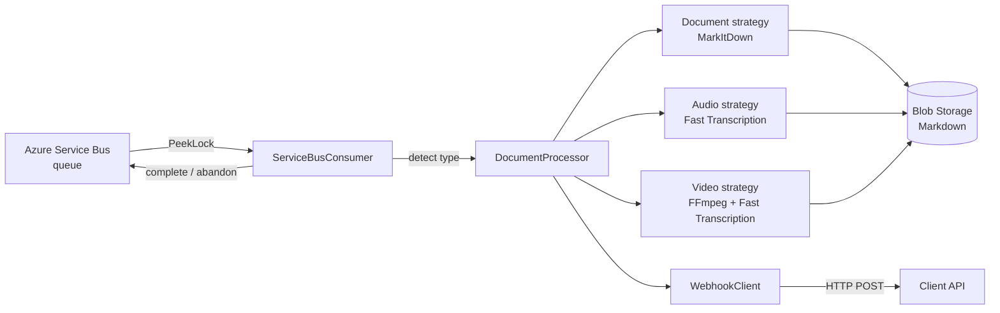

# Akay.ConvertToMarkdown

A small Python worker that normalizes content to Markdown. It runs as an Azure
Container App **without public ingress** and is driven entirely by Azure
Service Bus.

It handles:

- **Documents** — PDF, DOCX, PPTX, HTML, TXT, MD via [Microsoft MarkItDown](https://github.com/microsoft/markitdown).
- **Audio** — MP3, WAV, AAC, M4A, OGG/OPUS, FLAC via Azure AI Speech Fast Transcription.
- **Video** — MP4, MOV, MKV, WebM, AVI via FFmpeg audio extraction + Fast Transcription.

## Purpose

The worker performs a single, well-scoped job:

1. Receives a conversion request from Azure Service Bus.
2. Detects the content type (document, audio or video).
3. Obtains the source content from Blob Storage.
4. Normalizes it to Markdown using the matching strategy.
5. Uploads the resulting Markdown to a Blob Storage container.
6. Notifies through a single HTTP webhook, regardless of content type.
7. Completes the Service Bus message only when processing **and** the
   corresponding webhook notification have succeeded.

The worker has **no knowledge** of domain entities. Client metadata is carried
unchanged in the request's `payload` and returned in webhook notifications.

## Architecture



- **ServiceBusConsumer** — receives, deserializes, dispatches and settles messages
  (bounded concurrency).
- **DocumentProcessor** — orchestrates one request; knows nothing about Service Bus settlement.
- **processors** (`audio_processor`, `video_processor`) — per-content-type strategies.
- **services** (`fast_transcription_service`, `ffmpeg_service`, `markdown_builder`) — external integrations.
- **BlobStorage** — streaming download/upload abstraction.
- **DocumentConverter** — MarkItDown abstraction (`MarkItDownDocumentConverter`).
- **WebhookClient** — HTTP notifications with a small local retry policy.

## Supported content

| Type | Sources |
| --- | --- |
| Document | `.pdf`, `.docx`, `.pptx`, `.html`, `.htm`, `.txt`, `.md` |
| Audio | `.mp3`, `.wav`, `.aac`, `.m4a`, `.ogg`, `.opus`, `.flac` |
| Video | `.mp4`, `.mov`, `.mkv`, `.webm`, `.avi`, `.m4v`, `.mpg`, `.mpeg`, `.wmv` |

`.webm` is treated as video (the FFmpeg path handles audio-only WebM too).
Unknown extensions still fall through to the document path and are rejected as
`UNSUPPORTED_DOCUMENT_TYPE`.

## Local setup

Python 3.12 is required.

```bash
python -m venv .venv
.venv\Scripts\activate        # Windows
# or: source .venv/bin/activate

pip install -e ".[test]"
```

Media processing requires `ffmpeg` and `ffprobe` on the PATH.

## Azure authentication

Azure Blob Storage uses the optional `AZURE_STORAGE_SAS_TOKEN` when configured;
otherwise it uses the **async** `DefaultAzureCredential`. Azure Service Bus
independently uses that Azure Identity credential with a namespace, or a
separate connection string, including for the local emulator.

- In the Container App, a **User Assigned Managed Identity** is used. Set its
  client ID via `AZURE_CLIENT_ID`.
- Locally, `DefaultAzureCredential` falls back to Azure CLI developer
  credentials (`az login`).
- Azure Speech uses its resource key (`SPEECH_RESOURCE_KEY`) via the
  `Ocp-Apim-Subscription-Key` header.

## Required RBAC roles

The managed identity needs only the minimum permissions:

| Resource | Role |
| --- | --- |
| Service Bus queue | `Azure Service Bus Data Receiver` |
| Source Blob container/account | `Storage Blob Data Reader` |
| Destination Blob container/account | `Storage Blob Data Contributor` |

Do **not** grant Owner or Contributor.

## Environment variables

| Variable | Required | Default | Description |
| --- | --- | --- | --- |
| `AZURE_CLIENT_ID` | no | — | User Assigned Managed Identity client ID |
| `AZURE_STORAGE_ACCOUNT_URL` | yes | — | Account URL without a query string, e.g. `https://<account>.blob.core.windows.net` |
| `AZURE_STORAGE_SAS_TOKEN` | no | — | Secret SAS token, with or without `?`; takes precedence over Azure Identity for Blob Storage |
| `SOURCE_CONTAINER_NAME` | yes | — | Source container name |
| `DESTINATION_CONTAINER_NAME` | yes | — | Destination container name |
| `SERVICEBUS_FULLY_QUALIFIED_NAMESPACE` | one of** | — | e.g. `<ns>.servicebus.windows.net`; uses Azure Identity |
| `SERVICEBUS_CONNECTION_STRING` | one of** | — | Service Bus connection string, including emulator mode (secret) |
| `SERVICEBUS_QUEUE_NAME` | yes | — | Queue name, e.g. `convert-to-markdown` |
| `SERVICEBUS_MAX_LOCK_RENEWAL_SECONDS` | no | `900` | Max lock renewal duration per message |
| `WEBHOOK_CALLBACKS` | yes | — | JSON mapping of callback id → webhook URL |
| `WEBHOOK_API_KEY` | yes | — | Webhook secret (never logged) |
| `WEBHOOK_TIMEOUT_SECONDS` | no | `10` | Per-attempt HTTP timeout |
| `WEBHOOK_RETRY_COUNT` | no | `3` | Webhook attempts |
| `WEBHOOK_RETRY_DELAY_SECONDS` | no | `2` | Delay between attempts |
| `MAX_INPUT_SIZE_MB` | no | `100` | Max source size |
| `MAX_MEDIA_DURATION_MINUTES` | no | `240` | Max media duration |
| `PROCESS_TIMEOUT_MINUTES` | no | `60` | Whole-processing timeout |
| `MAX_CONCURRENT_JOBS` | no | `2` | Concurrent message processing |
| `SPEECH_RESOURCE_KEY` | yes* | — | Azure Speech resource key (secret) |
| `SPEECH_ENDPOINT` | yes* | — | e.g. `https://<resource>.cognitiveservices.azure.com` |
| `SPEECH_API_VERSION` | no | `2025-10-15` | Fast Transcription API version |
| `SPEECH_LOCALES` | no | *(auto)* | Comma-separated locales, e.g. `es-ES` |
| `SPEECH_TIMEOUT_SECONDS` | no | `600` | Transcription HTTP timeout |
| `SPEECH_RETRY_COUNT` | no | `2` | Transient transcription retries |
| `SPEECH_RETRY_DELAY_SECONDS` | no | `1` | Delay between transcription retries |
| `FFMPEG_TIMEOUT_SECONDS` | no | `300` | FFmpeg/FFprobe timeout |
| `FFMPEG_MAX_LOG_BYTES` | no | `8192` | Bounded subprocess log size |
| `TEMP_DIRECTORY` | no | `/tmp/akay` | Ephemeral conversion data |
| `LOG_LEVEL` | no | `INFO` | Logging level |

\* Required only when processing audio/video.

\** Configure at least one of `SERVICEBUS_FULLY_QUALIFIED_NAMESPACE` and
`SERVICEBUS_CONNECTION_STRING`. When both are present, the namespace takes
precedence. Empty or whitespace-only values are treated as absent. There is no
automatic fallback if the selected connection fails. Blob Storage authentication
is selected independently of the Service Bus mode.

The application **fails fast at startup** if a mandatory variable is absent.
Secrets have no default values.

## Running locally

For the local Service Bus Emulator, provide the following environment values
through your local secret configuration (the key below is a placeholder):

```text
SERVICEBUS_CONNECTION_STRING=Endpoint=sb://localhost;SharedAccessKeyName=RootManageSharedAccessKey;SharedAccessKey=SAS_KEY_VALUE;UseDevelopmentEmulator=true;
SERVICEBUS_QUEUE_NAME=convert-to-markdown
WEBHOOK_CALLBACKS={"topic-content":"http://localhost:5246/api/webhooks/topic-content-converted"}
WEBHOOK_API_KEY=<local-webhook-api-key>
```

For the emulator, leave `SERVICEBUS_FULLY_QUALIFIED_NAMESPACE` absent or empty,
otherwise it takes precedence over the connection string. Configure the
emulator's queue separately. A process running directly on the host can use
`localhost` for both the emulator and Akay.Be. From a container, `localhost`
refers to that container: use the appropriate Docker service name for a
containerized emulator or backend, or `host.docker.internal` when connecting
to a host process where supported. The complete Docker composition is a
separate setup step.

For local Docker development, configure a user delegation SAS limited to the
container, with read and write permissions and an expiry. The account URL must
not contain a SAS or any query string. Empty or whitespace-only SAS values use
`DefaultAzureCredential` instead; a token may have a leading `?`. Renew and
update the token when it expires, then restart the worker to load it. A
container-scoped SAS only authorizes that container, so both source and
destination must be within its scope:

```text
AZURE_STORAGE_ACCOUNT_URL=https://<account>.blob.core.windows.net
AZURE_STORAGE_SAS_TOKEN=<container-sas-token>
SOURCE_CONTAINER_NAME=topic-content
DESTINATION_CONTAINER_NAME=topic-content
```

Processing audio/video also requires Azure Speech and local FFmpeg/FFprobe.
Keep SAS tokens, connection strings and API keys in your environment or secret
store, not in version-controlled files. For Azure deployment, prefer managed
identity and omit `AZURE_STORAGE_SAS_TOKEN`.

```bash
akay-convert-to-markdown
# or
python -m akay_convert_to_markdown.main
```

## Running tests

```bash
pytest                     # unit tests
pytest --cov=akay_convert_to_markdown
```

Integration tests are disabled by default:

```bash
RUN_AZURE_INTEGRATION_TESTS=true pytest tests/integration
```

Media integration tests additionally require `ffmpeg`/`ffprobe` on the PATH and
`SPEECH_RESOURCE_KEY` + `SPEECH_ENDPOINT` set.

## Building the Docker image

```bash
docker build -t akay-convert-to-markdown .
```

The image installs `ffmpeg`/`ffprobe` (apt), validates them at build time, runs
as a non-root user and uses `/tmp/akay` for temporary data. No HTTP port is
exposed.

## Expected Service Bus message

```json
{
  "requestId": "e0a01a4c-1234-4567-8901-123456789abc",
  "source": {"type": "blob", "blobName": "subjects/3/topics/5/sources/550e8400-e29b-41d4-a716-446655440000.pdf"},
  "destinationBlobName": "subjects/3/topics/5/content/550e8400-e29b-41d4-a716-446655440000.md",
  "contentType": "document",
  "overwriteDestination": true,
  "callback": "topic-content",
  "payload": {"topicContentId": 15, "topicId": 5, "userId": 1234}
}
```

`requestId` is a UUID identifying a client-issued request. Service Bus
redeliveries keep the same ID; a new client-issued attempt gets a new ID.
Only `source.type: "blob"` is supported. `source.blobName` identifies a blob in
`SOURCE_CONTAINER_NAME`, and its extension determines the filename used for
conversion. `destinationBlobName` is the complete blob name within
`DESTINATION_CONTAINER_NAME`, chosen by the client.

`contentType` is optional (`document`, `audio`, or `video`); when omitted the
type is inferred from the source filename. `payload` is an optional JSON object,
defaulting to `{}`, returned without interpretation. `callback` selects a
configured webhook URL. This contract replaces the previous `documentId`,
`contextId`, `userId`, `fileName`, and `sourceBlobName` message fields;
producers must migrate before using this version.

## Destination and retries

`overwriteDestination` defaults to `false`. If the destination exists, the
worker reuses it and sends a completed webhook. With `true`, it converts and
overwrites the destination, including on redelivery. Concurrent requests with
overwrite disabled use an atomic create: if another request writes first, its
result is reused. Concurrent requests may still perform duplicate conversion.

Clients should use the same destination for retries of the same source version,
and distinct destinations for different source versions. An existing blob is
reused without checking its origin; the client owns that association.

## Webhook contracts

The webhook contract is identical for every content type.

### Completed

The destination URL is resolved from the message's `callback` identifier via
`WEBHOOK_CALLBACKS`.

```http
POST {callback-resolved URL}
X-Api-Key: <secret>
Idempotency-Key: convert-to-markdown:{requestId}:completed
```

```json
{
  "eventType": "document.conversion.completed",
  "requestId": "f7fc711f-b8d5-4e20-94fd-c77c0472a1d1",
  "source": {"type": "blob", "blobName": "uploads/lesson.pdf"},
  "destinationBlobName": "456/123/version-1/document.md",
  "contentType": "document",
  "payload": {"documentId": 123, "contextId": 456, "userId": 789}
}
```

### Failed

```http
Idempotency-Key: convert-to-markdown:{requestId}:failed
```

```json
{
  "eventType": "document.conversion.failed",
  "requestId": "f7fc711f-b8d5-4e20-94fd-c77c0472a1d1",
  "source": {"type": "blob", "blobName": "uploads/lesson.mp3"},
  "destinationBlobName": "456/123/version-1/document.md",
  "contentType": "audio",
  "payload": {"documentId": 123, "contextId": 456, "userId": 789},
  "error": {
    "code": "SPEECH_TRANSCRIPTION_FAILED",
    "message": "Azure Speech returned status 500."
  }
}
```

Stack traces and subprocess stdout/stderr are never exposed through the
webhook; they may be written to application logs (bounded).
For an invalid message, the failed webhook contains the recoverable fields
only. It is sent only if a valid `requestId` and configured `callback` can be
recovered.

## Error / retry semantics

- **Permanent errors** send the `document.conversion.failed` webhook; the message
  is completed only if the webhook returns 2xx. Codes include:
  `UNSUPPORTED_DOCUMENT_TYPE`, `UNSUPPORTED_CONTENT_TYPE`, `INVALID_MEDIA`,
  `NO_AUDIO_TRACK`, `FFMPEG_FAILED`,
  `SPEECH_TRANSCRIPTION_FAILED`, `PROCESSING_TIMEOUT`, `MEDIA_TOO_LONG`,
  `DOCUMENT_TOO_LARGE`, `SOURCE_BLOB_NOT_FOUND`, `DOCUMENT_CONVERSION_FAILED`,
  `INVALID_MESSAGE`.
- **Transient errors** abandon the message and let Service Bus redeliver it.
  This covers Blob/Service Bus failure, HTTP timeouts, webhook 408/429/5xx,
  network failure, unknown `callback`, and Azure Speech throttling
  (`SPEECH_RATE_LIMITED`).
- The webhook and the Speech client have small local retry policies
  (`WEBHOOK_RETRY_COUNT` / `SPEECH_RETRY_COUNT`) limited to transient conditions.
  Normal client errors (400/401/403/404) are not retried.
- Redelivery and dead-lettering are controlled by the queue's
  `MaxDeliveryCount`, not by application code.
- Delivery is **at-least-once**. Conversion and webhook notifications may be
  repeated; `Idempotency-Key` provides correlation and does not enforce
  deduplication.

## Logging

Structured JSON logs allow tracing a conversion by `requestId`. The webhook
API key, Azure credentials, speech key, and document/transcription contents are
never logged. Subprocess stdout/stderr are logged bounded (`*_MAX_LOG_BYTES`).

## Explicit non-goals

No domain logic, database access, RAG/chunking, OCR, LLM calls, image
extraction pipeline, HTTP API, or custom Service Bus retry scheduler.
