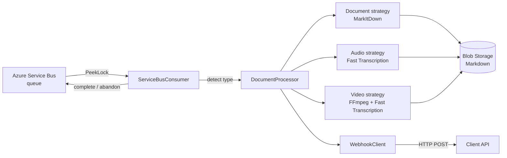

# Akay.ConvertToMarkdown

A small Python worker that normalizes content to Markdown. It runs as an Azure
Container App **without public ingress** and is driven entirely by Azure
Service Bus.

It handles:

- **Documents** — PDF, DOCX, PPTX, HTML, TXT, MD via [Microsoft MarkItDown](https://github.com/microsoft/markitdown).
- **Audio** — MP3, WAV, AAC, M4A, OGG/OPUS, FLAC via Azure AI Speech Fast Transcription.
- **Video** — MP4, MOV, MKV, WebM, AVI via FFmpeg audio extraction + Fast Transcription.

## Purpose

The worker performs a single, well-scoped job:

1. Receives a conversion request from Azure Service Bus.
2. Detects the content type (document, audio or video).
3. Obtains the source content from Blob Storage.
4. Normalizes it to Markdown using the matching strategy.
5. Uploads the resulting Markdown to a Blob Storage container.
6. Notifies through a single HTTP webhook, regardless of content type.
7. Completes the Service Bus message only when processing **and** the
   corresponding webhook notification have succeeded.

The worker has **no knowledge** of domain entities. `contextId` and
`documentId` are treated as opaque metadata.

## Architecture



- **ServiceBusConsumer** — receives, deserializes, dispatches and settles messages
  (bounded concurrency).
- **DocumentProcessor** — orchestrates one request; knows nothing about Service Bus settlement.
- **processors** (`audio_processor`, `video_processor`) — per-content-type strategies.
- **services** (`fast_transcription_service`, `ffmpeg_service`, `markdown_builder`) — external integrations.
- **BlobStorage** — streaming download/upload abstraction.
- **DocumentConverter** — MarkItDown abstraction (`MarkItDownDocumentConverter`).
- **WebhookClient** — HTTP notifications with a small local retry policy.

## Supported content

| Type | Sources |
| --- | --- |
| Document | `.pdf`, `.docx`, `.pptx`, `.html`, `.htm`, `.txt`, `.md` |
| Audio | `.mp3`, `.wav`, `.aac`, `.m4a`, `.ogg`, `.opus`, `.flac` |
| Video | `.mp4`, `.mov`, `.mkv`, `.webm`, `.avi`, `.m4v`, `.mpg`, `.mpeg`, `.wmv` |

`.webm` is treated as video (the FFmpeg path handles audio-only WebM too).
Unknown extensions still fall through to the document path and are rejected as
`UNSUPPORTED_DOCUMENT_TYPE`.

## Local setup

Python 3.12 is required.

```bash
python -m venv .venv
.venv\Scripts\activate        # Windows
# or: source .venv/bin/activate

pip install -e ".[test]"
```

Media processing requires `ffmpeg` and `ffprobe` on the PATH.

## Azure authentication

The worker uses Azure Identity with the **async**
`DefaultAzureCredential`. It never stores Storage or Service Bus connection
strings.

- In the Container App, a **User Assigned Managed Identity** is used. Set its
  client ID via `AZURE_CLIENT_ID`.
- Locally, `DefaultAzureCredential` falls back to Azure CLI developer
  credentials (`az login`).
- Azure Speech uses its resource key (`SPEECH_RESOURCE_KEY`) via the
  `Ocp-Apim-Subscription-Key` header.

## Required RBAC roles

The managed identity needs only the minimum permissions:

| Resource | Role |
| --- | --- |
| Service Bus queue | `Azure Service Bus Data Receiver` |
| Source Blob container/account | `Storage Blob Data Reader` |
| Destination Blob container/account | `Storage Blob Data Contributor` |

Do **not** grant Owner or Contributor.

## Environment variables

| Variable | Required | Default | Description |
| --- | --- | --- | --- |
| `AZURE_CLIENT_ID` | no | — | User Assigned Managed Identity client ID |
| `AZURE_STORAGE_ACCOUNT_URL` | yes | — | e.g. `https://<account>.blob.core.windows.net` |
| `SOURCE_CONTAINER_NAME` | yes | — | Source container name |
| `DESTINATION_CONTAINER_NAME` | yes | — | Destination container name |
| `SERVICEBUS_FULLY_QUALIFIED_NAMESPACE` | yes | — | e.g. `<ns>.servicebus.windows.net` |
| `SERVICEBUS_QUEUE_NAME` | yes | — | Queue name |
| `SERVICEBUS_MAX_LOCK_RENEWAL_SECONDS` | no | `900` | Max lock renewal duration per message |
| `WEBHOOK_CALLBACKS` | yes | — | JSON mapping of callback id → webhook URL |
| `WEBHOOK_API_KEY` | yes | — | Webhook secret (never logged) |
| `WEBHOOK_TIMEOUT_SECONDS` | no | `10` | Per-attempt HTTP timeout |
| `WEBHOOK_RETRY_COUNT` | no | `3` | Webhook attempts |
| `WEBHOOK_RETRY_DELAY_SECONDS` | no | `2` | Delay between attempts |
| `MAX_INPUT_SIZE_MB` | no | `100` | Max source size |
| `MAX_MEDIA_DURATION_MINUTES` | no | `240` | Max media duration |
| `PROCESS_TIMEOUT_MINUTES` | no | `60` | Whole-processing timeout |
| `MAX_CONCURRENT_JOBS` | no | `2` | Concurrent message processing |
| `SPEECH_RESOURCE_KEY` | yes* | — | Azure Speech resource key (secret) |
| `SPEECH_ENDPOINT` | yes* | — | e.g. `https://<resource>.cognitiveservices.azure.com` |
| `SPEECH_API_VERSION` | no | `2025-10-15` | Fast Transcription API version |
| `SPEECH_LOCALES` | no | *(auto)* | Comma-separated locales, e.g. `es-ES` |
| `SPEECH_TIMEOUT_SECONDS` | no | `600` | Transcription HTTP timeout |
| `SPEECH_RETRY_COUNT` | no | `2` | Transient transcription retries |
| `SPEECH_RETRY_DELAY_SECONDS` | no | `1` | Delay between transcription retries |
| `FFMPEG_TIMEOUT_SECONDS` | no | `300` | FFmpeg/FFprobe timeout |
| `FFMPEG_MAX_LOG_BYTES` | no | `8192` | Bounded subprocess log size |
| `TEMP_DIRECTORY` | no | `/tmp/akay` | Ephemeral conversion data |
| `LOG_LEVEL` | no | `INFO` | Logging level |

\* Required only when processing audio/video.

The application **fails fast at startup** if a mandatory variable is absent.
Secrets have no default values.

## Running locally

```bash
akay-convert-to-markdown
# or
python -m akay_convert_to_markdown.main
```

## Running tests

```bash
pytest                     # unit tests
pytest --cov=akay_convert_to_markdown
```

Integration tests are disabled by default:

```bash
RUN_AZURE_INTEGRATION_TESTS=true pytest tests/integration
```

Media integration tests additionally require `ffmpeg`/`ffprobe` on the PATH and
`SPEECH_RESOURCE_KEY` + `SPEECH_ENDPOINT` set.

## Building the Docker image

```bash
docker build -t akay-convert-to-markdown .
```

The image installs `ffmpeg`/`ffprobe` (apt), validates them at build time, runs
as a non-root user and uses `/tmp/akay` for temporary data. No HTTP port is
exposed.

## Expected Service Bus message

```json
{
  "documentId": "47cd79ca-xxxx-xxxx-xxxx-xxxxxxxxxxxx",
  "contextId": "5af11f72-xxxx-xxxx-xxxx-xxxxxxxxxxxx",
  "userId": "e0a01a4c-xxxx-xxxx-xxxx-xxxxxxxxxxxx",
  "fileName": "tema-1.pdf",
  "sourceBlobName": "5af11f72/.../47cd79ca/.../tema-1.pdf",
  "callback": "subject-topic"
}
```

`sourceBlobName` is required and locates the source content. An optional
`contentType` (`document` | `audio` | `video`) overrides automatic detection,
which otherwise resolves by file extension (there is no MIME type in the
message, and content is never inferred from external URLs).

The source Blob path is taken from `sourceBlobName` and is never derived from
`fileName`.

`documentId`, `contextId` and `userId` each accept **either a JSON number
(integer) or a UUID string**, independently. Integer ids are echoed back to the
webhook as JSON numbers; UUID ids are echoed back as strings. Any other string
value (including path-like values) is rejected as `INVALID_MESSAGE`.

## Output Blob structure

```text
{contextId}/{documentId}/document.md
```

The same destination Blob is overwritten when a `documentId` is reprocessed. If
the destination Markdown already exists, processing is skipped and the
completed webhook is re-sent (idempotent at-least-once delivery).

## Webhook contracts

The webhook contract is identical for every content type.

### Completed

The destination URL is resolved from the message's `callback` identifier via
`WEBHOOK_CALLBACKS`.

```http
POST {callback-resolved URL}
X-Akay-Webhook-Key: <secret>
Idempotency-Key: convert-to-markdown:{documentId}:completed
```

```json
{
  "eventType": "document.conversion.completed",
  "callback": "subject-topic",
  "documentId": "...",
  "contextId": "...",
  "userId": "...",
  "fileName": "tema-1.pdf",
  "output": {
    "containerName": "markdown",
    "blobName": "5af11f72.../47cd79ca.../document.md"
  }
}
```

### Failed

```http
Idempotency-Key: convert-to-markdown:{documentId}:failed
```

```json
{
  "eventType": "document.conversion.failed",
  "callback": "subject-topic",
  "documentId": "...",
  "contextId": "...",
  "userId": "...",
  "fileName": "tema-1.pdf",
  "error": {
    "code": "SPEECH_TRANSCRIPTION_FAILED",
    "message": "Azure Speech returned status 500."
  }
}
```

Stack traces and subprocess stdout/stderr are never exposed through the
webhook; they may be written to application logs (bounded).

## Error / retry semantics

- **Permanent errors** send the `document.conversion.failed` webhook; the message
  is completed only if the webhook returns 2xx. Codes include:
  `UNSUPPORTED_DOCUMENT_TYPE`, `UNSUPPORTED_CONTENT_TYPE`, `INVALID_MEDIA`,
  `NO_AUDIO_TRACK`, `FFMPEG_FAILED`,
  `SPEECH_TRANSCRIPTION_FAILED`, `PROCESSING_TIMEOUT`, `MEDIA_TOO_LONG`,
  `DOCUMENT_TOO_LARGE`, `SOURCE_BLOB_NOT_FOUND`, `DOCUMENT_CONVERSION_FAILED`,
  `INVALID_MESSAGE`.
- **Transient errors** abandon the message and let Service Bus redeliver it.
  This covers Blob/Service Bus failure, HTTP timeouts, webhook 408/429/5xx,
  network failure, unknown `callback`, and Azure Speech throttling
  (`SPEECH_RATE_LIMITED`).
- The webhook and the Speech client have small local retry policies
  (`WEBHOOK_RETRY_COUNT` / `SPEECH_RETRY_COUNT`) limited to transient conditions.
  Normal client errors (400/401/403/404) are not retried.
- Redelivery and dead-lettering are controlled by the queue's
  `MaxDeliveryCount`, not by application code.
- Delivery is **at-least-once**; the pipeline is idempotent.

## Logging

Structured JSON logs allow tracing a conversion by `documentId`. The webhook
API key, Azure credentials, speech key, and document/transcription contents are
never logged. Subprocess stdout/stderr are logged bounded (`*_MAX_LOG_BYTES`).

## Explicit non-goals

No domain logic, database access, RAG/chunking, OCR, LLM calls, image
extraction pipeline, HTTP API, or custom Service Bus retry scheduler.
