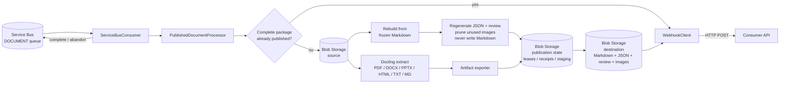
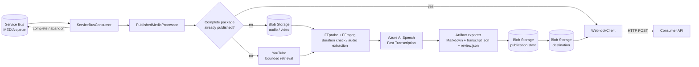
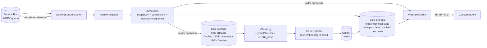

# Akay.ConvertToMarkdown

[Español](README-es.md)

A Service Bus driven worker suite that turns source material into structured Markdown and,
optionally, into vector-indexed content:

- **Documents** — PDF, DOCX, PPTX, HTML, TXT and Markdown converted with
  [Docling](https://github.com/docling-project/docling).
- **Audio and video** — transcribed with Azure AI Speech Fast Transcription; video audio is
  extracted with FFmpeg. Explicit YouTube videos are also supported.
- **Reviewed content** — an edited Markdown draft can be rebuilt into a fresh structured
  document without re-running extraction or OCR.
- **Indexing** — saved final artifacts are chunked, embedded with Azure OpenAI and written to
  Qdrant with ordered index/delete/reassign operations.

One Python package provides four entry points: three independent, single-purpose workers and a
combined compatibility worker. The dedicated workers add artifacts, reviews, publication
receipts, ordered indexing and versioned contracts. The combined worker retains the original
Markdown-only behaviour.

The workers have **no HTTP ingress**. They consume Azure Service Bus queues, read from Blob
Storage and call an authenticated webhook when a job finishes.

---

## Table of contents

- [Architecture](#architecture)
- [Features](#features)
- [Supported content](#supported-content)
- [Service Bus contracts](#service-bus-contracts)
- [Webhook contracts](#webhook-contracts)
- [Configuration](#configuration)
- [Azure resources](#azure-resources)
- [Local setup](#local-setup)
- [Docker](#docker)
- [Usage examples](#usage-examples)
- [Processing guarantees](#processing-guarantees)
- [Tests](#tests)
- [Known limitations](#known-limitations)
- [Repository layout](#repository-layout)

---

## Architecture

The three diagrams below cover the document, media and indexing paths. They render automatically
on GitHub and in any Markdown viewer with Mermaid support.

### Worker entry points

Each worker has its own queue environment variable. Dedicated workers never fall back to the
combined queue, and locally known queue names must be distinct.

| Command | Python module | Queue variable | Responsibility |
| --- | --- | --- | --- |
| `akay-convert-document` | `akay_convert_to_markdown.document_main` | `DOCUMENT_SERVICEBUS_QUEUE_NAME` | Document extraction, Markdown reconstruction, complete document artifact publication. Default concurrency `1`. |
| `akay-transcribe-media` | `akay_convert_to_markdown.media_main` | `MEDIA_SERVICEBUS_QUEUE_NAME` | Blob audio/video and explicit YouTube transcription, transcript/review publication. Default concurrency `2`. |
| `akay-index-content` | `akay_convert_to_markdown.index_main` | `INDEX_SERVICEBUS_QUEUE_NAME` | Ordered index/delete of saved final artifacts in Qdrant. Default concurrency `2`. |
| `akay-convert-to-markdown` | `akay_convert_to_markdown.main` | `SERVICEBUS_QUEUE_NAME` | Combined compatibility worker: document, audio and video to a single Markdown file. |

Run any entry as a module, for example:

```bash
python -m akay_convert_to_markdown.document_main
```

### 1. Document conversion



1. The consumer receives a locked message and parses the document contract.
2. An already complete, compatible package at the destination is reused without extracting
   again. An incompatible or unowned destination fails as `ARTIFACT_PUBLICATION_CONFLICT`.
3. The source is downloaded and size-checked.
4. `operation=convert` runs Docling and exports Markdown. `operation=rebuildFromMarkdown` reads
   the edited Markdown and replaces only its JSON artifacts, pruning unused inventory images.
5. The worker builds a complete local package: Markdown, Docling JSON, `review.json` and figure
   and table crops.
6. Conversion packages use create-only writes. Rebuilds stage the JSON files for retry, then
   overwrite the existing artifacts without writing, normalizing or deleting the Markdown.
7. The completed webhook is sent and its success is recorded. Only then is the message settled.

For `convert`, an existing complete package is reusable even when `overwriteDestination=true`. This makes
redelivery safe and prevents a second, different extraction from replacing accepted material.

### 2. Audio and video transcription



- Audio formats go directly to Fast Transcription.
- Video formats are probed, their first audio stream is extracted with `-vn`, and the audio is
  transcribed. WebM may contain audio only and still uses the video strategy.
- YouTube sources retrieve one audio-only file under a bounded network, time and temporary
  storage policy, then reuse the same FFmpeg/Speech path.
- The published package consists of Markdown, `transcript.json` and `review.json`. Segment
  timestamps are preserved in milliseconds; unavailable measurements stay `null`.
- Speech phrases are never re-segmented, reformatted or translated.

### 3. Indexing and deletion



1. The worker admits the operation against a durable per-content receipt.
2. A lower `operationSequence` emits `content.index.operation.superseded`. A replay of the
   current completed operation reuses its stored result without chunking or embedding again.
3. A newer index operation reads the saved final artifact (`format=docling` or
   `format=transcript`), optionally reads the final review, and chunks the content.
4. Chunks are embedded and written to Qdrant with deterministic UUIDv5 point IDs. A shorter
   result deletes only the exact scope/content/profile tail.
5. A completed or deleted event is persisted before the webhook and replayed on redelivery.

A delete operation removes **only Qdrant points** for the exact scope, content and profile. It
never deletes Blob files, database rows or other content.

### Artifact layout

The sidecar directory is derived from the Markdown destination: the `.md` suffix is replaced by
`.artifacts/`.

For a destination `topics/manual.md`:

| Artifact | Blob name |
| --- | --- |
| Markdown | `topics/manual.md` |
| Docling JSON | `topics/manual.artifacts/document.docling.json` |
| Review | `topics/manual.artifacts/review.json` |
| Figure crops | `topics/manual.artifacts/images/figure-001.png` |
| Table crops | `topics/manual.artifacts/images/table-002.png` |

For media, the JSON artifact is `topics/manual.artifacts/transcript.json` and the review is
`topics/manual.artifacts/review.json`.

Notes:

- `review.json` is the **only** image inventory. Completed webhooks never contain image lists,
  binary data or image prefixes.
- A Markdown destination cannot live inside a reserved `.artifacts` directory.
- `document.md` and `document.MD` cannot claim the same `document.artifacts/` namespace.
- Originals are never moved, copied or deleted.

### Review and transcript contents

`review.json` contains technical counts, sections, tables, image and formula inventories,
available extraction confidence and warnings. `document.docling.json` retains the full
structured document. For media, segment text and timings live in `transcript.json`, not in
the review or webhook. Completed webhooks provide the artifact Blob names to read.

#### Formula inventory

Every review includes `formulas` and `summary.formulaCount`, equal to the array length.
Each occurrence has a document-local ID stable across identical retries, its
`doclingItemRef`, nullable `sectionId`, extracted `text`, nullable `latex` and nullable
`pageNumber`. The section is `null` when no emitted section applies, including additional
documents; the page is `null` when unavailable. Identical expressions remain separate
occurrences. For example, this is a fragment of a document review:

```json
{
  "summary": { "formulaCount": 2 },
  "formulas": [
    {
      "id": "formula-001",
      "doclingItemRef": "#/texts/4",
      "sectionId": "4c8d1f14-ffda-5b2e-9616-c7a4f82e34ef",
      "text": "a / b",
      "latex": "\\frac{a}{b}",
      "pageNumber": 2
    },
    {
      "id": "formula-002",
      "doclingItemRef": "#/texts/5",
      "sectionId": "4c8d1f14-ffda-5b2e-9616-c7a4f82e34ef",
      "text": "a / b",
      "latex": null,
      "pageNumber": 3
    }
  ]
}
```

The collector uses only existing structured FormulaItems. It retains source text (`orig`
when available, otherwise `text`) and the decoded representation available in the pinned
item's `text` field as LaTeX; an absent or whitespace-only representation becomes `null`.
It does not correct expressions, add an LLM/model/extraction pass, or implicitly enable
`formulaEnrichment`. Available LaTeX is not a guarantee of syntactic or mathematical validity.
There are no separate formula files, `codeBlocks` or `codeBlockCount` inventories.

When reading older reviews, missing `formulas` and `formulaCount` default to `[]` and `0`.
Reviews with no detected formulas and all media reviews emit those empty values; equations
are never inferred from spoken transcript text. Reconstruction collects formulas anew from
the rebuilt document without copying the old inventory or page provenance. See the
[parser limitation](#known-limitations) before relying on Markdown math detection.

### Reader citations and media segments

In the Akay reading experience, the **principal Markdown is the reading surface**. Additional
transcripts and short explanatory notes supply supporting knowledge; their Markdown remains
a processing artifact rather than a separate reader destination. Material intended to be read
belongs in the principal. The workers remain reusable outside this consumer policy.

| Evidence used | Reader citation target | Data already supplied by the worker/indexer |
| --- | --- | --- |
| Principal text | Its section in the current principal Markdown. | Final review section IDs and indexed `sectionId`/`headingPath`. |
| Additional note/document | Its assigned section in the principal. | The additional's `contentKey` and the `fixed` parent `sectionId`/`headingPath` supplied in the index request. |
| Additional audio/video/YouTube | A segment of that medium within its assigned principal section. | The same parent section context, media identity/origin, and `provenance.segments` with IDs and available start/end milliseconds. |

For example, a consumer can present **Simplifying fractions → Explanatory video ·
02:15–02:40**: open the principal section or play the associated medium from the cited
segment. This does not imply that the transcript's exact words are written in the principal.
`contentKey` identifies the evidence resource; `sectionId` identifies its reading context.
The indexer preserves both, plus individual segment timings, in Qdrant. A chunk can cover
multiple segments; splitting a segment does not invent word-level timestamps. Missing times
stay `null`.

Original document page numbers, coordinates and confidence are extraction diagnostics,
not reader-navigation targets. `doclingItemRef` connects structured items internally;
`prov.bbox`/`prov.charspan` are source-item provenance, not offsets into the generated Markdown.
After reconstruction, text has no page provenance and `summary.pageCount` and section/table/
formula `pageNumber` values are `null`. Retained image pages still describe their original crops.

**Consumer integration is still required:** resolve the section against the current principal
Markdown, authorize access to the resource, render the citation and control media playback.
An HTML section comment is not a browser anchor by itself. After reconstruction, map the
regenerated review IDs to the current rendered headings rather than relying on old comments.
The worker supplies the metadata; it does not implement the reader, player or those UI mappings.

---

## Features

### Documents

- Extraction of PDF, DOCX, PPTX, HTML/HTM, TXT and Markdown with Docling.
- PDF pipeline with local models, CPU inference, OCR, accurate table structure, heading
  hierarchy, picture crops and optional code/formula enrichment.
- Per-request OCR language: `es`, `eu`, `gl`, `ca`, `fr`, `en`, `de` (default `es`).
- Deterministic section IDs, parent/child ordering and heading paths for principal content.
- Structured review with page count, sections, tables, image and formula inventories,
  confidence grades and safe warnings.
- `rebuildFromMarkdown` overwrites the Docling JSON and review of an edited Markdown, keeps
  referenced inventory images and deletes unused ones. The Markdown is never written.

### Audio and video

- Blob audio/video and explicit single-video YouTube sources.
- Azure AI Speech Fast Transcription with phrase order, optional speaker identity, locale and
  millisecond timestamps.
- Stable `segment-0001` style IDs, duration validation and explicit warnings for unavailable
  timestamps.
- Markdown with display anchors plus a machine-readable timed transcript.

### Indexing

- Hybrid chunking over Docling JSON or transcript JSON.
- Azure OpenAI `text-embedding-3-small`, 1536 dimensions, `cl100k_base` tokenizer.
- Qdrant collections with immutable profile/space binding metadata.
- Deterministic point IDs, scoped replacement, tail pruning and per-profile deletion.
- Ordered index/delete/reassign with durable receipts, superseding and callback replay.
- An in-flight acknowledgement barrier prevents a newer writer from racing an uncertain Qdrant
  mutation.

### Reliability and operations

- Versioned, strict request and event contracts (unknown fields are rejected).
- Complete-set publication: nothing is reported as complete until every file exists.
- Blob leases and ETags for publication and index-state coordination.
- Whole-workflow time budget separate from the per-processing timeout.
- Service Bus lock renewal, lock-loss cancellation, graceful shutdown and draining.
- Permanent failures are persisted and replayed without re-extracting or re-transcribing.
- Structured JSON logs correlated by `requestId`; secrets and content are never logged.

### Explicit non-goals

- No domain model, database access, approval workflow or chat implementation.
- No HTTP API, UI or inbound server.
- No automatic indexing after conversion. Indexing is always an explicit request.
- No automatic domain cleanup when an index delete is processed.

---

## Supported content

| Type | Extensions |
| --- | --- |
| Document | `.pdf`, `.docx`, `.pptx`, `.html`, `.htm`, `.txt`, `.md` |
| Audio | `.mp3`, `.wav`, `.aac`, `.m4a`, `.ogg`, `.opus`, `.flac` |
| Video | `.mp4`, `.mov`, `.mkv`, `.webm`, `.avi`, `.m4v`, `.mpg`, `.mpeg`, `.wmv` |

`.webm` is routed through the video strategy, which also handles audio-only WebM. Unknown
document extensions fail as `UNSUPPORTED_DOCUMENT_TYPE`.

---

## Service Bus contracts

### Common rules

- The message body is UTF-8 JSON.
- Each dedicated worker reads only its own queue.
- Requests are **strict**: unknown fields, duplicate JSON keys, wrong types, `NaN`/`Infinity`
  and invalid UUIDs are rejected with `INVALID_MESSAGE`.
- `payload` is an opaque JSON object, default `{}`, echoed in the webhook without interpretation.
- `callback` is a configured identity resolved through `WEBHOOK_CALLBACKS`, never a URL.
- Queue delivery is **at-least-once**. Reuse the same `requestId` for retries of the same
  client operation; use a new `requestId` for a new attempt with different parameters.
- Dead-lettering is controlled by the queue's `MaxDeliveryCount`, not by application code.

A generic sender using the Azure Service Bus SDK:

```python
import json
import os

from azure.servicebus import ServiceBusClient, ServiceBusMessage

message = {
    "schemaVersion": 1,
    "requestId": "5d0c5f6e-4a3b-4c2d-9e1f-2a3b4c5d6e7f",
    # ...
}

with ServiceBusClient.from_connection_string(os.environ["SERVICEBUS_CONNECTION_STRING"]) as client:
    with client.get_queue_sender("convert-document") as sender:
        sender.send_messages(ServiceBusMessage(json.dumps(message)))
```

For namespace-based authentication, construct `ServiceBusClient(namespace, credential=DefaultAzureCredential())`
instead.

### Document conversion

Required fields:

| Field | Value |
| --- | --- |
| `schemaVersion` | `1` |
| `requestId` | UUID |
| `contentKey` | Opaque, non-blank content identity |
| `source` | `{"type": "blob", "blobName": "<name in SOURCE_CONTAINER_NAME>"}` |
| `destinationBlobName` | Required for `convert`; omit for `rebuildFromMarkdown` |
| `contentType` | `"document"` |
| `operation` | `"convert"` (default) |
| `callback` | Configured callback identity |
| `documentOptions` | Optional; see below |
| `overwriteDestination` | Optional boolean, default `false` |

```json
{
  "schemaVersion": 1,
  "requestId": "5d0c5f6e-4a3b-4c2d-9e1f-2a3b4c5d6e7f",
  "contentKey": "topic-content:550e8400-e29b-41d4-a716-446655440000",
  "source": {
    "type": "blob",
    "blobName": "subjects/3/topics/5/sources/manual.pdf"
  },
  "destinationBlobName": "subjects/3/topics/5/content/manual.md",
  "contentType": "document",
  "operation": "convert",
  "overwriteDestination": false,
  "documentOptions": {
    "extractSections": true,
    "codeEnrichment": false,
    "formulaEnrichment": false,
    "ocrLanguage": "es"
  },
  "callback": "topic-content",
  "payload": {
    "topicContentId": 15,
    "topicId": 5,
    "userId": 1234
  }
}
```

`documentOptions`:

| Option | Default | Meaning |
| --- | --- | --- |
| `extractSections` | `false` | Emit deterministic section IDs and heading paths. Use `true` for principal material; `false` for additional material. |
| `codeEnrichment` | `false` | PDF only. Run code recognition on PDF regions. |
| `formulaEnrichment` | `false` | PDF only. Run formula recognition and emit LaTeX when available. |
| `ocrLanguage` | `es` | Exactly one of `es`, `eu`, `gl`, `ca`, `fr`, `en`, `de`. This is document OCR, not translation or Speech. |

Enrichment flags on non-PDF sources produce an `ENRICHMENT_NOT_APPLICABLE` warning and keep the
native content.

### Markdown reconstruction (`rebuildFromMarkdown`)

Use this operation when a user has edited the Markdown produced by a previous conversion and the
final structured artifacts must reflect that text before indexing.

```json
{
  "schemaVersion": 1,
  "requestId": "0f6b2c1d-8e7a-4b5c-9d0e-1f2a3b4c5d6e",
  "contentKey": "topic-content:550e8400-e29b-41d4-a716-446655440000",
  "source": {
    "type": "blob",
    "blobName": "subjects/3/topics/5/content/manual.md"
  },
  "contentType": "document",
  "operation": "rebuildFromMarkdown",
  "documentOptions": {
    "extractSections": true
  },
  "callback": "topic-content",
  "payload": {
    "topicContentId": 15,
    "approvalRequestId": "0f6b2c1d-8e7a-4b5c-9d0e-1f2a3b4c5d6e"
  }
}
```

Rules:

- `source.blobName` must be frozen Markdown (`.md`). Do not edit it underneath a redelivery of
  the same request.
- Omit `destinationBlobName` and `extractionReviewBlobName`. Paths are derived from the source:
  `manual.md` updates `manual.artifacts/document.docling.json` and `manual.artifacts/review.json`
  in `DESTINATION_CONTAINER_NAME`.
- Rebuild always replaces the JSON artifacts; it does not use `overwriteDestination` to decide reuse.
- The Markdown is read from `SOURCE_CONTAINER_NAME` and never modified, copied or deleted. If
  edited content stays in the conversion output container, configure the source accordingly.
- `codeEnrichment` and `formulaEnrichment` must be `false`. No OCR, layout inference or model
  enrichment is run.
- The current `review.json` is overwritten. There is no extraction-review backup; the edited
  Markdown is authoritative. Text pages and PDF confidence are unavailable after reconstruction.
- Sections, tables and formulas come from the rebuilt document, including parser-supported
  additions, edits and deletions. Formula inventory is not copied from the previous review;
  [dollar-delimited Markdown math is not detected by the pinned parser](#known-limitations).
- Keep images from the current inventory only when referenced by the Markdown. Delete unused
  inventory images from the same artifact directory; leave unrelated files untouched. Links
  are never fetched or rewritten and no new image crops are inferred from Markdown.
- The same completed webhook is used, with `destinationBlobName` equal to `source.blobName`.
- Old section comments in Markdown are ignored during parsing but remain byte-for-byte intact.
  Use the regenerated review for final section IDs.
- Wait for completion before indexing and lock editing while indexing. A further edit uses a new
  request UUID. Technical retry staging is internal, not another public artifact generation.

Without edits, reuse the initial completed package and skip reconstruction.

### Audio, video and YouTube

```json
{
  "schemaVersion": 1,
  "requestId": "b1ad362f-0911-4773-8651-1508d94cb004",
  "contentKey": "topic-content:6c1d2e3f-4a5b-6c7d-8e9f-0a1b2c3d4e5f",
  "source": {
    "type": "blob",
    "blobName": "media/lesson-01.mp3"
  },
  "destinationBlobName": "subjects/3/topics/5/content/lesson-01.md",
  "contentType": "audio",
  "overwriteDestination": false,
  "callback": "topic-content",
  "payload": {
    "topicContentId": 21
  }
}
```

Video Blob source:

```json
{
  "schemaVersion": 1,
  "requestId": "c2be473e-1a2b-4c3d-8e4f-5a6b7c8d9e0f",
  "contentKey": "topic-content:7d2e3f4a-5b6c-7d8e-9f0a-1b2c3d4e5f60",
  "source": {
    "type": "blob",
    "blobName": "media/lesson-02.webm"
  },
  "destinationBlobName": "subjects/3/topics/5/content/lesson-02.md",
  "contentType": "video",
  "callback": "topic-content",
  "payload": {}
}
```

YouTube source:

```json
{
  "schemaVersion": 1,
  "requestId": "d3cf584f-2b3c-4d5e-9f60-6b7c8d9e0f1a",
  "contentKey": "topic-content:8e3f4a5b-6c7d-8e9f-0a1b-2c3d4e5f6071",
  "source": {
    "type": "youtube",
    "url": "https://www.youtube.com/watch?v=abcdefghijk"
  },
  "destinationBlobName": "subjects/3/topics/5/content/video.md",
  "contentType": "video",
  "callback": "topic-content",
  "payload": {}
}
```

Rules:

- Media requests do not accept `documentOptions`.
- YouTube is always `contentType=video` and must be a single video URL; playlists, live streams,
  URL credentials, fragments and unknown query fields are rejected.
- Blob output and publication-state configuration are required even when the input is a URL.
- The completed event references `transcript.json` and `review.json`, not a Docling JSON.

#### Editing a transcript before indexing

There is no `rebuildFromMarkdown` operation for media. The consumer performs the correction:

1. Load `transcript.json`.
2. Change only the `text` of existing segments, selected by `id`.
3. Preserve segment IDs, order, origin, speaker and available time boundaries.
4. Save the corrected `transcript.json`.
5. Regenerate the Markdown from those same segments.
6. Send the saved corrected transcript to the index worker with `source.format=transcript`.

No second transcription, FFmpeg call or media queue request is required.

### Index, delete and reassign

Index request:

```json
{
  "schemaVersion": 1,
  "requestId": "e4d06950-3c4d-5e6f-a071-7c8d9e0f1a2b",
  "operation": "index",
  "operationSequence": 1,
  "scopeKey": "subject:3",
  "contentKey": "topic-content:550e8400-e29b-41d4-a716-446655440000",
  "source": {
    "type": "blob",
    "format": "docling",
    "blobName": "subjects/3/topics/5/content/manual.artifacts/document.docling.json"
  },
  "sectionContext": {
    "mode": "fromReview",
    "reviewBlobName": "subjects/3/topics/5/content/manual.artifacts/review.json"
  },
  "indexProfile": {
    "id": "default",
    "provider": "AzureOpenAI",
    "model": "text-embedding-3-small",
    "deployment": "text-embedding-3-small",
    "dimensions": 1536,
    "tokenizer": "cl100k_base",
    "maxChunkTokens": 600,
    "distance": "Cosine",
    "collection": "akay-content"
  },
  "metadata": {
    "topicId": 5
  },
  "callback": "content-index",
  "payload": {
    "topicContentId": 15
  }
}
```

Section context modes:

| Mode | Use |
| --- | --- |
| `fromReview` | Docling source with its final review. Sections come from the review. |
| `fixed` | Explicit `sectionId` and `headingPath`, for additional content or reassignment. |
| `none` | No section association. |

For Akay additions, supply the principal section in `fixed` mode. The indexer retains segment
IDs/times for transcript sources alongside that section context. See
[reader citations and media segments](#reader-citations-and-media-segments) for navigation
semantics and the consumer responsibilities.

Delete request:

```json
{
  "schemaVersion": 1,
  "requestId": "f5e17a61-4d5e-6f70-b182-8d9e0f1a2b3c",
  "operation": "delete",
  "operationSequence": 2,
  "scopeKey": "subject:3",
  "contentKey": "topic-content:550e8400-e29b-41d4-a716-446655440000",
  "indexTarget": {
    "profileId": "default",
    "collection": "akay-content"
  },
  "callback": "content-index",
  "payload": {}
}
```

Reassignment is a **higher-sequence index** using existing final artifacts and a new `fixed`
section context. It does not re-transcribe or re-convert.

Rules:

- `operationSequence` is a positive per-content operation counter, not a document version.
- The exact `(scopeKey, contentKey)` identifies the coordination lane.
- `indexProfile` must match one immutable profile configured in `INDEX_PROFILES` exactly.
- The only supported embedding space is `AzureOpenAI` / `text-embedding-3-small` / `1536` /
  `cl100k_base`, with `modelRevision` absent.
- `metadata` cannot override reserved point fields such as `scopeKey`, `contentKey`, `profileId`,
  `operationSequence`, `chunkIndex`, `sectionId`, `headingPath`, `text`, `source` or
  `provenance`.
- Delete requires `profileId` and `collection` exactly as configured or previously used by that
  content.

### Combined compatibility envelope

The combined worker keeps the original simple contract. It produces a single Markdown file and
does **not** accept `schemaVersion`, `contentKey`, `documentOptions`, `operation`,
`operationSequence`, `scopeKey` or `extractionReviewBlobName`.

```json
{
  "requestId": "e0a01a4c-1234-4567-8901-123456789abc",
  "source": {
    "type": "blob",
    "blobName": "subjects/3/topics/5/sources/550e8400-e29b-41d4-a716-446655440000.pdf"
  },
  "destinationBlobName": "subjects/3/topics/5/content/550e8400-e29b-41d4-a716-446655440000.md",
  "contentType": "document",
  "overwriteDestination": true,
  "callback": "topic-content",
  "payload": {
    "topicContentId": 15,
    "topicId": 5,
    "userId": 1234
  }
}
```

`contentType` is optional (`document`, `audio` or `video`) and inferred from the source filename
when omitted. The destination is reused when it already exists and `overwriteDestination` is
`false`; the worker then sends a completed webhook without converting again.

The dedicated document and media workers also accept this envelope and process it Markdown-only.
The index worker accepts only schema version 1. Do not send versioned jobs to the combined worker;
use the dedicated routes for artifact-aware processing.

### Routing summary

| Need | Worker | Queue |
| --- | --- | --- |
| Document extraction with artifacts | `akay-convert-document` | `DOCUMENT_SERVICEBUS_QUEUE_NAME` |
| Markdown reconstruction after editing | `akay-convert-document` | `DOCUMENT_SERVICEBUS_QUEUE_NAME` |
| Audio/video transcript with artifacts | `akay-transcribe-media` | `MEDIA_SERVICEBUS_QUEUE_NAME` |
| Indexing, deletion, reassignment | `akay-index-content` | `INDEX_SERVICEBUS_QUEUE_NAME` |
| Plain Markdown compatibility | `akay-convert-to-markdown` | `SERVICEBUS_QUEUE_NAME` |

---

## Webhook contracts

### Transport and security

```http
POST <URL resolved from WEBHOOK_CALLBACKS[callback]>
Content-Type: application/json
X-Api-Key: <WEBHOOK_API_KEY>
Idempotency-Key: <requestId>:<eventType>
```

The combined worker uses the older key format:

```text
convert-to-markdown:<requestId>:completed
convert-to-markdown:<requestId>:failed
```

Rules:

- A 2xx response means the notification was accepted. Any other outcome is a delivery failure and
  the Service Bus message is abandoned for redelivery.
- Delivery is at-least-once. The `Idempotency-Key` is for correlation; the receiver must also
  deduplicate and reject stale requests/sequences.
- Stack traces, raw exception messages, subprocess output, document text, transcript text and
  credentials are never included.
- Permanent processing failures persist a safe failed event before the HTTP call; redelivery
  replays that event instead of re-extracting.
- An invalid message receives a failed event only when a valid `requestId` and a configured
  callback can be recovered.

> The completed event type for **both** documents and media is `document.conversion.completed`.
> Use `contentType` and `artifacts` to distinguish them.

### `document.conversion.completed`

Document:

```json
{
  "schemaVersion": 1,
  "requestId": "5d0c5f6e-4a3b-4c2d-9e1f-2a3b4c5d6e7f",
  "contentKey": "topic-content:550e8400-e29b-41d4-a716-446655440000",
  "payload": {
    "topicContentId": 15,
    "topicId": 5,
    "userId": 1234
  },
  "eventType": "document.conversion.completed",
  "source": {
    "type": "blob",
    "blobName": "subjects/3/topics/5/sources/manual.pdf"
  },
  "destinationBlobName": "subjects/3/topics/5/content/manual.md",
  "contentType": "document",
  "operation": "convert",
  "artifacts": {
    "doclingJsonBlobName": "subjects/3/topics/5/content/manual.artifacts/document.docling.json",
    "reviewBlobName": "subjects/3/topics/5/content/manual.artifacts/review.json"
  }
}
```

Media:

```json
{
  "schemaVersion": 1,
  "requestId": "b1ad362f-0911-4773-8651-1508d94cb004",
  "contentKey": "topic-content:6c1d2e3f-4a5b-6c7d-8e9f-0a1b2c3d4e5f",
  "payload": {
    "topicContentId": 21
  },
  "eventType": "document.conversion.completed",
  "source": {
    "type": "blob",
    "blobName": "media/lesson-01.mp3"
  },
  "destinationBlobName": "subjects/3/topics/5/content/lesson-01.md",
  "contentType": "audio",
  "artifacts": {
    "transcriptJsonBlobName": "subjects/3/topics/5/content/lesson-01.artifacts/transcript.json",
    "reviewBlobName": "subjects/3/topics/5/content/lesson-01.artifacts/review.json"
  }
}
```

For `rebuildFromMarkdown`, `operation` is `"rebuildFromMarkdown"` and `destinationBlobName` equals
the source Markdown name; it does not mean a Markdown was written. For YouTube, `source` is
`{"type": "youtube", "url": "<original URL>"}`.

### `document.conversion.failed`

```json
{
  "schemaVersion": 1,
  "requestId": "5d0c5f6e-4a3b-4c2d-9e1f-2a3b4c5d6e7f",
  "contentKey": "topic-content:550e8400-e29b-41d4-a716-446655440000",
  "payload": {
    "topicContentId": 15
  },
  "eventType": "document.conversion.failed",
  "source": {
    "type": "blob",
    "blobName": "subjects/3/topics/5/sources/manual.pdf"
  },
  "destinationBlobName": "subjects/3/topics/5/content/manual.md",
  "contentType": "document",
  "operation": "convert",
  "error": {
    "code": "DOCUMENT_CONVERSION_FAILED",
    "message": "The document could not be converted."
  }
}
```

Recoverable fields may be omitted. `error.code` and `error.message` are always safe values.

### `content.indexing.completed`

```json
{
  "schemaVersion": 1,
  "requestId": "e4d06950-3c4d-5e6f-a071-7c8d9e0f1a2b",
  "contentKey": "topic-content:550e8400-e29b-41d4-a716-446655440000",
  "payload": {
    "topicContentId": 15
  },
  "eventType": "content.indexing.completed",
  "scopeKey": "subject:3",
  "operationSequence": 1,
  "index": {
    "profileId": "default",
    "chunkCount": 37
  }
}
```

### `content.index.deleted`

```json
{
  "schemaVersion": 1,
  "requestId": "f5e17a61-4d5e-6f70-b182-8d9e0f1a2b3c",
  "contentKey": "topic-content:550e8400-e29b-41d4-a716-446655440000",
  "payload": {},
  "eventType": "content.index.deleted",
  "scopeKey": "subject:3",
  "operationSequence": 2,
  "index": {
    "profileId": "default"
  }
}
```

### `content.index.operation.superseded`

```json
{
  "schemaVersion": 1,
  "requestId": "aabbccdd-eeff-4011-2233-445566778899",
  "contentKey": "topic-content:550e8400-e29b-41d4-a716-446655440000",
  "payload": {},
  "eventType": "content.index.operation.superseded",
  "scopeKey": "subject:3",
  "operationSequence": 1,
  "currentOperationSequence": 3
}
```

A superseded event never reactivates older content.

### Index failures

```json
{
  "schemaVersion": 1,
  "requestId": "e4d06950-3c4d-5e6f-a071-7c8d9e0f1a2b",
  "contentKey": "topic-content:550e8400-e29b-41d4-a716-446655440000",
  "payload": {},
  "eventType": "content.indexing.failed",
  "operation": "index",
  "scopeKey": "subject:3",
  "operationSequence": 1,
  "error": {
    "code": "INDEX_PROFILE_INCOMPATIBLE",
    "message": "The profile is incompatible with the configured embedding adapter."
  }
}
```

Deletions use `eventType: "content.index.deletion.failed"` and `operation: "delete"`.

---

## Configuration

All settings are environment variables. Mandatory values have no default and the process fails
fast at startup when they are missing. Secrets have no defaults.

`L` = combined worker, `D` = document worker, `M` = media worker, `I` = index worker.

### Common variables

| Variable | Workers | Required | Default | Description |
| --- | --- | --- | --- | --- |
| `AZURE_CLIENT_ID` | L/D/M/I | No | — | Client ID of the user-assigned managed identity used by `DefaultAzureCredential`. |
| `AZURE_STORAGE_ACCOUNT_URL` | L/D/M/I | Yes | — | Blob account URL without a query string, e.g. `https://<account>.blob.core.windows.net`. |
| `AZURE_STORAGE_SAS_TOKEN` | L/D/M/I | No | — | Container-scoped SAS token, with or without a leading `?`. Takes precedence over Azure Identity. |
| `SOURCE_CONTAINER_NAME` | L/D/M/I | Yes | — | Source container. For the index worker, the container holding saved final artifacts. |
| `SERVICEBUS_FULLY_QUALIFIED_NAMESPACE` | L/D/M/I | One of | — | e.g. `<namespace>.servicebus.windows.net`; uses Azure Identity. |
| `SERVICEBUS_CONNECTION_STRING` | L/D/M/I | One of | — | Service Bus connection string, including emulator mode. |
| `SERVICEBUS_QUEUE_NAME` | L | Yes | — | Combined worker queue. |
| `DOCUMENT_SERVICEBUS_QUEUE_NAME` | D | Yes | — | Document worker queue. |
| `MEDIA_SERVICEBUS_QUEUE_NAME` | M | Yes | — | Media worker queue. |
| `INDEX_SERVICEBUS_QUEUE_NAME` | I | Yes | — | Index worker queue. |
| `SERVICEBUS_MAX_LOCK_RENEWAL_SECONDS` | L/D/M/I | No | `4500` | Maximum lock-renewal duration. Must be at least `WORKFLOW_TIMEOUT_SECONDS + 60`. |
| `WEBHOOK_CALLBACKS` | L/D/M/I | Yes | — | JSON object mapping callback identities to absolute HTTP(S) URLs. |
| `WEBHOOK_API_KEY` | L/D/M/I | Yes | — | Secret sent in `X-Api-Key`. |
| `WEBHOOK_TIMEOUT_SECONDS` | L/D/M/I | No | `10` | Per-attempt webhook timeout. |
| `WEBHOOK_RETRY_COUNT` | L/D/M/I | No | `3` | Webhook attempts for transient conditions. |
| `WEBHOOK_RETRY_DELAY_SECONDS` | L/D/M/I | No | `2` | Delay between webhook attempts. |
| `MAX_INPUT_SIZE_MB` | L/D/M/I | No | `100` | Maximum source or saved-artifact size. |
| `PROCESS_TIMEOUT_MINUTES` | L/D/M/I | No | `60` | Processing timeout for the combined, document and media paths. It also participates in the workflow-budget validation for every worker. |
| `WORKFLOW_TIMEOUT_SECONDS` | L/D/M/I | No | `4200` | Whole-job budget: processing, publication, callback retries, cleanup and settlement. |
| `MAX_CONCURRENT_JOBS` | L/D/M/I | No | `2` (`D`: `1`) | Concurrent messages per worker process. |
| `TEMP_DIRECTORY` | L/D/M/I | No | `/tmp/akay` | Ephemeral working directory. |
| `LOG_LEVEL` | L/D/M/I | No | `INFO` | Logging level. |

Authentication rules:

- Configure at least one of `SERVICEBUS_FULLY_QUALIFIED_NAMESPACE` and
  `SERVICEBUS_CONNECTION_STRING`. The namespace takes precedence when both are present.
- `AZURE_STORAGE_ACCOUNT_URL` must not contain a query string. Configure the SAS separately.
- Without `AZURE_STORAGE_SAS_TOKEN`, Blob Storage uses `DefaultAzureCredential`.
- Locally, `DefaultAzureCredential` can use `az login`. In Azure, assign a user-assigned managed
  identity and set `AZURE_CLIENT_ID`.
- Locally known queue names must all be distinct; a collision with another worker queue fails
  startup.

### Document worker

| Variable | Required | Default | Description |
| --- | --- | --- | --- |
| `DESTINATION_CONTAINER_NAME` | Yes | — | Container for Markdown and artifacts. |
| `PUBLICATION_STATE_CONTAINER_NAME` | For versioned jobs | — | Existing technical-state container. |
| `PUBLICATION_STATE_PREFIX` | For versioned jobs | — | Shared technical prefix for receipts and staging. |
| `DOCLING_ARTIFACTS_PATH` | For PDF | — | Directory containing the prefetched Docling layout/table/OCR assets, plus code/formula assets when used. No ambient model-cache fallback. |

If either publication-state value is supplied, both must be present and non-blank. Without them,
versioned document jobs fail transiently before reading the source. The document image already
sets `DOCLING_ARTIFACTS_PATH=/opt/docling/models`; provide it only for host or custom-image runs.

### Media worker

| Variable | Required | Default | Description |
| --- | --- | --- | --- |
| `DESTINATION_CONTAINER_NAME` | Yes | — | Container for Markdown and artifacts. |
| `PUBLICATION_STATE_CONTAINER_NAME` | Yes for versioned jobs | — | Existing technical-state container. |
| `PUBLICATION_STATE_PREFIX` | Yes for versioned jobs | — | Shared technical prefix. |
| `MAX_MEDIA_DURATION_MINUTES` | No | `240` | Maximum media duration. |
| `SPEECH_RESOURCE_KEY` | Yes | — | Azure AI Speech resource key. |
| `SPEECH_ENDPOINT` | Yes | — | e.g. `https://<resource>.cognitiveservices.azure.com`. |
| `SPEECH_API_VERSION` | No | `2025-10-15` | Fast Transcription API version. |
| `SPEECH_LOCALES` | No | auto | Comma-separated candidate locales, e.g. `es-ES`. |
| `SPEECH_TIMEOUT_SECONDS` | No | `600` | Transcription HTTP timeout. |
| `SPEECH_RETRY_COUNT` | No | `2` | Transient transcription retries. |
| `SPEECH_RETRY_DELAY_SECONDS` | No | `1` | Delay between transcription retries. |
| `FFMPEG_TIMEOUT_SECONDS` | No | `300` | FFmpeg/FFprobe timeout. |
| `FFMPEG_MAX_LOG_BYTES` | No | `8192` | Bounded subprocess log size. |
| `YOUTUBE_TIMEOUT_SECONDS` | No | `300` | YouTube extraction/download time budget. |
| `YOUTUBE_MAX_TEMP_MB` | No | `256` | Attempt-local temporary storage limit for YouTube. |

The dedicated media worker requires non-blank `SPEECH_RESOURCE_KEY` and `SPEECH_ENDPOINT` at
startup. FFmpeg and FFprobe must be on the `PATH`.

### Index worker

Common Blob, Service Bus, callback and workflow settings also apply. The index worker does not
require a destination container, Speech settings or FFmpeg.

| Variable | Required | Default | Description |
| --- | --- | --- | --- |
| `INDEX_STATE_CONTAINER` | Yes | — | Existing technical-state container for receipts and cached outcomes. |
| `INDEX_STATE_PREFIX` | Yes | — | Shared technical prefix. |
| `INDEX_PROFILES` | Yes | — | JSON array of immutable profile objects. |
| `INDEX_TOKENIZER_PATH` | Yes | — | Local `cl100k_base.tiktoken` file with the official hash. |
| `INDEX_QDRANT_URL` | Yes | — | Qdrant HTTP(S) origin without credentials, path, query or fragment. |
| `INDEX_QDRANT_AUTH_MODE` | Yes | — | `none` or `apiKey`. |
| `INDEX_QDRANT_API_KEY` | With `apiKey` | — | Secret. `apiKey` mode requires HTTPS and forbids an empty key. |
| `INDEX_QDRANT_TIMEOUT_SECONDS` | No | `30` | Per-call timeout (1–300). |
| `INDEX_BATCH_SIZE` | No | `32` | Chunks per preparation/upsert batch (1–2048). |
| `INDEX_MAX_CHUNKS` | No | `10000` | Maximum chunks per operation. |
| `INDEX_MAX_STATE_BYTES` | No | `134217728` | Bounded technical state/input reads (128 MiB). |
| `AZURE_OPENAI_ENDPOINT` | Yes | — | HTTPS resource origin without credentials, path, query or fragment. |
| `AZURE_OPENAI_DEPLOYMENT` | Yes | — | Actual embedding deployment name. Must match every profile's `deployment`. |
| `AZURE_OPENAI_AUTH_MODE` | Yes | — | `apiKey` or `entra`. The CLI entry requires `apiKey`. |
| `AZURE_OPENAI_API_KEY` | With `apiKey` | — | Secret. Must be absent in `entra` mode. |
| `AZURE_OPENAI_API_VERSION` | No | `2024-10-21` | Pinned REST version; only `2024-10-21` is accepted. |
| `AZURE_OPENAI_TIMEOUT_SECONDS` | No | `30` | Per-attempt HTTP timeout. |
| `AZURE_OPENAI_RETRY_COUNT` | No | `3` | Attempts (1–10). |
| `AZURE_OPENAI_RETRY_DELAY_SECONDS` | No | `1` | Exponential backoff base (0–30). |
| `AZURE_OPENAI_BATCH_SIZE` | No | `32` | Inputs per HTTP call (1–2048). |
| `AZURE_OPENAI_MAX_BATCH_TOKENS` | No | `65536` | Aggregate token bound (8192–300000). |
| `AZURE_OPENAI_MAX_RESPONSE_BYTES` | No | `16777216` | Bounded response body. |

The index image includes the tokenizer at `/opt/tokenizers/cl100k_base.tiktoken`; set
`INDEX_TOKENIZER_PATH` to that path. If adapter configuration is missing or invalid, the entry
logs `INDEX_CONFIGURATION_REQUIRED` and exits with code `2` before constructing clients or
consuming messages.

`INDEX_PROFILES` example:

```json
[
  {
    "id": "default",
    "provider": "AzureOpenAI",
    "model": "text-embedding-3-small",
    "deployment": "text-embedding-3-small",
    "dimensions": 1536,
    "tokenizer": "cl100k_base",
    "maxChunkTokens": 600,
    "distance": "Cosine",
    "collection": "akay-content"
  }
]
```

The profile is an immutable snapshot. A changed deployment, collection, chunk budget or distance
requires a new profile ID and an explicit reindex.

Validation rules:

- `WORKFLOW_TIMEOUT_SECONDS` must cover `PROCESS_TIMEOUT_MINUTES` plus the full callback retry
  budget plus at least 60 seconds for publication.
- `SERVICEBUS_MAX_LOCK_RENEWAL_SECONDS` must cover the workflow plus at least 60 seconds for
  drain and settlement.
- `DESTINATION_CONTAINER_NAME` is only required for conversion/transcription.
- `INDEX_TOKENIZER_PATH` must be the official `cl100k_base` file; its SHA-256 is checked.
- `AZURE_OPENAI_AUTH_MODE=entra` is supported only by the programmatic builder with an explicit
  async token provider, not by the CLI entry point.

---

## Azure resources

### Services to provision

| Service | Purpose | Required by |
| --- | --- | --- |
| Azure Blob Storage | Source, destination, publication state and index state containers. | All |
| Azure Service Bus | One namespace with three dedicated queues (plus the optional combined queue). No topics or subscriptions. | All |
| Azure AI Speech | Fast Transcription. | Media |
| Azure OpenAI | `text-embedding-3-small` deployment with 1536 dimensions. | Index |
| Qdrant | Vector database reachable over HTTP(S). Can be Qdrant Cloud, a self-hosted server or a Container App. | Index |
| Azure Container Apps | Hosts the three worker apps with no ingress. | Deployment |
| User-assigned managed identity | Blob, Service Bus, Key Vault and scaler authentication. | Recommended |
| Azure Key Vault | Stores webhook, Speech, Azure OpenAI, Qdrant and registry secrets. | Recommended |
| GitHub Container Registry | Stores the three worker images. | Deployment |
| Log Analytics / Azure Monitor | Logs, queue depth, DLQ age, callback failures, restarts. | Recommended |

### Containers

Create the containers before starting any worker. The workers never create them.

| Container | Content | Access |
| --- | --- | --- |
| Source | Original documents/media, or saved final artifacts for the index worker. | Read |
| Destination | Markdown, Docling JSON, transcript JSON, review and image crops. | Read/write |
| Publication state | Receipts, leases, staged attempt files. | Read/write/delete + lease |
| Index state | Admission receipts, lanes, cached mutations and vector outcomes. | Read/write/delete + lease |

For the index worker, `SOURCE_CONTAINER_NAME` must contain the final artifacts produced by the
document or media worker. It may be the same container as the conversion destination.

### Identities and RBAC

Use a separate user-assigned managed identity per worker app (or one explicitly authorized shared
identity). Grant the minimum roles:

| Resource | Scope | Role |
| --- | --- | --- |
| Service Bus queue | Each queue | `Azure Service Bus Data Receiver` |
| Source Blob container | Source | `Storage Blob Data Reader` |
| Destination Blob container | Destination | `Storage Blob Data Contributor` |
| Publication state container | State | `Storage Blob Data Contributor` |
| Index state container | State | `Storage Blob Data Contributor` |
| Key Vault | Vault | `Key Vault Secrets User` |
| Azure OpenAI (Entra mode) | Resource | `Cognitive Services OpenAI User` |

Additional identities:

- The **KEDA scaler identity** on each Container App also needs `Azure Service Bus Data Receiver`
  on its queue. Runtime receiver permissions do not configure KEDA.
- The **deployment OIDC identity** is separate from the runtime identities. It needs only the
  authorized resource/deployment write and managed-identity assignment permissions.
- GHCR pull credentials are separate from both the deployment identity and Azure managed
  identity. Store them in Key Vault and reference them from the app.

Do not grant Owner or Contributor to runtime identities.

### Secrets

Store these in Key Vault and reference them from Container Apps:

- `WEBHOOK_API_KEY`
- `SPEECH_RESOURCE_KEY` (media)
- `AZURE_OPENAI_API_KEY` (index, `apiKey` mode)
- `INDEX_QDRANT_API_KEY` (index, `apiKey` mode)
- GHCR pull password
- `AZURE_STORAGE_SAS_TOKEN` only if you deliberately use SAS instead of managed identity

Non-secret configuration such as queue names, container names, callback JSON, profiles and
endpoints can be plain environment values.

### Container Apps settings

Each worker is a separate Container App with:

- **No ingress** (no HTTP port, no public endpoint).
- A **user-assigned managed identity** and `AZURE_CLIENT_ID`.
- **Secrets** backed by versioned Key Vault references.
- A **KEDA Azure Service Bus scaler** configured with the queue name, namespace and scaler
  identity. There is no HTTP scaler.
- `minReplicas` and `maxReplicas` chosen for the workload. Document extraction is CPU and memory
  heavy; start with document concurrency `1`.
- A writable ephemeral volume at `/tmp/akay`. The images run as UID/GID `10001` and expose no
  ports.
- A termination grace period long enough to drain the configured workflow.

Measured uncompressed image sizes for sizing guidance (not a capacity guarantee):

| Image | Approximate size |
| --- | --- |
| Document converter | 4.6 GB |
| Media transcriber | 1.3 GB |
| Content indexer | 0.7 GB |

### Deployment workflow

The repository includes two GitHub Actions workflows:

- `content-processing-ci` runs tests first, then builds the three images and runs offline smoke
  checks. GHCR publication is a separate manual gate: dispatch with `publish=true` on `main` and
  set the repository variable `GHCR_PUBLICATION_ENABLED=true`. The workflow records one
  complete SHA/run/attempt identity and all three image digests.
- `deploy-content-processing-worker` updates **one existing Container App at a time**. It is
  manual (`workflow_dispatch`) and requires the inputs `environment`, `worker`, `authorize` and
  `cutover_confirmed`. It uses OIDC, not stored Azure credentials.

Deployment prerequisites and environment variables:

| Variable / resource | Purpose |
| --- | --- |
| `CONTENT_PROCESSING_DEPLOYMENT_ENABLED=true` | Explicit deployment gate. |
| `CONTENT_PROCESSING_AZURE_CONFIG` | Non-secret JSON describing subscription, resource group, environment, namespace and the three worker objects. |
| `AZURE_DEPLOY_CLIENT_ID`, `AZURE_TENANT_ID`, `AZURE_SUBSCRIPTION_ID` | OIDC deployment identity. |
| `GHCR_IMAGE_REPOSITORIES` | Three lowercase `ghcr.io/owner/repository` values. |
| Protected GitHub environment | Required reviewers and branch protection. |
| Existing Container Apps environment | Standard environment; express environments do not support this configuration. |
| Existing apps, queues, identities, containers and Key Vault | The workflow updates existing apps; it does not create prerequisites. |

`CONTENT_PROCESSING_AZURE_CONFIG` has this shape. The example fills the document worker; the
`media` and `index` objects use the same shape with their role-specific environment.

```json
{
  "schemaVersion": 1,
  "subscriptionId": "<subscription-uuid>",
  "resourceGroup": "<existing-resource-group>",
  "environmentId": "<full-container-apps-environment-resource-id>",
  "location": "<existing-location>",
  "serviceBusNamespace": "<namespace-without-servicebus.windows.net>",
  "legacyQueue": "<combined-worker-queue>",
  "workers": {
    "document": {
      "appName": "<existing-app>",
      "queueName": "<document-queue>",
      "imageRepository": "ghcr.io/owner/document",
      "runtimeIdentity": "<uami-resource-id>",
      "runtimeClientId": "<uami-client-id>",
      "scalerIdentity": "<uami-resource-id>",
      "secretsIdentity": "<uami-resource-id>",
      "registryUsername": "<ghcr-user>",
      "registryPasswordSecret": "<app-secret-name>",
      "secrets": [
        {
          "name": "<app-secret-name>",
          "keyVaultUrl": "https://<vault>.vault.azure.net/secrets/<name>/<version>"
        }
      ],
      "resources": {
        "cpu": 2,
        "memory": "4Gi"
      },
      "workloadProfileName": "<existing-profile>",
      "tags": {
        "app": "akay-convert-document"
      },
      "minReplicas": 0,
      "maxReplicas": 3,
      "concurrency": 1,
      "messageCount": 1,
      "pollingInterval": 30,
      "cooldownPeriod": 300,
      "terminationGracePeriodSeconds": 600,
      "env": {
        "AZURE_STORAGE_ACCOUNT_URL": "https://<account>.blob.core.windows.net",
        "SOURCE_CONTAINER_NAME": "sources",
        "DESTINATION_CONTAINER_NAME": "content",
        "PUBLICATION_STATE_CONTAINER_NAME": "state",
        "PUBLICATION_STATE_PREFIX": "workers/document",
        "WEBHOOK_CALLBACKS": "{\"topic-content\":\"https://api.example.com/webhooks/content\"}",
        "WEBHOOK_API_KEY": {
          "secretRef": "<app-secret-name>"
        }
      }
    },
    "media": {},
    "index": {}
  }
}
```

The generator supplies `AZURE_CLIENT_ID`, the known queue assignments,
`DOCLING_ARTIFACTS_PATH` and `INDEX_TOKENIZER_PATH`; do not override them in `env`.

Use `tools/container_apps.py prepare` to validate the configuration, generate the three ARM
templates and a deployment plan without logging in to Azure:

```bash
python tools/container_apps.py prepare \
  --config <controlled-config.json> \
  --release <release.json> \
  --run-metadata <publication-run.json> \
  --sha <full-sha> \
  --run-id <run-id> \
  --attempt <attempt> \
  --output .local/deployment-review
```

The output directory must be new. It contains `document.arm.json`, `media.arm.json`,
`index.arm.json` and `deployment-plan.json`.

### Cutover and rollback

1. Preserve the current approved configuration, image digests and state namespaces.
2. Pause producers and stop the combined consumer before reusing a queue. Drain or reconcile its
   in-flight messages and inspect its DLQ.
3. Use three distinct queues. Never point a dedicated worker at a queue that still receives
   combined or mixed messages.
4. Deploy one worker at a time from the same release identity. Verify pull secrets, Blob and
   state access, Service Bus receiver **and scaler**, callback delivery, model/tokenizer access
   and resources before enabling producers.
5. Enable conversion first; index only after the consuming application has approved content and
   persisted final sections.
6. To roll back, stop the affected producer routes and consumers, then redeploy the previous
   complete release for that single worker. App-level secrets, identities and configuration are
   not revision-local, so restoring a revision alone is not a full rollback.
7. Restore the combined consumer only with its previous image and only after the dedicated
   consumers have stopped.

---

## Local setup

### Python

Python 3.12 is required.

```bash
python -m venv .venv
```

Windows:

```powershell
.venv\Scripts\Activate.ps1
```

Linux/macOS:

```bash
source .venv/bin/activate
```

Full development installation (all three workers):

```bash
pip install --require-hashes \
  -r requirements/document-windows.txt \
  -r requirements/media-windows.txt \
  -r requirements/index-windows.txt
pip install -e ".[test]"
```

On Linux x86_64/glibc >= 2.28 use the `*-linux.txt` locks instead. For a single worker, install
only its target lock and then `pip install --no-deps .`.

FFmpeg and FFprobe are required for media processing:

```bash
ffmpeg -version
ffprobe -version
```

YouTube additionally requires the pinned adapter:

```bash
pip install -e ".[youtube]"
```

### Docling model assets

DOCX, PPTX, HTML, TXT and Markdown extraction runs without model weights. PDF requires an
explicit local bundle; the worker never downloads missing weights at runtime.

The required 19 files and their SHA-256 values are listed in
`requirements/document-models.json`. Prepare a directory such as `.local/docling-models` with
this structure:

```text
docling-project--docling-layout-heron/
docling-project--docling-models/model_artifacts/tableformer/accurate/
docling-project--CodeFormulaV2/
RapidOcr/
```

If the Hugging Face cache is empty, populate the pinned repositories first. The exact revisions are
listed in `requirements/document-models.json`:

```bash
huggingface-cli download docling-project/docling-layout-heron \
  --revision 8f39ad3c0b4c58e9c2d2c84a38465abf757272d8
huggingface-cli download docling-project/docling-models --revision v2.3.0
huggingface-cli download docling-project/CodeFormulaV2 \
  --revision ecedbe111d15c2dc60bfd4a823cbe80127b58af4
```

Then stage the bundle from the cache and the installed RapidOCR package:

```bash
python docs/checks/content_processing_n3_models.py \
  --hf-cache "~/.cache/huggingface/hub" \
  --rapidocr-models ".venv/lib/python3.12/site-packages/rapidocr/models" \
  --stage ".local/docling-models"
```

On Windows, the default cache path is `%USERPROFILE%\.cache\huggingface\hub` and the installed
RapidOCR models are under `.venv\Lib\site-packages\rapidocr\models`.

Then verify every file:

```bash
python tools/verify_assets.py --document-dir .local/docling-models
```

Point the worker at the bundle:

```text
DOCLING_ARTIFACTS_PATH=/absolute/path/to/.local/docling-models
```

### Tokenizer asset

The index worker needs the official `cl100k_base` vocabulary. Download it once, outside the
worker:

```bash
mkdir -p .local/tokenizer
curl --fail --silent --show-error \
  --output .local/tokenizer/cl100k_base.tiktoken \
  https://openaipublic.blob.core.windows.net/encodings/cl100k_base.tiktoken

python tools/verify_assets.py --tokenizer-file .local/tokenizer/cl100k_base.tiktoken
```

On PowerShell: `New-Item -ItemType Directory -Force .local/tokenizer`.

The expected SHA-256 is
`223921b76ee99bde995b7ff738513eef100fb51d18c93597a113bcffe865b2a7`.

### Local dependencies

| Dependency | Local option |
| --- | --- |
| Service Bus | Azure Service Bus emulator, or a real namespace. |
| Blob Storage | A real storage account with a container-scoped SAS, or Azurite with a SAS. |
| Qdrant | `docker run -p 6333:6333 qdrant/qdrant`. |
| FFmpeg | Install on the host, or use the media image. |
| Webhook receiver | `python -m tools.callback_receiver` or your own HTTP endpoint. |

For the Service Bus emulator:

```text
SERVICEBUS_CONNECTION_STRING=Endpoint=sb://localhost;SharedAccessKeyName=RootManageSharedAccessKey;SharedAccessKey=SAS_KEY_VALUE;UseDevelopmentEmulator=true;
SERVICEBUS_QUEUE_NAME=convert-to-markdown
WEBHOOK_CALLBACKS={"topic-content":"http://localhost:8765/callbacks"}
WEBHOOK_API_KEY=<local-webhook-api-key>
```

Leave `SERVICEBUS_FULLY_QUALIFIED_NAMESPACE` absent or empty when using the emulator; otherwise
it takes precedence. From a container, `localhost` refers to that container. Use the Docker
service name of the emulator/backend or `host.docker.internal` where supported.

For local Blob Storage with a real account, create a user delegation SAS limited to the
container with read and write permissions. The account URL must not contain the SAS:

```text
AZURE_STORAGE_ACCOUNT_URL=https://<account>.blob.core.windows.net
AZURE_STORAGE_SAS_TOKEN=<container-sas-token>
SOURCE_CONTAINER_NAME=topic-content
DESTINATION_CONTAINER_NAME=topic-content
```

For identity-based local development, run `az login` and omit the SAS.

### Running the workers

```bash
akay-convert-document
# or
python -m akay_convert_to_markdown.document_main

akay-transcribe-media
akay-index-content
akay-convert-to-markdown
```

A complete local end-to-end harness is available:

```bash
pytest tests/unit/test_content_handoff.py -q --tb=short
python -m tools.content_processing_demo \
  --tokenizer .local/tokenizer/cl100k_base.tiktoken \
  --output .local/handoff-01
```

It exercises document extraction, reconstruction, publication, strict parsing, chunking, local
Qdrant and ordered index/delete with explicit service doubles. It does not contact Azure, Speech,
YouTube or an embedding service.

---

## Docker

### Build the combined image

```bash
docker build -t akay-convert-to-markdown .
```

The image installs FFmpeg, validates it at build time, runs as a non-root user and uses
`/tmp/akay` for temporary data. It exposes no ports.

### Build the three dedicated images

The document and index images need explicit, verified build assets as named contexts.

Prepare the assets:

```bash
python tools/verify_assets.py \
  --document-dir .local/docling-models \
  --tokenizer-file .local/tokenizer/cl100k_base.tiktoken
```

Build:

```bash
# Document converter
docker build -f Dockerfile.workers --target document-converter \
  --build-context document_assets=.local/docling-models \
  -t akay-document:local .

# Media transcriber
docker build -f Dockerfile.workers --target media-transcriber \
  -t akay-media:local .

# Content indexer
docker build -f Dockerfile.workers --target content-indexer \
  --build-context tokenizer_assets=.local/tokenizer \
  -t akay-index:local .
```

`tokenizer_assets` must be a directory whose root contains `cl100k_base.tiktoken`. The
`document_assets` context root is the model bundle root.

Alternatively, use the checker that builds and runs all offline smoke phases:

```bash
python tools/check_images.py \
  --docker-host unix:///var/run/docker.sock \
  --document-models .local/docling-models \
  --tokenizer-file .local/tokenizer/cl100k_base.tiktoken
```

On Windows with Docker Desktop, use the `npipe:////./pipe/dockerDesktopLinuxEngine` host and the
path to your Buildx plugin.

### Run the containers

The workers have no ingress; they start consuming immediately. Mount a writable temporary volume
and pass configuration through an env file (never commit it).

Document:

```bash
docker run --rm \
  --env-file .env.document \
  --read-only \
  --tmpfs /tmp/akay:rw,nosuid,size=2g,mode=1777 \
  akay-document:local
```

Media:

```bash
docker run --rm \
  --env-file .env.media \
  --read-only \
  --tmpfs /tmp/akay:rw,nosuid,size=2g,mode=1777 \
  akay-media:local
```

Index:

```bash
docker run --rm \
  --env-file .env.index \
  --read-only \
  --tmpfs /tmp/akay:rw,nosuid,size=1g,mode=1777 \
  akay-index:local
```

### Example local env files

`.env.document`:

```text
AZURE_STORAGE_ACCOUNT_URL=https://<account>.blob.core.windows.net
AZURE_STORAGE_SAS_TOKEN=<container-sas-token>
SOURCE_CONTAINER_NAME=sources
DESTINATION_CONTAINER_NAME=content
PUBLICATION_STATE_CONTAINER_NAME=state
PUBLICATION_STATE_PREFIX=workers/document
SERVICEBUS_CONNECTION_STRING=Endpoint=sb://localhost;SharedAccessKeyName=RootManageSharedAccessKey;SharedAccessKey=SAS_KEY_VALUE;UseDevelopmentEmulator=true;
DOCUMENT_SERVICEBUS_QUEUE_NAME=convert-document
WEBHOOK_CALLBACKS={"local":"http://host.docker.internal:8765/callbacks"}
WEBHOOK_API_KEY=local-webhook-key
DOCLING_ARTIFACTS_PATH=/opt/docling/models
```

`.env.media`:

```text
AZURE_STORAGE_ACCOUNT_URL=https://<account>.blob.core.windows.net
AZURE_STORAGE_SAS_TOKEN=<container-sas-token>
SOURCE_CONTAINER_NAME=sources
DESTINATION_CONTAINER_NAME=content
PUBLICATION_STATE_CONTAINER_NAME=state
PUBLICATION_STATE_PREFIX=workers/media
SERVICEBUS_CONNECTION_STRING=Endpoint=sb://localhost;SharedAccessKeyName=RootManageSharedAccessKey;SharedAccessKey=SAS_KEY_VALUE;UseDevelopmentEmulator=true;
MEDIA_SERVICEBUS_QUEUE_NAME=transcribe-media
SPEECH_RESOURCE_KEY=<speech-key>
SPEECH_ENDPOINT=https://<speech-resource>.cognitiveservices.azure.com
WEBHOOK_CALLBACKS={"local":"http://host.docker.internal:8765/callbacks"}
WEBHOOK_API_KEY=local-webhook-key
```

`.env.index`:

```text
AZURE_STORAGE_ACCOUNT_URL=https://<account>.blob.core.windows.net
AZURE_STORAGE_SAS_TOKEN=<container-sas-token>
SOURCE_CONTAINER_NAME=content
INDEX_STATE_CONTAINER=state
INDEX_STATE_PREFIX=workers/index
SERVICEBUS_CONNECTION_STRING=Endpoint=sb://localhost;SharedAccessKeyName=RootManageSharedAccessKey;SharedAccessKey=SAS_KEY_VALUE;UseDevelopmentEmulator=true;
INDEX_SERVICEBUS_QUEUE_NAME=index-content
INDEX_PROFILES=[{"id":"default","provider":"AzureOpenAI","model":"text-embedding-3-small","deployment":"text-embedding-3-small","dimensions":1536,"tokenizer":"cl100k_base","maxChunkTokens":600,"distance":"Cosine","collection":"akay-content"}]
INDEX_TOKENIZER_PATH=/opt/tokenizers/cl100k_base.tiktoken
INDEX_QDRANT_URL=http://host.docker.internal:6333
INDEX_QDRANT_AUTH_MODE=none
AZURE_OPENAI_ENDPOINT=https://<resource>.openai.azure.com
AZURE_OPENAI_DEPLOYMENT=text-embedding-3-small
AZURE_OPENAI_AUTH_MODE=apiKey
AZURE_OPENAI_API_KEY=<embedding-key>
WEBHOOK_CALLBACKS={"local":"http://host.docker.internal:8765/callbacks"}
WEBHOOK_API_KEY=local-webhook-key
```

On Linux, replace `host.docker.internal` with the appropriate host address or use Docker service
names. For a containerized Qdrant, use its service name instead of the host address.

---

## Usage examples

The examples below assume a configured queue and a callback identity. They show the message
payloads only; send them with your preferred Service Bus client.

### 1. Convert a document to Markdown

Request:

```json
{
  "schemaVersion": 1,
  "requestId": "11111111-1111-4111-8111-111111111111",
  "contentKey": "topic-content:manual-01",
  "source": {
    "type": "blob",
    "blobName": "subjects/3/topics/5/sources/manual.pdf"
  },
  "destinationBlobName": "subjects/3/topics/5/content/manual.md",
  "contentType": "document",
  "operation": "convert",
  "overwriteDestination": false,
  "documentOptions": {
    "extractSections": true,
    "codeEnrichment": false,
    "formulaEnrichment": false,
    "ocrLanguage": "es"
  },
  "callback": "topic-content",
  "payload": {
    "topicContentId": 15,
    "topicId": 5
  }
}
```

Expected artifacts:

```text
subjects/3/topics/5/content/manual.md
subjects/3/topics/5/content/manual.artifacts/document.docling.json
subjects/3/topics/5/content/manual.artifacts/review.json
subjects/3/topics/5/content/manual.artifacts/images/figure-001.png
```

Completed event: `document.conversion.completed` with `operation=convert` and the two artifact
references.

### 2. Rebuild an edited Markdown draft

Flow:

1. Convert the original to `subjects/3/topics/5/content/manual.md`.
2. The user edits and saves that same `manual.md`; freeze it until rebuilding finishes.
3. Send a new request with a new `requestId`, the same `contentKey`, and
   `operation=rebuildFromMarkdown`.

```json
{
  "schemaVersion": 1,
  "requestId": "22222222-2222-4222-8222-222222222222",
  "contentKey": "topic-content:manual-01",
  "source": {
    "type": "blob",
    "blobName": "subjects/3/topics/5/content/manual.md"
  },
  "contentType": "document",
  "operation": "rebuildFromMarkdown",
  "documentOptions": {
    "extractSections": true
  },
  "callback": "topic-content",
  "payload": {
    "topicContentId": 15
  }
}
```

Result: overwrite `manual.artifacts/document.docling.json` and `manual.artifacts/review.json`,
keep referenced inventory images and delete unused ones. `manual.md` remains unchanged, including
its bytes, line endings and existing comments. The webhook references that same `manual.md`.

If the edited Markdown has no changes, skip this request and index the original final artifacts.

### 3. Transcribe audio, video or a YouTube video

Audio:

```json
{
  "schemaVersion": 1,
  "requestId": "33333333-3333-4333-8333-333333333333",
  "contentKey": "topic-content:lesson-audio-01",
  "source": {
    "type": "blob",
    "blobName": "media/lesson-01.mp3"
  },
  "destinationBlobName": "subjects/3/topics/5/content/lesson-01.md",
  "contentType": "audio",
  "callback": "topic-content",
  "payload": {
    "topicContentId": 21
  }
}
```

Video:

```json
{
  "schemaVersion": 1,
  "requestId": "44444444-4444-4444-8444-444444444444",
  "contentKey": "topic-content:lesson-video-02",
  "source": {
    "type": "blob",
    "blobName": "media/lesson-02.mp4"
  },
  "destinationBlobName": "subjects/3/topics/5/content/lesson-02.md",
  "contentType": "video",
  "callback": "topic-content",
  "payload": {}
}
```

YouTube:

```json
{
  "schemaVersion": 1,
  "requestId": "55555555-5555-4555-8555-555555555555",
  "contentKey": "topic-content:lesson-youtube-03",
  "source": {
    "type": "youtube",
    "url": "https://www.youtube.com/watch?v=abcdefghijk"
  },
  "destinationBlobName": "subjects/3/topics/5/content/lesson-03.md",
  "contentType": "video",
  "callback": "topic-content",
  "payload": {}
}
```

Expected artifacts for any of them:

```text
subjects/3/topics/5/content/lesson-01.md
subjects/3/topics/5/content/lesson-01.artifacts/transcript.json
subjects/3/topics/5/content/lesson-01.artifacts/review.json
```

To correct a transcript, update only `segments[].text` in `transcript.json`, regenerate the
Markdown, save both, and index the corrected `transcript.json`. Do not change segment IDs, order,
origin, speaker or time boundaries.

### 4. Index the final artifacts

Index a converted document using its final review:

```json
{
  "schemaVersion": 1,
  "requestId": "66666666-6666-4666-8666-666666666666",
  "operation": "index",
  "operationSequence": 1,
  "scopeKey": "subject:3",
  "contentKey": "topic-content:manual-01",
  "source": {
    "type": "blob",
    "format": "docling",
    "blobName": "subjects/3/topics/5/content/manual.artifacts/document.docling.json"
  },
  "sectionContext": {
    "mode": "fromReview",
    "reviewBlobName": "subjects/3/topics/5/content/manual.artifacts/review.json"
  },
  "indexProfile": {
    "id": "default",
    "provider": "AzureOpenAI",
    "model": "text-embedding-3-small",
    "deployment": "text-embedding-3-small",
    "dimensions": 1536,
    "tokenizer": "cl100k_base",
    "maxChunkTokens": 600,
    "distance": "Cosine",
    "collection": "akay-content"
  },
  "metadata": {
    "topicId": 5,
    "role": "principal"
  },
  "callback": "content-index",
  "payload": {
    "topicContentId": 15
  }
}
```

Index additional content with a fixed section association:

```json
{
  "schemaVersion": 1,
  "requestId": "77777777-7777-4777-8777-777777777777",
  "operation": "index",
  "operationSequence": 1,
  "scopeKey": "subject:3",
  "contentKey": "topic-content:additional-01",
  "source": {
    "type": "blob",
    "format": "docling",
    "blobName": "subjects/3/topics/5/additional/appendix.artifacts/document.docling.json"
  },
  "sectionContext": {
    "mode": "fixed",
    "sectionId": "8af35178-a031-50c7-9c53-d77084e0c684",
    "headingPath": ["Manual", "Appendix"]
  },
  "indexProfile": {
    "id": "default",
    "provider": "AzureOpenAI",
    "model": "text-embedding-3-small",
    "deployment": "text-embedding-3-small",
    "dimensions": 1536,
    "tokenizer": "cl100k_base",
    "maxChunkTokens": 600,
    "distance": "Cosine",
    "collection": "akay-content"
  },
  "callback": "content-index",
  "payload": {}
}
```

Index a corrected transcript:

```json
{
  "schemaVersion": 1,
  "requestId": "88888888-8888-4888-8888-888888888888",
  "operation": "index",
  "operationSequence": 1,
  "scopeKey": "subject:3",
  "contentKey": "topic-content:lesson-audio-01",
  "source": {
    "type": "blob",
    "format": "transcript",
    "blobName": "subjects/3/topics/5/content/lesson-01.artifacts/transcript.json"
  },
  "sectionContext": {
    "mode": "fixed",
    "sectionId": "7172ce0f-1a0b-5376-a8ed-871bbb1227fc",
    "headingPath": ["Lesson 1"]
  },
  "indexProfile": {
    "id": "default",
    "provider": "AzureOpenAI",
    "model": "text-embedding-3-small",
    "deployment": "text-embedding-3-small",
    "dimensions": 1536,
    "tokenizer": "cl100k_base",
    "maxChunkTokens": 600,
    "distance": "Cosine",
    "collection": "akay-content"
  },
  "callback": "content-index",
  "payload": {}
}
```

### 5. Delete or reassign indexed content

Delete only the Qdrant points:

```json
{
  "schemaVersion": 1,
  "requestId": "99999999-9999-4999-8999-999999999999",
  "operation": "delete",
  "operationSequence": 2,
  "scopeKey": "subject:3",
  "contentKey": "topic-content:manual-01",
  "indexTarget": {
    "profileId": "default",
    "collection": "akay-content"
  },
  "callback": "content-index",
  "payload": {}
}
```

Reassign additional content to a new section using a higher sequence and the existing artifacts:

```json
{
  "schemaVersion": 1,
  "requestId": "aaaaaaaa-aaaa-4aaa-8aaa-aaaaaaaaaaaa",
  "operation": "index",
  "operationSequence": 3,
  "scopeKey": "subject:3",
  "contentKey": "topic-content:lesson-audio-01",
  "source": {
    "type": "blob",
    "format": "transcript",
    "blobName": "subjects/3/topics/5/content/lesson-01.artifacts/transcript.json"
  },
  "sectionContext": {
    "mode": "fixed",
    "sectionId": "bbbbbbbb-bbbb-4bbb-8bbb-bbbbbbbbbbbb",
    "headingPath": ["New principal", "Lesson 1"]
  },
  "indexProfile": {
    "id": "default",
    "provider": "AzureOpenAI",
    "model": "text-embedding-3-small",
    "deployment": "text-embedding-3-small",
    "dimensions": 1536,
    "tokenizer": "cl100k_base",
    "maxChunkTokens": 600,
    "distance": "Cosine",
    "collection": "akay-content"
  },
  "callback": "content-index",
  "payload": {}
}
```

The older operation cannot resurrect points after a newer sequence has been accepted.

### 6. Run a local callback receiver

```bash
python -m tools.callback_receiver \
  --api-key local-webhook-key \
  --port 8765
```

It validates the event JSON, checks `X-Api-Key`, deduplicates by `Idempotency-Key`, returns `409`
for a changed body under the same key and can simulate a lost acknowledgement. It binds to
`127.0.0.1` only and is a development fixture, not a production endpoint.

### 7. Recommended end-to-end lifecycle

1. The producer uploads the source and sends a conversion request.
2. The consumer stores the completed result and shows the Markdown, review and images to an
   authorized user.
3. On approval:
   - No edits: reuse the initial complete package.
   - Document edits: send `rebuildFromMarkdown` and accept only that new result.
   - Transcript edits: save the corrected `transcript.json`, regenerate Markdown, and index the
     corrected transcript.
4. Persist the final sections from the accepted final review before attaching additional content.
5. Send an explicit index request with the final artifact paths and an immutable profile.
6. Enable retrieval only after the matching `content.indexing.completed` event.
7. On removal, send an explicit scoped delete. Clean Blob artifacts, database rows and domain
   associations separately; index deletion does not do that.
8. Deduplicate callbacks and ignore stale requests or sequences. A superseded operation cannot
   reactivate old content.

---

## Processing guarantees

### Complete-set publication

- The following immutable-package rules apply to `convert` and media transcription. For
  `rebuildFromMarkdown`, the existing JSON artifacts are overwritten and unused images removed;
  the Markdown is not an output. Retries resume staged JSON and callback delivery. Blob writes
  are not a multi-file transaction: wait for the completed callback before indexing.

- A conversion is complete only when the Markdown, JSON, review and image crops exist and match
  the recorded inventory.
- The worker stages files under its technical state prefix, freezes the package, then publishes
  with create-only writes.
- A completed package is reused on redelivery. A different source, options or `contentKey` at
  the same destination is a conflict, not an overwrite.
- A partial upload resumes from the durable stage without re-extracting.
- A legacy Markdown-only file is never adopted as a complete package.

### Retry and settlement

| Outcome | Service Bus action | Webhook |
| --- | --- | --- |
| Completed | Complete | `document.conversion.completed`, `content.indexing.completed` or `content.index.deleted`. |
| Permanent processing failure | Complete only after the failed webhook returns 2xx | Safe failed event. |
| Transient failure (network, Blob, 408/429/5xx, lock loss, unknown callback) | Abandon for redelivery | None. |
| Superseded index operation | Complete | `content.index.operation.superseded`. |
| Invalid message | Complete after notification, or abandon if notification fails | `INVALID_MESSAGE` only when identity and callback are recoverable. |

Webhook retries cover timeouts, network errors, `408`, `429` and `5xx`. Other HTTP client errors
are not retried locally; the delivery is treated as failed and the message is abandoned.

### Ordering

- Admission is keyed by exact `(scopeKey, contentKey)` and a target-wide lane.
- A higher `operationSequence` supersedes older work.
- A replay of the current completed operation returns the stored event without re-embedding.
- Indexing is serialized per target lane by design. Do not run direct writers against the same
  live Qdrant target.
- If a Qdrant mutation is dispatched but its acknowledgement is lost, the lane stays blocked.
  Restoring it requires proving quiescence and repairing the exact technical state; lease expiry
  alone is not proof that an old write cannot arrive.

### Logging

Structured JSON logs allow tracing by `requestId`, `contentKey`, `scopeKey` and
`operationSequence`. The webhook API key, SAS token, Speech key, Azure OpenAI key, Qdrant key,
document text, transcript text, raw exception messages and subprocess output are never logged.

---

## Tests

```bash
pytest
pytest --cov=akay_convert_to_markdown
```

Integration tests are disabled by default:

```bash
RUN_AZURE_INTEGRATION_TESTS=true pytest tests/integration
```

Docling model tests are independently opt-in:

```bash
RUN_DOCLING_MODEL_TESTS=true \
DOCLING_TEST_ARTIFACTS_PATH=/absolute/path/to/models \
pytest tests/integration/test_docling_models.py
```

Quality diagnostics are a separate opt-in:

```bash
RUN_DOCLING_QUALITY_DIAGNOSTICS=true pytest tests/integration/test_docling_models.py
```

Media integration tests require FFmpeg/FFprobe and `SPEECH_RESOURCE_KEY` + `SPEECH_ENDPOINT`.

Useful local checks:

```bash
python tools/verify_assets.py --document-dir .local/docling-models
python tools/verify_assets.py --tokenizer-file .local/tokenizer/cl100k_base.tiktoken
python tools/check_images.py --help
python -m tools.content_processing_demo --help
```

---

## Known limitations

- **OCR quality**: scanned PDFs may contain recognition errors. Spanish accent fidelity is known
  to be imperfect; quality for the other six OCR languages has not been measured. The worker
  reports what the engine produces and does not post-correct text.
- **Reconstruction**: `rebuildFromMarkdown` rebuilds structure from Markdown; it is not a
  lossless layout round trip. For edited text, final page numbers and PDF confidence grades are
  `null` by design.
- **Enrichment scope**: code and formula recognition apply to PDF regions only.
- **Formula detection**: inventory covers detected structured FormulaItems, not every equation
  or inline expression. Docling 2.141.0 / Marko 2.2.5's Markdown backend retains `$...$` and
  `$$...$$` as text rather than FormulaItems. Those expressions are absent from the rebuilt
  formula inventory. No math-parser fallback or enrichment model is run during reconstruction.
- **YouTube**: retrieval depends on the pinned extractor, Deno and EJS versions. Platform
  changes can break extraction; the policy is intentionally narrow.
- **Indexing space**: the supported embedding space is fixed to Azure OpenAI
  `text-embedding-3-small`, 1536 dimensions and `cl100k_base`. A different model requires a new
  profile and an explicit reindex, not just a different deployment.
- **No domain layer**: approval, permissions, current-result selection, database writes,
  retrieval filters and domain cleanup are consumer responsibilities.
- **At-least-once delivery**: webhook receivers must deduplicate and reject stale operations.

---

## Repository layout

```text
src/akay_convert_to_markdown/
  document_main.py          Document worker entry point
  media_main.py             Media worker entry point
  index_main.py             Index worker entry point
  main.py                   Combined compatibility worker
  config/                   Environment-backed settings
  contracts/                Strict Service Bus, webhook, review and transcript contracts
  conversion/               Docling extraction, artifact export, Markdown reconstruction
  indexing/                 Chunking, tokenizer, embeddings, Qdrant point sets, ordering
  messaging/                Service Bus consumer
  notifications/            Webhook client
  processing/               Document/media/index processors and publication
  services/                 FFmpeg, Speech, YouTube and Markdown builders
  storage/                  Blob Storage and complete-set publication
docs/                       Feature guides, contracts, operations and deployment notes
requirements/               Hashed dependency locks and asset inventories
tools/                      Image checks, asset verification, local demo and deployment helpers
Dockerfile                  Combined compatibility image
Dockerfile.workers          Three dedicated worker targets
tests/                      Unit, integration and contract tests
```

For detailed subsystem references, see the feature guides in `docs/`.
